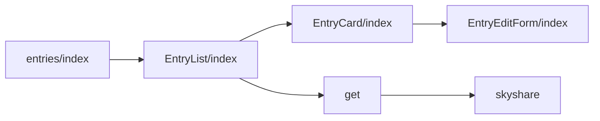
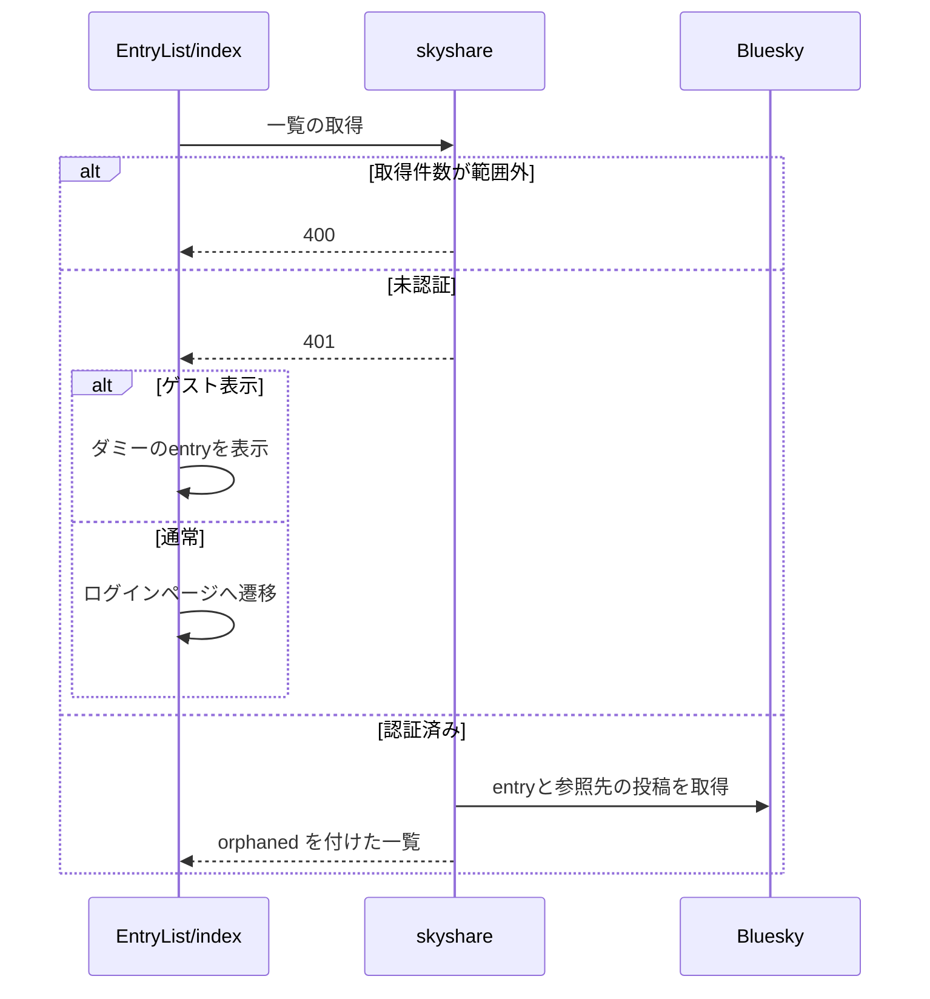

# 作成したentryの一覧と編集 設計書

## 1. 構成

| パス                                            | 責務                                 |
| ----------------------------------------------- | ------------------------------------ |
| `src/pages/v2/entries/skyshare.ts`              | 自分のentryの一覧のハンドラ          |
| `src/lib/api/schema/v2/entries/skyshare/get.ts` | 一覧のクエリと応答のスキーマ         |
| `src/components/entry/EntryList/index.tsx`      | 一覧の取得とカードの並び             |
| `src/components/entry/EntryCard/index.tsx`      | 1件のカードの表示と操作              |
| `src/components/entry/EntryEditForm/index.tsx`  | 見出しとキャプションの編集ダイアログ |
| `src/pages/entries/index.astro`                 | 一覧ページ                           |

## 2. 関係図・ワークフロー

一覧ページの構成要素の依存方向を示す。



一覧の取得と、未認証・ゲスト表示での分岐を示す。



## 3. 設計項目

### D-1: 一覧のAPI (FR-1, FR-2, FR-3)

```ts
// GET /v2/entries/skyshare?limit=&cursor= → 200 { cursor?, entries: (TimelineSkyshareEntry & { orphaned: boolean })[] }
const GET_POSTS_BATCH_SIZE = 25
// 1. listRecords で自分の entry を limit 件（既定 20）取り、normalizeTimelineEntry で整形する
// 2. 各 entry の sourceUri を 25 件ずつ getPosts で引き、返らなかったものを orphaned: true にする
```

| 事象                  | 応答                                     |
| --------------------- | ---------------------------------------- |
| `limit` が範囲外      | 400                                      |
| `locals.agent` が無い | 401                                      |
| 連携先の例外          | `resolveXrpcStatus` で変換したステータス |

### D-2: カードと編集 (FR-4, FR-5, FR-6, FR-7, FR-8)

```tsx
type EntryCardProps = {
  item: TimelineSkyshareEntry
  onDeleted: () => void
  onSaved: (next: { heading: string; caption: string }) => void
  guestMode?: boolean
}
type EntryEditFormProps = {
  open: boolean
  uri: string
  initialHeading?: string
  initialCaption?: string
  onClose: () => void
  onSaved: (next: { heading: string; caption: string }) => void
}
```

| 要素             | 内容                                                                                                                                  |
| ---------------- | ------------------------------------------------------------------------------------------------------------------------------------- |
| カード           | 作成日時・キャプション（無ければ案内文）・代表画像（拡大なし）・編集・削除・entryを開くリンク                                         |
| 参照先が削除済み | `ui["card-muted"]` で中身のコントラストを下げる（面の色は変えない）。削除は単純な確認だけを出す                                       |
| 編集ダイアログ   | 見出し（上限100バイト）とキャプション（上限300バイト）の入力欄。文字数の表示はUTF-8のバイト数で数える。変更が無いとき保存を無効にする |
| 保存             | `PUT /v2/entry` に `{ uri, heading, caption }` を送り、成功したら `onSaved` を呼ぶ                                                    |
| ゲスト表示       | 編集のボタンを `disabled` にし、削除は模擬の状態遷移だけを行う                                                                        |

### D-3: 一覧ページ (FR-4)

| 項目       | 内容                                                                              |
| ---------- | --------------------------------------------------------------------------------- |
| 生成       | 静的に生成し、実データは `EntryList` が `GET /v2/entries/skyshare` で取得する     |
| 続きの取得 | 無限スクロールで `cursor` を渡して取得する                                        |
| 未認証     | ゲスト表示でなければログインページへ遷移し、ゲスト表示ならダミーのentryを表示する |

## 4. エラー処理

| 事象             | 処理                                     |
| ---------------- | ---------------------------------------- |
| 一覧の取得の失敗 | 一覧の読み込み失敗の文言を表示する       |
| 更新の失敗       | 編集ダイアログに更新失敗の文言を表示する |
