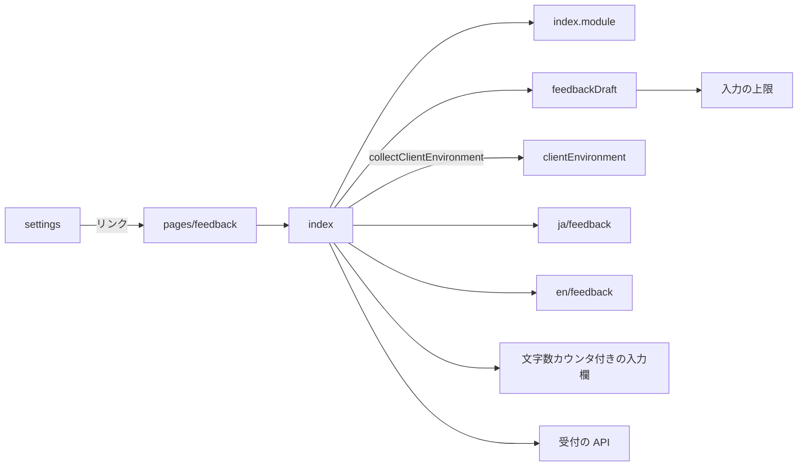
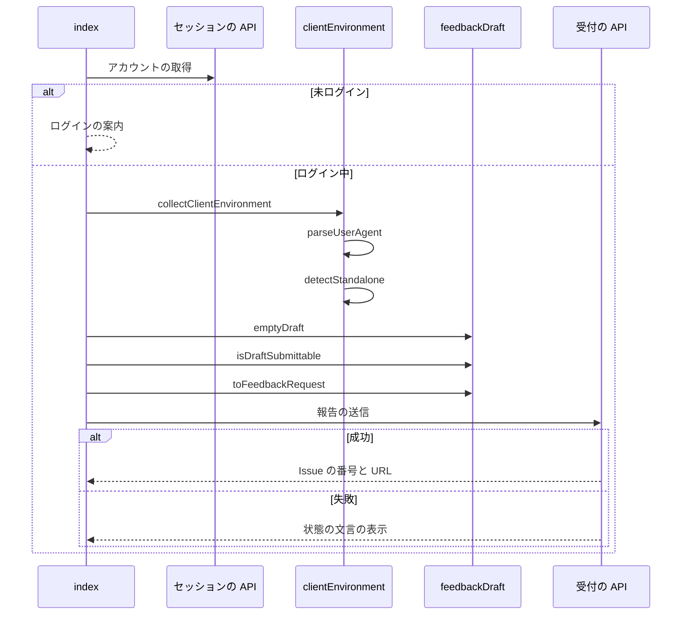

# 不具合報告と機能提案のフォーム 設計書

## 1. 構成

| パス                                                    | 責務                                                     |
| ------------------------------------------------------- | -------------------------------------------------------- |
| `src/util/clientEnvironment.ts`                         | 識別文字列からの OS とブラウザの判定と、起動の形態の判定 |
| `src/lib/feedback/feedbackDraft.ts`                     | 入力の状態の型と、送信の可否と送信の本文の組み立て       |
| `src/components/feedback/FeedbackForm/index.tsx`        | ログインの確認・入力欄・注記・送信と結果の表示           |
| `src/components/feedback/FeedbackForm/index.module.css` | フォームの見た目                                         |
| `src/pages/feedback.astro`                              | 報告と提案の単独のページ                                 |
| `src/pages/settings.astro`                              | 設定のページの報告と提案へのリンク                       |
| `src/lib/i18n/messages/ja/feedback.ts`                  | 報告と提案の文言（日本語。正本）                         |
| `src/lib/i18n/messages/en/feedback.ts`                  | 報告と提案の文言（英語）                                 |

## 2. 関係図・ワークフロー

ページとフォームの部品の依存方向を示す。



ページを開いてから送信の結果を示すまでの流れと分岐を示す。



## 3. 設計項目

### D-1: 環境の情報の判定 (FR-9)

```ts
export type ClientEnvironment = { os: string; browser: string; userAgent: string; standalone: boolean }
// 識別文字列から OS とブラウザの名前と版を返す。判定できない部分は "Unknown"
export const parseUserAgent = (ua: string, maxTouchPoints = 0): { os: string; browser: string }
// display-mode が standalone・fullscreen・minimal-ui か、iOS の navigator.standalone が true
export const detectStandalone = (win: Window): boolean
// userAgentData があれば高精度の値（platformVersion・fullVersionList）で OS とブラウザを補う
export const collectClientEnvironment = async (win: Window): Promise<ClientEnvironment>
```

| 判定     | 規則（上から順に最初に一致したもの）                                                                                        |
| -------- | --------------------------------------------------------------------------------------------------------------------------- |
| OS       | iPhone・iPad の `OS x_y` は iOS・iPadOS、`Macintosh` で触れる点が2以上は iPadOS、Android、Windows NT、Mac OS X、CrOS、Linux |
| ブラウザ | `EdgiOS`・`Edg`、`OPR`、`SamsungBrowser`、`FxiOS`・`Firefox`、`CriOS`・`Chrome`、`Version/x Safari`                         |
| Windows  | userAgentData の `platformVersion` の先頭が13以上なら 11、それ未満なら 10                                                   |

- ドメインの型を使わない汎用の処理として `src/util` に置く。

### D-2: 入力の状態と送信の本文 (FR-3, FR-5, FR-7)

```ts
export type FeedbackKind = "bug" | "enhancement"
export type Reproducibility = (typeof REPRODUCIBILITY_VALUES)[number]
export type FeedbackDraft = {
  kind: FeedbackKind; title: string
  steps: string; reproducibility: Reproducibility | null
  description: string; technicalNotes: string
}
export const emptyDraft = (): FeedbackDraft
// 種別の必須の項目が空白だけでなく、すべての欄が上限以内なら true
export const isDraftSubmittable = (draft: FeedbackDraft): boolean
// 種別に合う項目だけを載せる。技術的な補足は空白だけなら省く
export const toFeedbackRequest = (
  draft: FeedbackDraft, env: ClientEnvironment, build: { version: string; commit: string | null },
): CreateFeedbackBody
```

- 種別を切り替えても他の種別の入力を保持し、送信の本文には載せない。
- 文字数は書記素で数え、上限は受付と共有の値を使う。
- 送信の後は `emptyDraft()` に戻し、種別だけを残す。

### D-3: フォームの表示 (FR-2, FR-4, FR-6, FR-8, FR-10)

| 要素       | 内容                                                                                                                   |
| ---------- | ---------------------------------------------------------------------------------------------------------------------- |
| ログイン   | `getSessionOnce` の401でフォームを出さず、ログインが必要な文言と `/login/` へのリンクを示す                            |
| 種別       | `RadioButton` を2つ横に並べる（不具合・新機能の提案）                                                                  |
| 件名       | `CountedTextInput`（1行）。見出しは `feedback.title.bug`・`feedback.title.enhancement` を種別で切り替える              |
| 本文       | `CountedTextInput`（複数行・自動伸長）。カウンタは `countFeedbackLength` で数え、上限を分母にする                      |
| 再現の頻度 | `RadioButton` を4つ（毎回起きる・ときどき起きる・起きない・試していない）                                              |
| 注記       | ハンドルと環境の情報の自動収集と開発者への共有、GitHub の公開の Issue に載ること、プライバシーポリシーへのリンクを示す |
| 送る値     | Bluesky（`@handle`）・Skyshare の版・コミットの先頭7文字・OS・ブラウザ・PWA の可否・識別文字列を項目名つきで並べる     |
| 送信       | `isDraftSubmittable` が false か送信中なら `disabled`                                                                  |
| 成功       | 完了の文言と Issue の URL へのリンク（新しいタブ）を示す                                                               |
| 失敗       | 429 は `feedback.error.rateLimited`、503 は `feedback.error.unavailable`、他は `errorMessageKeyFromStatus`             |

- 送る値の一覧は、送信の本文に載る値と同じものを表示する。

### D-4: ページと導線と文言 (FR-1, FR-11)

```astro
---
export const prerender = true
const robots = ["noindex", "nofollow", "noarchive", "noimageindex"]
---

<Baselayout pageTitleKey="pageTitle.feedback" robots={robots}>
  <h1 data-i18n="feedback.heading">…</h1>
  <FeedbackForm client:load />
  <StandaloneFooter />
</Baselayout>
```

- サイドバーとフッターナビの slot を渡さず、ナビの項目にも加えない。ナビがないため、フォームの下に設定のページへ戻るリンク（`feedback.back`）を置く。
- 設定のページは、ヘルプへのリンクの下に `/feedback/` へのリンク（`settings.feedbackLink`）を置く。
- 文言は辞書の `feedback.*` に置き、日本語を正本とし、英語は同じキー集合を型で強制される。

## 4. エラー処理

| 事象                         | 処理                                     |
| ---------------------------- | ---------------------------------------- |
| セッションの取得が通信で失敗 | ログインの案内を示す                     |
| userAgentData の取得が失敗   | 識別文字列だけで判定した値を使う         |
| 送信が通信で失敗             | `error.network` の文言を示し、入力を残す |
