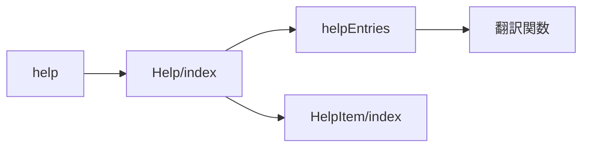
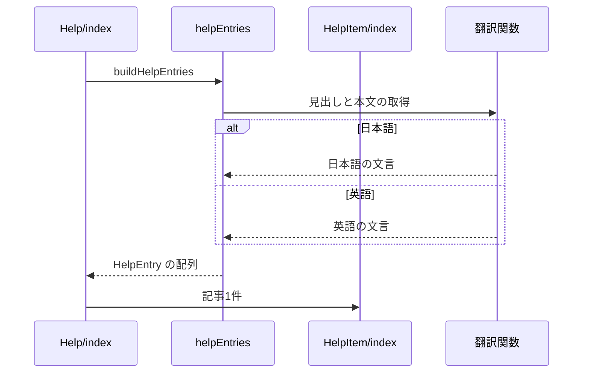

# ヘルプページ 設計書

## 1. 構成

| パス                                     | 責務                   |
| ---------------------------------------- | ---------------------- |
| `src/components/help/helpEntries.tsx`    | 記事のデータの組み立て |
| `src/components/help/Help/index.tsx`     | 記事の一覧の表示       |
| `src/components/help/HelpItem/index.tsx` | 記事1件のカードの表示  |
| `src/pages/help.astro`                   | ヘルプのページ         |

## 2. 関係図・ワークフロー

ヘルプのページの構成要素の依存方向を示す。



記事の組み立てと、表示言語による分岐を示す。



## 3. 設計項目

### D-1: 記事の組み立て (FR-1, FR-2)

```ts
export type HelpEntry = {
  id: string // 表示順の変更に影響されない固定値
  title: string
  description: ReactNode // 文字列に加え、画像や一覧などの要素も置ける
  content?: ReactNode // 本文の下に置く手順の一覧など
}
export const buildHelpEntries = (t: Translator["t"]): HelpEntry[]
```

- 記事は外部のデータを持たず、`buildHelpEntries` に直接追記する。文言は辞書の `page.help.*` に置く。

### D-2: 表示 (FR-3)

| 要素         | 内容                                                                                        |
| ------------ | ------------------------------------------------------------------------------------------- |
| 一覧         | `ComponentList` で記事を縦に並べる。キーは `id`                                             |
| 記事のカード | 設定ページと同じカード（`base-card`・`base-padding`）に、見出し・本文・任意の内容を描画する |
| ページ       | 静的に生成し、サイドバーとフッターを表示する。ナビゲーションの項目には加えない              |

## 4. エラー処理

- なし
