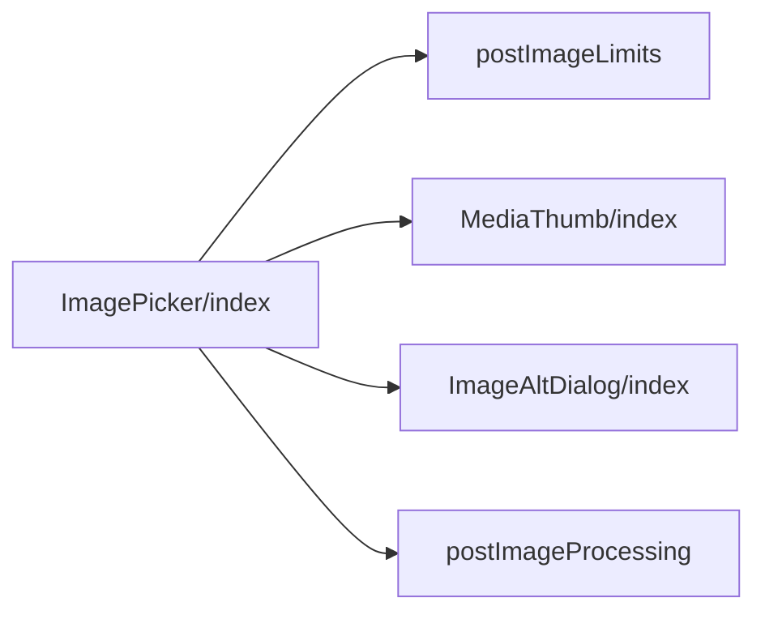
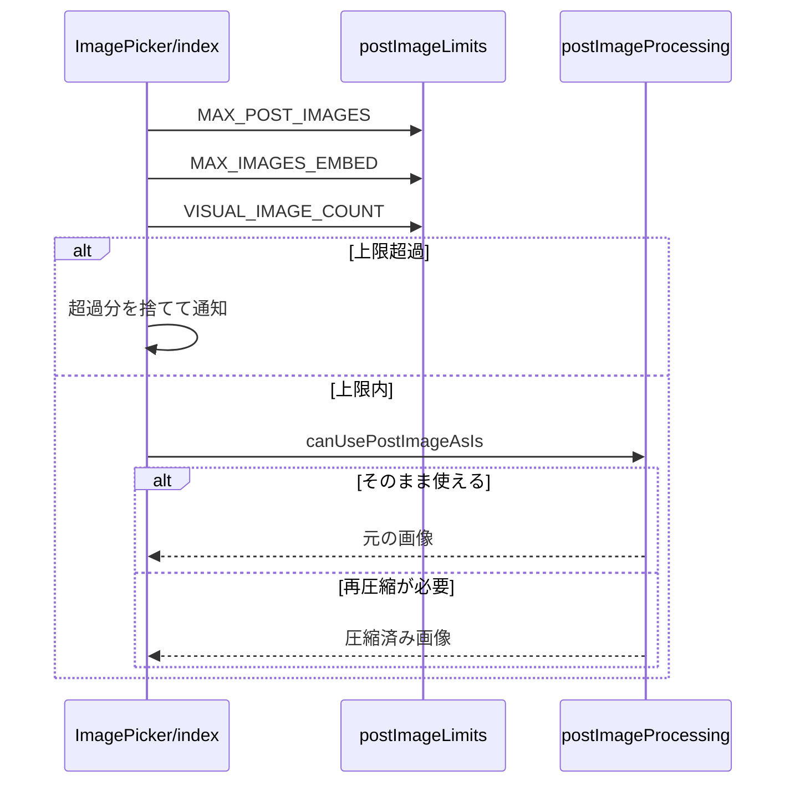

# 画像の添付 設計書

## 1. 構成

| パス                                            | 責務                                           |
| ----------------------------------------------- | ---------------------------------------------- |
| `src/lib/image/postImageLimits.ts`              | 画像の枚数の定数                               |
| `src/components/image/ImagePicker/index.tsx`    | 画像の選択・プレビュー・通知                   |
| `src/components/common/MediaThumb/index.tsx`    | サムネイルの枠と取り外し・代替テキストのボタン |
| `src/components/image/ImageAltDialog/index.tsx` | 代替テキストの編集                             |
| `src/lib/image/postImageProcessing.ts`          | 投稿用の画像の圧縮                             |

## 2. 関係図・ワークフロー

画像選択の部品間の依存方向を示す。



画像の追加から圧縮までの流れを示す。



## 3. 設計項目

### D-1: 枚数と通知 (FR-1, FR-3, FR-4, NFR-1)

```ts
export const MAX_POST_IMAGES = 10
export const MAX_IMAGES_EMBED = 4
export const VISUAL_IMAGE_COUNT = 4
// addFiles: allowed = MAX_POST_IMAGES - slots.length。超えた分は捨てて overflowNotice を表示する
const def = defs[idx] // idx >= VISUAL_IMAGE_COUNT なら undefined
const cropPixels = def
  ? computeInitialCrop(size.width, size.height, def.w, def.h)
  : null
```

- 5枚目以降のスロットは `cropState.cropPixels = null` とし、代表画像の切り抜きの対象に含めない。
- `index >= VISUAL_IMAGE_COUNT` のサムネイルに `slot-excluded-badge` を重ねる。取り外しで順序が変わると、位置から判定し直す。
- 通知は次の追加と取り外しで消す。

### D-2: プレビュー (FR-2, FR-5, FR-7)

```ts
type MediaThumbProps = {
  onRemove: () => void
  onEditAlt: () => void
  removeAriaLabel: string
  altAriaLabel: string
  altFilled: boolean // 代替テキストが入力済みなら強調色
  disabled?: boolean
  style?: CSSProperties
  testId?: string
  children: ReactNode
}
```

| ボタン               | 見た目                                                                       |
| -------------------- | ---------------------------------------------------------------------------- |
| 取り外し（右上）     | 40pxの円、文字 `--font-size-2xl`                                             |
| 代替テキスト（右下） | 高さ36px、文字 `--font-size-lg`、左右の余白 `--space-3`                      |
| 共通                 | `border: 2px solid #fff`、背景 `rgb(0 0 0 / 60%)`、hoverで `--color-bluesky` |

- `value` が null でなく内部のスロットが空のとき（予約の書き戻しのように外から渡されたとき）は、`originalBlobs` から object URL を作り、`meta` の寸法と代替テキストと `computeInitialCrop` の切り抜きでスロットを組み立てる。このときは `onChange` を呼ばず、渡された `thumbnailBlob` をそのまま使う。

### D-3: 圧縮 (FR-6)

```ts
// JPEG か PNG で、容量が予算内ならそのまま使う
export const canUsePostImageAsIs = (blob: Blob): boolean
// それ以外は compressToByteBudget で 2,000,000 バイト以内に収まるまで縮小・再圧縮する
```

全画像（最大10枚）を個別に処理し、代表画像の合成とは独立させる。

## 4. エラー処理

| 事象                 | 処理                     |
| -------------------- | ------------------------ |
| 上限を超えた選択     | 超えた分を捨てて通知する |
| 画像の読み込みの失敗 | そのファイルを追加しない |
