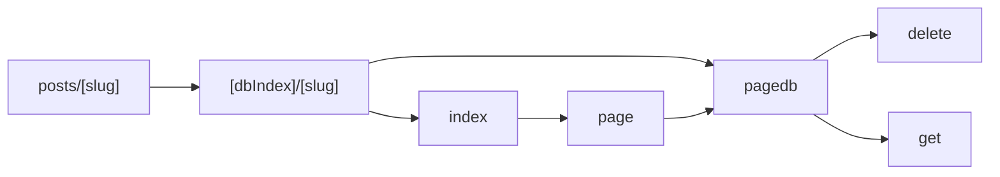
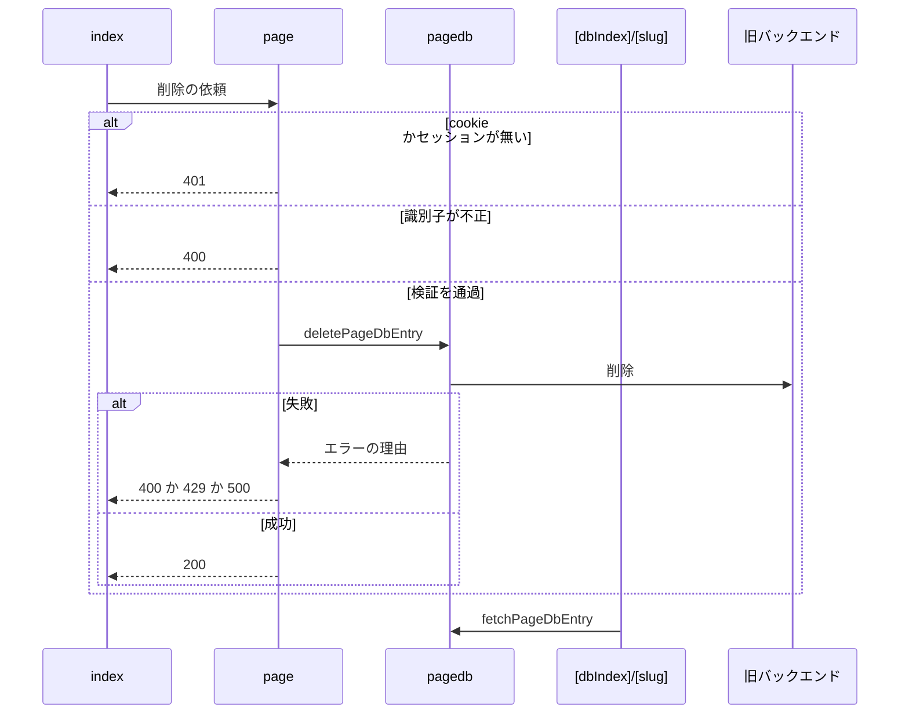

# 旧形式の投稿ページ 設計書

## 1. 構成

| パス                                                    | 責務                               |
| ------------------------------------------------------- | ---------------------------------- |
| `src/pages/v1/page.ts`                                  | 削除のハンドラ                     |
| `src/lib/legacy/pagedb.ts`                              | 旧バックエンドへの取得と削除の依頼 |
| `src/lib/api/schema/v1/page/delete.ts`                  | 旧バックエンドの削除のスキーマ     |
| `src/lib/api/schema/v1/page/_dbIndex/_dbKey/get.ts`     | 旧バックエンドの取得のスキーマ     |
| `src/pages/posts/[dbIndex]/[slug].astro`                | 投稿ページ                         |
| `src/pages/posts/[slug].astro`                          | 種別を省略したURLの書き換え        |
| `src/components/entry/LegacyPageDeleteButton/index.tsx` | 削除のボタン                       |

## 2. 関係図・ワークフロー

旧形式の投稿ページに関わる依存方向を示す。



削除の依頼の検証と、旧バックエンドの失敗の変換を示す。



## 3. 設計項目

### D-1: 旧バックエンドへの依頼 (FR-5, FR-6)

```ts
export type PageDbErrorReason = "BadRequest" | "RateLimitExceeded" | "InternalServerError" | "UnknownError"
export const deletePageDbEntry = async (params: { dbIndex: string; dbKey: string; did: string; accessJwt: string }): Promise<{ ok: true } | { error: PageDbErrorReason }>
export const fetchPageDbEntry = async (params: { dbIndex: string; dbKey: string }): Promise<PageDbEntry | { error: PageDbErrorReason }>
```

- 削除は `pageId = "<dbIndex>/<dbKey>"` で依頼する。取得は種別とキーを URL エンコードして渡す。
- 取得の成功は `{ ogp, handle, imgs: { thumb, alt }[] }` を返す。通信の例外は握りつぶして `UnknownError` にする。

### D-2: 削除のハンドラ (FR-1, FR-2, FR-3, FR-4)

| 段階       | 条件                                                                    | 結果 |
| ---------- | ----------------------------------------------------------------------- | ---- |
| cookie     | ヘッダに cookie が無い                                                  | 401  |
| 本文       | JSON として解釈できない                                                 | 400  |
| 識別子     | `dbIndex` が `legacy` か数字でない、`dbKey` が `^[^/@]+@[^/@]+$` でない | 400  |
| セッション | `did` か `accessJwt` を持つセッションが無い                             | 401  |
| 依頼       | `BadRequest` → 400、`RateLimitExceeded` → 429、その他 → 500             | 上記 |
| 成功       | 本文なし                                                                | 200  |

### D-3: 投稿ページと削除のボタン (FR-1, FR-7)

| 項目               | 内容                                                                                                                                               |
| ------------------ | -------------------------------------------------------------------------------------------------------------------------------------------------- |
| 識別子の検証       | `dbIndex` が `legacy` か数字でなければ 404。キーを `@` で分けて 2 つ得られなければ識別子が不正な 404。通過したときだけ旧バックエンドへ問い合わせる |
| 取得の失敗         | `RateLimitExceeded` は 503、`BadRequest` は 404、その他は 500 で表示する                                                                           |
| 種別を省略した URL | `dbIndex = legacy` として同じページへ書き換える                                                                                                    |
| 削除のボタンの表示 | セッションを持つ投稿者本人にだけ表示する。`legacy` のときは handle、数字のときは DID で本人かを判定する。本人確認は旧バックエンドが行う            |
| 削除のボタンの動作 | 確認のうえ `DELETE /v1/page/` に `{ dbIndex, dbKey }` を送り、成功したらページを再読み込みする                                                     |

## 4. エラー処理

| 事象           | 処理                                 |
| -------------- | ------------------------------------ |
| 削除の失敗     | ボタンの下に削除失敗の文言を表示する |
| 取得の通信失敗 | 500 のエラー表示にする               |
