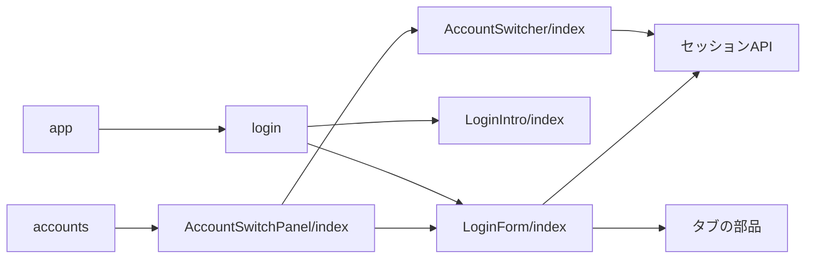
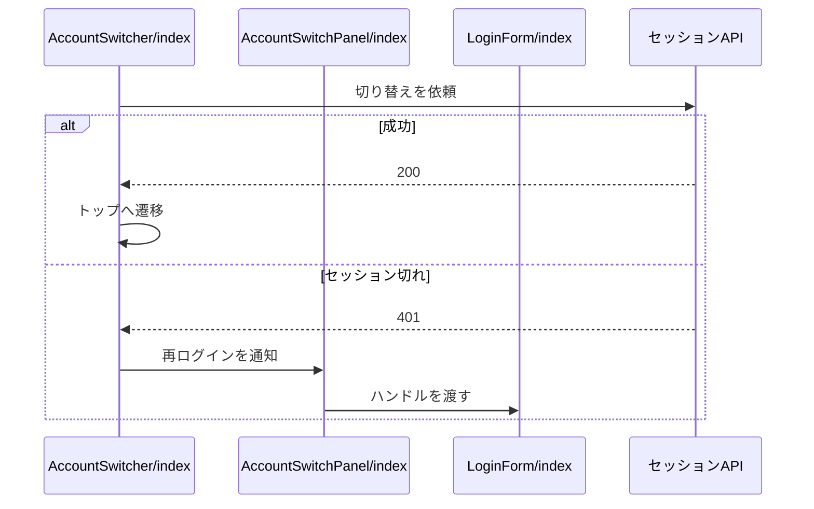
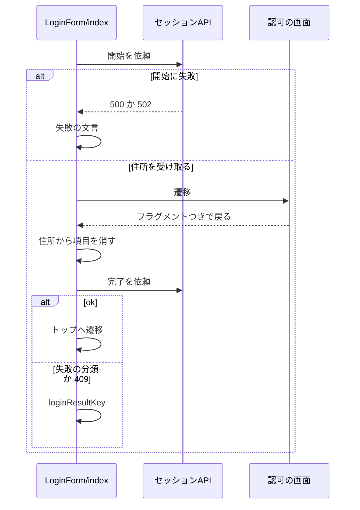

# ログインとアカウント切り替え 設計書

## 1. 構成

| パス                                                  | 責務                                                       |
| ----------------------------------------------------- | ---------------------------------------------------------- |
| `src/components/account/AccountSwitcher/index.tsx`    | アカウントの一覧・切り替え・ログアウト                     |
| `src/components/account/AccountSwitchPanel/index.tsx` | 一覧と再ログインの統括                                     |
| `src/components/account/LoginForm/index.tsx`          | ログインのフォーム。認可の画面からの戻りの完了と結果の表示 |
| `src/components/account/LoginIntro/index.tsx`         | ログインの案内                                             |
| `src/pages/login.astro`                               | ログインのページ                                           |
| `src/pages/accounts.astro`                            | アカウントのページ                                         |
| `src/pages/app.astro`                                 | 旧パスの転送                                               |

## 2. 関係図・ワークフロー

構成要素の依存方向を示す。



切り替えの流れと、セッション切れによる分岐を示す。



OAuth のタブでの開始から、戻りでの完了と結果の分岐を示す。



## 3. 設計項目

### D-1: アカウントの一覧 (FR-1, FR-5)

| 状態          | 表示・動作                                         |
| ------------- | -------------------------------------------------- |
| 読み込み中    | 読み込み中の文言                                   |
| 取得が401     | ログインのページへ遷移する                         |
| 取得が401以外 | 一覧を空にし、取得失敗の文言を出す                 |
| 0件           | 空の文言                                           |
| 1件以上       | カードを並べ、使用中のカードに使用中の目印を付ける |

- 使用中のカードは押しても切り替えないが、無効の見た目（`card-muted`）にはしない。目印は使用中のバッジだけとする。

### D-2: 切り替えとログアウト (FR-2, FR-3, FR-4)

| 操作               | 依頼                     | 結果                                                         |
| ------------------ | ------------------------ | ------------------------------------------------------------ |
| 使用中でないカード | セッションの更新に識別子 | 200: トップへ遷移。401: 要再ログインの目印と再ログインの案内 |
| ログアウト         | セッションの削除に識別子 | 200: 一覧を再取得。0件になればログインのページへ遷移         |

- ログアウトのボタンは、カードの切り替えを起こさない。
- 再ログインの案内は、統括の部品がログインのフォームのハンドルを入力済みにして差し替える。

### D-3: ログインのフォーム (FR-6)

| 項目       | 内容                                                                     |
| ---------- | ------------------------------------------------------------------------ |
| 構成       | OAuth のボタンと、アプリパスワードの入力を包む折りたたみ（初めは閉じる） |
| 入力       | 折りたたみの中で、ハンドル（前後の空白を除く）とアプリパスワード         |
| 成功       | 成功の文言を出し、一定時間の後にトップへ遷移する                         |
| 失敗       | ステータスから表示言語の文言を選んで出す。サーバーの文言は出さない       |
| 通信の例外 | 接続失敗の文言を出す                                                     |

### D-4: ページと案内 (FR-7, FR-8)

| 要素             | 内容                                                       |
| ---------------- | ---------------------------------------------------------- |
| ログインのページ | フォームと案内を表示する。静的に生成する                   |
| 案内             | 旧UIのリンク（`/legacy/`）とゲスト表示のリンクを含むカード |
| 旧パス           | ログインのページへリダイレクトする                         |

### D-5: OAuth のボタンと戻り (FR-9, FR-10, FR-11, FR-12)

```ts
type Props = { initialHandle?: string } // LoginForm。再ログインでは OAuth の開始の loginHint にも使う
// LoginForm の OAuth のボタン
const startOAuth = async () => {
  const res = await startSessionAuthorization({ returnTo: window.location.pathname, loginHint: initialHandle })
  if (res.status === 200) window.location.href = res.data.url
  else setMessageKey(errorMessageKeyFromStatus(res.status, "login"))
}
// LoginForm（戻りの完了の結果）
export const loginResultKey = (result: string): PlainMessageKey
```

| 完了の応答                           | 表示                                                             |
| ------------------------------------ | ---------------------------------------------------------------- |
| 200 `ok`                             | 成功の文言を出し、未ログインの記録を消して一定時間の後にトップへ |
| 200 `Denied`                         | 許可しなかった旨                                                 |
| 200 `StateInvalid`・`IssuerMismatch` | やり直しを促す旨                                                 |
| 200 `AccountUnverified`              | Bluesky がホスティングするアカウントだけが使える旨               |
| 200 その他の分類・通信の例外         | 汎用の失敗                                                       |
| 409                                  | アカウント数の上限                                               |

- OAuth は説明文を持たず、ボタンだけを置く。ボタンは開始の依頼中は押せなくする。
- アプリパスワードの入力は、共通の折りたたみ（`Collapsible`。見出しは文言 `account.login.passwordToggle`）の中に置く。閉じている間は入力欄を描画しない。フォーム自体がカードという構造は保つ。
- ログインのフォームは、用途がログインのフラグメントを読んだら、再読み込みで同じ項目を送らないよう先に `history.replaceState` で住所から消し、完了を依頼する。進行（ログイン中）と結果は、アプリパスワードのログインと同じフォーム内のステータスメッセージ（`#message`）で表示する（成功は緑、失敗は赤）。
- フォームが水和するまでの待ちを埋めるため、レイアウトの先頭のスクリプトが、戻りの住所なら描画の前に `<html data-oauth-returning="pending">` を付ける。

| 印の値    | 付ける側                                           | 表示                                                                                       |
| --------- | -------------------------------------------------- | ------------------------------------------------------------------------------------------ |
| `pending` | レイアウトの先頭のスクリプト                       | ステータスメッセージの位置に、水和の前のログイン中の文言（CSS で表示）。フォームは押せない |
| `active`  | ログインのフォーム（水和した時点）                 | ステータスメッセージのログイン中の文言と結果。フォームは押せない                           |
| なし      | ログインのフォーム（失敗したとき、戻りでないとき） | フォームを押せる                                                                           |

- フォームを押せなくするのは CSS（`pointer-events`。ボタンと折りたたみは薄くし、ステータスメッセージは薄くしない）と、送信・開始の処理の先頭の確認の両方で行う（キーボードの送信も止めるため）。成功したときは遷移まで印を残す。
- 戻りの完了はログインのフォームが受け持つため、フォームを置くログインのページとアカウントのページで行われる。開始の `returnTo` は開始したページのパスとする。

## 4. エラー処理

| 事象             | 処理                                       |
| ---------------- | ------------------------------------------ |
| 一覧の取得の失敗 | 一覧全体を失敗の文言に置き換える           |
| 切り替えの失敗   | 一覧を残したまま、失敗の文言をその場に出す |
| ログアウトの失敗 | 一覧を残したまま、失敗の文言をその場に出す |
