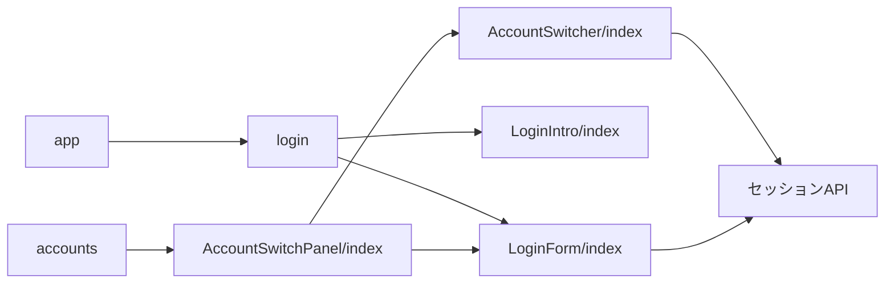
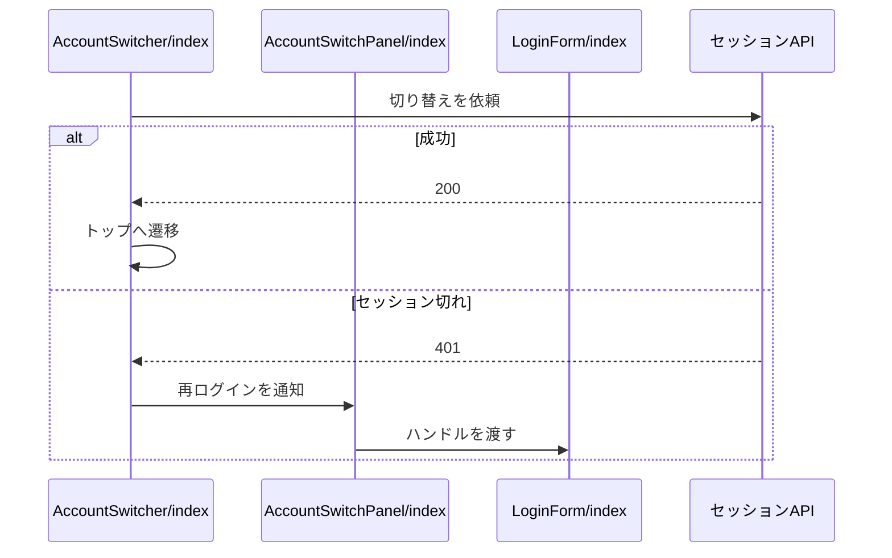

# ログインとアカウント切り替え 設計書

## 1. 構成

| パス                                                  | 責務                                   |
| ----------------------------------------------------- | -------------------------------------- |
| `src/components/account/AccountSwitcher/index.tsx`    | アカウントの一覧・切り替え・ログアウト |
| `src/components/account/AccountSwitchPanel/index.tsx` | 一覧と再ログインの統括                 |
| `src/components/account/LoginForm/index.tsx`          | ログインのフォーム                     |
| `src/components/account/LoginIntro/index.tsx`         | ログインの案内                         |
| `src/pages/login.astro`                               | ログインのページ                       |
| `src/pages/accounts.astro`                            | アカウントのページ                     |
| `src/pages/app.astro`                                 | 旧パスの転送                           |

## 2. 関係図・ワークフロー

構成要素の依存方向を示す。

切り替えの流れと、セッション切れによる分岐を示す。

## 3. 設計項目

### D-1: アカウントの一覧 (FR-1, FR-5)

| 状態          | 表示・動作                                         |
| ------------- | -------------------------------------------------- |
| 読み込み中    | 読み込み中の文言                                   |
| 取得が401     | ログインのページへ遷移する                         |
| 取得が401以外 | 一覧を空にし、取得失敗の文言を出す                 |
| 0件           | 空の文言                                           |
| 1件以上       | カードを並べ、使用中のカードに使用中の目印を付ける |

### D-2: 切り替えとログアウト (FR-2, FR-3, FR-4)

| 操作               | 依頼                     | 結果                                                         |
| ------------------ | ------------------------ | ------------------------------------------------------------ |
| 使用中でないカード | セッションの更新に識別子 | 200: トップへ遷移。401: 要再ログインの目印と再ログインの案内 |
| ログアウト         | セッションの削除に識別子 | 200: 一覧を再取得。0件になればログインのページへ遷移         |

- ログアウトのボタンは、カードの切り替えを起こさない。
- 再ログインの案内は、統括の部品がログインのフォームのハンドルを入力済みにして差し替える。

### D-3: ログインのフォーム (FR-6)

| 項目       | 内容                                                               |
| ---------- | ------------------------------------------------------------------ |
| 入力       | ハンドル（前後の空白を除く）とアプリパスワード                     |
| 成功       | 成功の文言を出し、一定時間の後にトップへ遷移する                   |
| 失敗       | ステータスから表示言語の文言を選んで出す。サーバーの文言は出さない |
| 通信の例外 | 接続失敗の文言を出す                                               |

### D-4: ページと案内 (FR-7, FR-8)

| 要素             | 内容                                                       |
| ---------------- | ---------------------------------------------------------- |
| ログインのページ | フォームと案内を表示する。静的に生成する                   |
| 案内             | 旧UIのリンク（`/legacy/`）とゲスト表示のリンクを含むカード |
| 旧パス           | ログインのページへリダイレクトする                         |

## 4. エラー処理

| 事象             | 処理                                       |
| ---------------- | ------------------------------------------ |
| 一覧の取得の失敗 | 一覧全体を失敗の文言に置き換える           |
| 切り替えの失敗   | 一覧を残したまま、失敗の文言をその場に出す |
| ログアウトの失敗 | 一覧を残したまま、失敗の文言をその場に出す |
