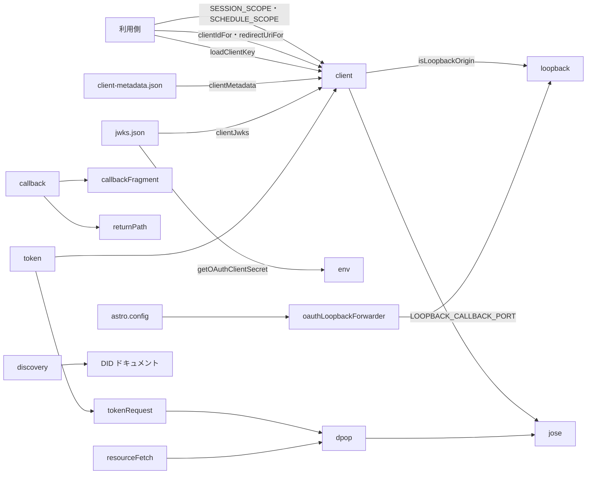
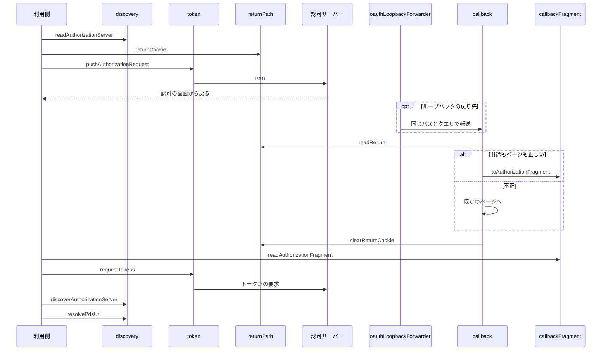
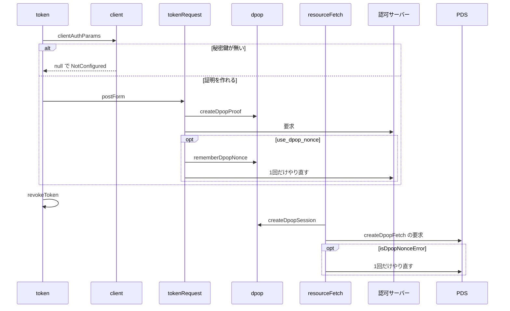

# Bluesky OAuth クライアント 設計書

## 1. 構成

| パス                                      | 責務                                           |
| ----------------------------------------- | ---------------------------------------------- |
| `src/lib/oauth/loopback.ts`               | 開発用の公開クライアントの判定と戻り先の住所   |
| `src/lib/oauth/client.ts`                 | クライアントの識別子・権限・メタデータ・証明   |
| `src/lib/oauth/env.ts`                    | クライアントの秘密鍵のシークレットの取得       |
| `src/lib/oauth/discovery.ts`              | 認可サーバーの探索と DID からの PDS の解決     |
| `src/lib/oauth/jose.ts`                   | ES256 の JWT の署名と鍵                        |
| `src/lib/oauth/dpop.ts`                   | DPoP の証明と nonce                            |
| `src/lib/oauth/tokenRequest.ts`           | 認可サーバーへのフォームの要求とやり直し       |
| `src/lib/oauth/token.ts`                  | 認可の要求の事前送信・コードの交換・更新・取消 |
| `src/lib/oauth/resourceFetch.ts`          | PDS への DPoP つきの要求                       |
| `src/lib/oauth/callbackFragment.ts`       | 戻りの項目とフラグメントの相互変換             |
| `src/lib/oauth/returnPath.ts`             | 戻りの用途とページの cookie での受け渡し       |
| `src/pages/oauth/callback.ts`             | 戻りを許可を始めたページのフラグメントへ転送   |
| `src/pages/oauth/client-metadata.json.ts` | クライアントのメタデータ                       |
| `src/pages/oauth/jwks.json.ts`            | クライアントの公開鍵の一覧                     |
| `hack/oauthLoopbackForwarder.ts`          | 開発サーバーでのループバックの戻り先の中継     |
| `astro.config.mjs`                        | 開発サーバーへの中継の組み込み                 |

## 2. 関係図・ワークフロー

公開の端点と処理のモジュールの依存方向を示す。



認可の開始から戻りまでの流れと、開発用の中継と戻り先の cookie の分岐を示す。



トークンの要求と PDS への要求での、nonce によるやり直しと失敗の分類を示す。



## 3. 設計項目

### D-1: クライアントの識別とメタデータ (FR-1, FR-2, FR-3)

```ts
// loopback.ts（他のモジュールを読み込まない。開発サーバーの設定からも読み込む）
export const LOOPBACK_CALLBACK_PORT = 4322
export const isLoopbackOrigin = (origin: string): boolean // ホスト名が localhost・127.0.0.1・[::1]
const isLoopbackClientId = (clientId: string): boolean // "http://localhost" で始まる
const loopbackRedirectUri = (): string // "http://127.0.0.1:4322/oauth/callback/"

// client.ts
export const SESSION_SCOPE = "atproto transition:generic"
export const SCHEDULE_SCOPE: string // atproto・投稿と返信と引用の制限と entry の作成と上書き・画像
const CLIENT_SCOPE: string // 2つの権限の重複を除いた和
export const clientIdFor = (origin: string): string
export const redirectUriFor = (origin: string): string
const jwksUriFor = (origin: string): string
export const clientMetadata = (origin: string, clientName: string): Record<string, unknown>
export type ClientKey = { key: CryptoKey; jwk: EcPrivateJwk; kid: string }
export const loadClientKey = (secret: string | undefined): Promise<ClientKey | null>
export const clientJwks = (client: ClientKey): { keys: Record<string, unknown>[] }
export const clientAuthParams = (client: ClientKey | null, clientId: string, issuer: string, now: number): Promise<Record<string, string> | null>

// env.ts
export const getOAuthClientSecret = (): Promise<string | undefined> // Worker のシークレット OAUTH_CLIENT_KEY
```

| 配信元                   | 識別子                                                        | 戻り先                                  | 証明                                     |
| ------------------------ | ------------------------------------------------------------- | --------------------------------------- | ---------------------------------------- |
| ループバックのホスト     | `http://localhost?redirect_uri=<戻り先>&scope=<CLIENT_SCOPE>` | `http://127.0.0.1:4322/oauth/callback/` | `{ client_id }` だけ                     |
| それ以外（本番・確認用） | `${origin}/oauth/client-metadata.json`                        | `${origin}/oauth/callback/`             | 秘密鍵で署名した60秒の `private_key_jwt` |

- メタデータは `scope` に `CLIENT_SCOPE` を載せ、`token_endpoint_auth_method: "private_key_jwt"`・`dpop_bound_access_tokens: true`・`jwks_uri` を持つ。応答は `public, max-age=300` でキャッシュさせる。
- 秘密鍵は Worker のシークレット `OAUTH_CLIENT_KEY` に、`kid` を含む P-256 の JWK の JSON で置く。生成は `hack/generate-oauth-key.mjs` で行い、配備先への登録は CI が `hack/ensure-worker-secrets.mjs` で未登録のときだけ行う（develop とプレビューの基本設定は同じ値）。
- `clientAuthParams` は、ループバックの識別子なら秘密鍵の有無によらず `{ client_id }` を返し、それ以外で秘密鍵が無ければ null を返す。保管した識別子で更新するときも、識別子から判定する。

### D-2: 認可サーバーの探索と PDS の解決 (FR-4, FR-5)

```ts
export type AuthorizationServer = {
  issuer: string
  authorizationEndpoint: string
  parEndpoint: string
  tokenEndpoint: string
  revocationEndpoint?: string
}
export const readAuthorizationServer = (issuer: string, fetchImpl?: typeof fetch): Promise<AuthorizationServer | null>
export const discoverAuthorizationServer = (pdsUrl: string, fetchImpl?: typeof fetch): Promise<AuthorizationServer | null>
export const resolvePdsUrl = (did: string, fetchImpl?: typeof fetch): Promise<string | null>
```

| 関数                          | 処理                                                                                                                                                     |
| ----------------------------- | -------------------------------------------------------------------------------------------------------------------------------------------------------- |
| `readAuthorizationServer`     | `<issuer のオリジン>/.well-known/oauth-authorization-server` を取得し、`issuer` の一致・PAR・トークンの端点・DPoP の ES256・`private_key_jwt` を確かめる |
| `discoverAuthorizationServer` | `<PDS>/.well-known/oauth-protected-resource` の `authorization_servers` の先頭を `readAuthorizationServer` に渡す                                        |
| `resolvePdsUrl`               | `did:plc` は PLC ディレクトリ、`did:web` はホストの `did.json` を取得し、`#atproto_pds` の端点を返す。ホストに `:`・`/` を含む `did:web` は扱わない      |

- 取得の失敗・JSON でない応答・条件を満たさないメタデータは、すべて null とする。

### D-3: DPoP とトークンの要求 (FR-6, FR-7, NFR-2)

```ts
// dpop.ts
export type DpopSession = { key: CryptoKey; publicJwk: EcPublicJwk; nonces: Map<string, string> }
export const createDpopSession = (jwk: EcPrivateJwk): Promise<DpopSession>
export const createDpopProof = (session: DpopSession, method: string, url: string, now: number, accessToken?: string): Promise<string>
export const rememberDpopNonce = (session: DpopSession, url: string, res: Response): void
export const isDpopNonceError = (res: Response): Promise<boolean>

// tokenRequest.ts
export const postForm = (req: { url: string; params: () => Promise<Record<string, string>>; dpop: DpopSession; now: number; fetchImpl: typeof fetch; onRequest?: () => boolean }): Promise<Response | null>

// token.ts
export type TokenSet = { accessToken: string; refreshToken: string; expiresAt: number; sub: string; scope: string }
export type TokenFailure = "Expired" | "RateLimited" | "Transient" | "BudgetExceeded" | "Invalid" | "NotConfigured"
export type TokenResult = { ok: true; tokens: TokenSet } | { ok: false; kind: TokenFailure }
export type TokenGrant =
  | { type: "authorization_code"; code: string; redirectUri: string; verifier: string }
  | { type: "refresh_token"; refreshToken: string }
export const pushAuthorizationRequest = (input: {
  as: AuthorizationServer; client: ClientKey | null; clientId: string; redirectUri: string; scope: string
  state: string; verifier: string; loginHint?: string; dpop: DpopSession; now: number
}, fetchImpl?: typeof fetch): Promise<{ ok: true; url: string } | { ok: false; kind: "NotConfigured" | "Transient" }>
export const requestTokens = (input: {
  tokenEndpoint: string; issuer: string; client: ClientKey | null; clientId: string; grant: TokenGrant
  dpop: DpopSession; now: number; onRequest?: () => boolean
}, fetchImpl?: typeof fetch): Promise<TokenResult>
export const revokeToken = (input: {
  revocationEndpoint?: string; issuer: string; client: ClientKey | null; clientId: string
  refreshToken: string; dpop: DpopSession; now: number
}, fetchImpl?: typeof fetch): Promise<void>
```

| 応答                                                      | `requestTokens` の結果                                                |
| --------------------------------------------------------- | --------------------------------------------------------------------- |
| 送る前に `clientAuthParams` が null                       | `NotConfigured`                                                       |
| `onRequest` が偽                                          | `BudgetExceeded`                                                      |
| 通信の例外・5xx                                           | `Transient`                                                           |
| 429                                                       | `RateLimited`                                                         |
| 4xx の `invalid_grant`                                    | `Expired`                                                             |
| その他の 4xx                                              | `Invalid`                                                             |
| 200 で `token_type` が DPoP・`sub`・2つのトークンがそろう | `ok`（`expiresAt = now + expires_in`、`expires_in` が無ければ3600秒） |
| 200 でそれ以外                                            | `Invalid`                                                             |

- PAR は `response_type=code`・`code_challenge_method=S256`・`state`・`scope`・`redirect_uri` を送り、`loginHint` があれば `login_hint` に入れる。認可の画面の住所は `authorizationEndpoint?client_id=…&request_uri=…` とする。
- DPoP の証明の `htu` はクエリとフラグメントを除いた住所とし、nonce は発行元のオリジンごとに覚える。認可サーバーの `use_dpop_nonce` の400と、PDS の `WWW-Authenticate` の401を nonce の指示とみなす。
- 取消は端点が無ければ何もせず、失敗しても例外を投げない。
- ログには端点の応答のステータスと例外の種類だけを出し、本文・トークン・認可コード・鍵を出さない。

### D-4: PDS への要求 (FR-8, NFR-1)

```ts
export type DpopFetchInput = {
  pdsUrl: string
  accessToken: string
  dpop: DpopSession
  now: () => number
  fetchImpl?: typeof fetch
}
// path は "/xrpc/..." の形。PDS のオリジンに付けて送る
export const createDpopFetch = (input: DpopFetchInput): ((path: string, init?: RequestInit) => Promise<Response>)
```

- 要求ごとに `Authorization: DPoP <accessToken>` と、`ath`（アクセストークンの SHA-256）を入れた証明を付ける。
- nonce の指示を受けたら1回だけやり直す。やり直しのために、本文が `ReadableStream` のときは送る前にバイト列へ読み込む。
- 最後に受け取った nonce は `dpop.nonces` に残り、利用側が次の要求の初期値として持ち越せる。
- このモジュール群は WebCrypto と `fetch` だけで実装し、atproto のライブラリを読み込まない（Cron の実行と、全リクエストで読み込むミドルウェアから使うため）。

### D-5: 戻りの受け渡し (FR-9, FR-10)

```ts
// returnPath.ts
export type ReturnPurpose = "schedule" | "session"
const RETURN_COOKIE = "oauth_return"
const DEFAULT_RETURN_PATHS: Record<ReturnPurpose, string> = { schedule: "/settings/", session: "/login/" }
const isSafeReturnPath = (path: unknown): path is string
export const returnCookie = (purpose: ReturnPurpose, path: string | undefined): string
export const clearReturnCookie = (): string
export const readReturn = (cookieHeader: string | null): { purpose: ReturnPurpose; path: string }

// callbackFragment.ts（ブラウザとサーバーの両方から読み込むため、他のモジュールに依存しない）
const AUTHORIZATION_FRAGMENT_KEY = "oauthReturn"
const FORWARDED_KEYS = ["code", "state", "iss", "error"] as const
export const toAuthorizationFragment = (query: URLSearchParams, purpose: string): string
export const readAuthorizationFragment = (hash: string, purpose: string): Partial<Record<(typeof FORWARDED_KEYS)[number], string>> | null

// GET /oauth/callback/?code&state&iss -> 303 <ページ>#oauthReturn=<用途>&code&state&iss
```

| cookie の値                  | 転送先                             |
| ---------------------------- | ---------------------------------- |
| `<用途>:<正しいページ>`      | そのページ                         |
| `<用途>:<不正なページ>`      | その用途の既定のページ             |
| 無い・用途が不正・壊れている | `/settings/`（予約の設定のページ） |

- cookie は `Path=/oauth/callback/`・`Max-Age=600`・`HttpOnly`・`Secure`・`SameSite=Lax`（別のサイトからの戻りで届くように）とする。
- 正しいページは、`/` で始まり、`//`・`\\`・`#`・制御文字を含まない512文字以内のパスとする。
- 戻り先は要求に `cache-control: no-store` と `referrer-policy: no-referrer` を付け、項目をクエリのまま渡さない（アクセス解析や Referer に認可コードを載せないため）。セッションは使わない。
- 既知の項目以外はフラグメントへ移さない。`readAuthorizationFragment` は目印の値が用途と一致するときだけ項目を返す。

### D-6: 開発サーバーでの中継 (FR-11)

```ts
// hack/oauthLoopbackForwarder.ts（Node の http を使うため src の外に置く）
export const oauthLoopbackForwarder = (): import("vite").Plugin
```

| 要求                      | 応答                                                                 |
| ------------------------- | -------------------------------------------------------------------- |
| `GET /oauth/callback/...` | 302 で `https://localhost:<開発サーバーのポート>` に同じパスとクエリ |
| それ以外                  | 404                                                                  |

- Vite の `configureServer` で、`127.0.0.1:LOOPBACK_CALLBACK_PORT` の http で待ち受ける。開発サーバーの停止で閉じる。ポートが使用中なら警告を出して中継せずに続ける。
- `astro.config.mjs` は開発サーバーの Vite のプラグインに加える。本番のビルドでは `configureServer` が呼ばれないため動かない。
- 開発用の公開クライアントで認可を受けるときは、ブラウザで `https://localhost:<ポート>` を開く（cookie がホストごとのため、別のホスト名では戻りを受けられない）。

## 4. エラー処理

| 事象                                   | 処理                                                 |
| -------------------------------------- | ---------------------------------------------------- |
| 秘密鍵のシークレットが無い・壊れている | 公開鍵の一覧は500、トークンの要求は `NotConfigured`  |
| 認可サーバーのメタデータが取得できない | 探索は null を返し、利用側が502にする                |
| 戻り先の cookie が無い                 | 予約の設定のページへ転送し、完了は利用側で失敗にする |
| 中継のポートが使用中                   | 警告を出し、開発サーバーは中継なしで動かす           |
