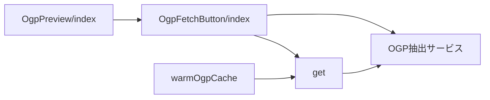
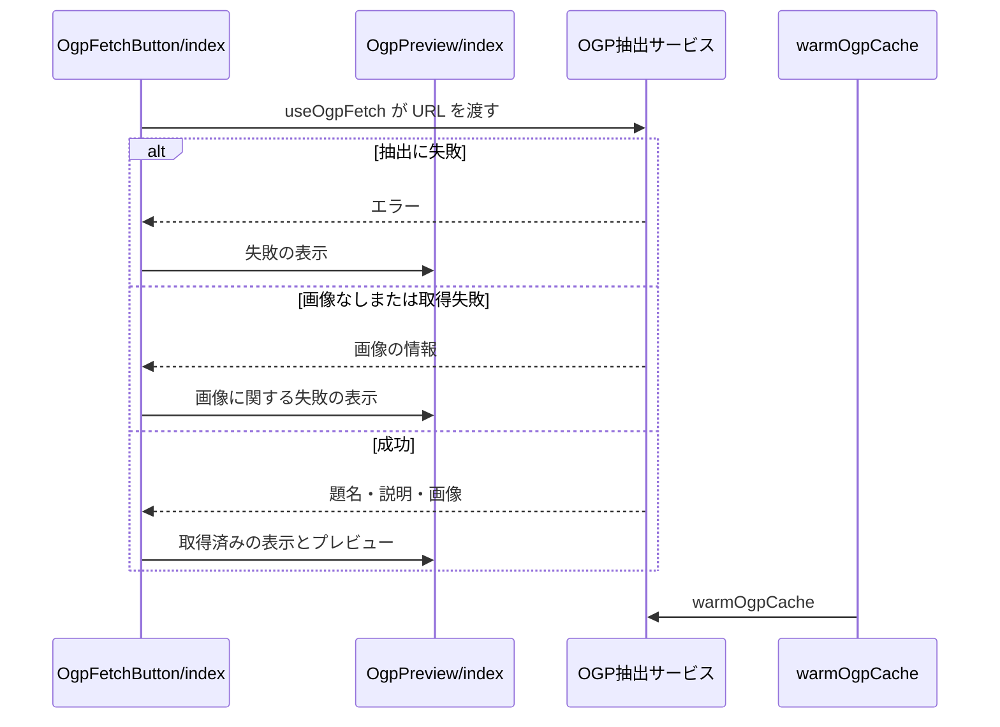

# リンクカードの取得 設計書

## 1. 構成

| パス                                            | 責務                              |
| ----------------------------------------------- | --------------------------------- |
| `src/components/image/OgpFetchButton/index.tsx` | URLの検出・取得の実行・取得ボタン |
| `src/components/image/OgpPreview/index.tsx`     | 取得状況とプレビューの表示        |
| `src/lib/entry/warmOgpCache.ts`                 | OGPのキャッシュの事前取得         |
| `src/lib/api/schema/v1/extract/get.ts`          | OGP抽出APIのスキーマ              |

## 2. 関係図・ワークフロー

リンクカードの取得に関わる依存方向を示す。



取得の成功と失敗による分岐を示す。



## 3. 設計項目

### D-1: 取得と表示 (FR-4, FR-5, FR-6)

```ts
export type OgpResult = {
  meta: { title: string; description: string }
  imageBlob: Blob
  sourceUrl: string
}
export type UseOgpFetchResult = {
  detectedUrl: string | null
  isOgpLoading: boolean
  ogpStatus: DeferredMessage | null
  previewUrl: string | null
  title?: string
  handleFetchOgp: () => void
  clearOgpStatus: () => void
}
```

| 段階       | 内容                                                                                                                |
| ---------- | ------------------------------------------------------------------------------------------------------------------- |
| URLの検出  | `RichText` で本文のリンクを検出し、最初のURLを使う。検出に失敗したときは `https?://` の正規表現で補う               |
| 取得       | `extractUrl({ url })` の結果から画像のURLを取り、画像を取得して `createOgpThumbnailFromBlob` でサムネイルに変換する |
| 失敗の分類 | 抽出の失敗・画像なし・画像の取得失敗・画像の形式が不正・変換の失敗・予期しない例外の6種に文言を出し分ける           |
| 取得ボタン | URLがあるときだけ描画し、取得中は無効にする                                                                         |
| プレビュー | 取得中・取得状況の文言・画像を描画し、取り外しの操作があるときは取り外しのボタンを付ける                            |

### D-2: 抽出APIとキャッシュの事前取得 (FR-1, FR-2, FR-3)

```ts
// GET /v1/extract?url=<url> → 200 { title, description, image?, url }
export const warmOgpCache = async (url: string): Promise<void> => {
  if (!url) return
  try {
    await extractUrl({ url }, { signal: AbortSignal.timeout(3000) })
  } catch {}
}
```

- 事前取得は、共有の直後に相手側がカードを生成するとき、初回のアクセスが遅くなるのを避けるために行う。失敗は握りつぶす。

## 4. エラー処理

| 事象               | 処理                                           |
| ------------------ | ---------------------------------------------- |
| 取得の各段階の失敗 | 状況の文言を表示し、リンクカードを未設定にする |
| 事前取得の失敗     | 無視する                                       |
