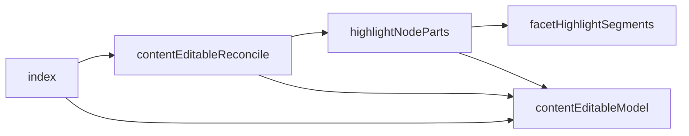
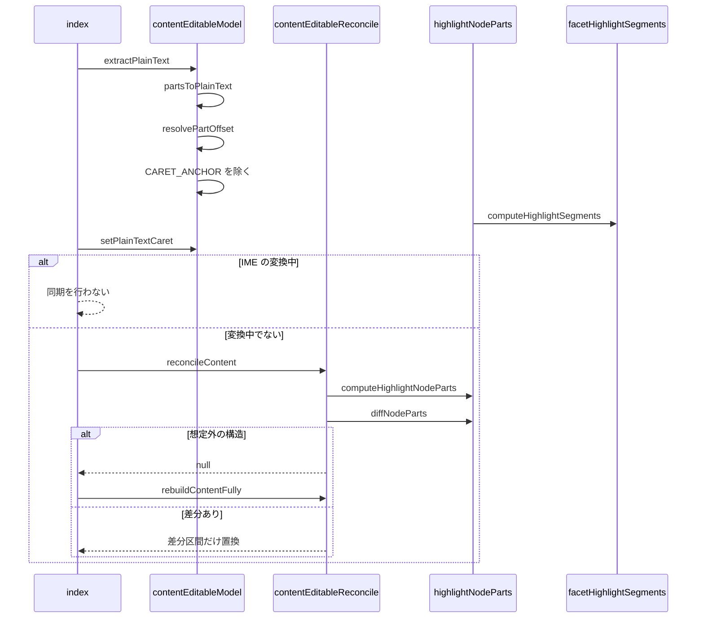

# 投稿本文の編集欄 設計書

## 1. 構成

| パス                                                          | 責務                                        |
| ------------------------------------------------------------- | ------------------------------------------- |
| `src/util/textarea/facetHighlightSegments.ts`                 | 本文からの色付け対象の検出と分割            |
| `src/util/textarea/highlightNodeParts.ts`                     | DOMの子ノード単位の部品への展開と差分の算出 |
| `src/util/textarea/contentEditableModel.ts`                   | 編集欄のDOMと平文の文字位置の相互変換       |
| `src/util/textarea/contentEditableReconcile.ts`               | 現在のDOMから理想の構造への差分更新         |
| `src/components/post/ThreadComposer/PostBodyEditor/index.tsx` | 編集欄の描画・入力の取り込み・同期          |

## 2. 関係図・ワークフロー

編集欄とその部品の依存方向を示す。



入力から差分更新までの流れと、変換中や構造不明の分岐を示す。



## 3. 設計項目

### D-1: 色付け対象の検出 (FR-1, FR-2, FR-3, FR-4)

```ts
export type HighlightSegment = { text: string; highlighted: boolean }
// ハッシュタグ: (?<=^|[\s(])[#＃][\p{L}\p{N}\p{M}_]+
// メンション:   (?<=^|[\s(])@[a-zA-Z0-9.-]+
// URL:          スキームあり、またはドメインらしき文字列（スキームなしは既知 TLD で終わるものだけ）
export const computeHighlightSegments = (text: string): HighlightSegment[]
```

- 3種の一致を開始位置の昇順に並べ、先に採用した範囲と重なるものを捨てる。URL 内の `#` は URL の一部になる。
- `RichText.detectFacets` はハンドルが既知 TLD で終わるまでメンションと判定しないため使わない。スキームなしのドメインだけ、同じ TLD の一覧で検証して投稿時にリンクになる範囲と一致させる。

### D-2: 部品への展開と差分 (FR-5, FR-6)

```ts
export type NodePart =
  | { type: "text"; value: string; highlighted: boolean }
  | { type: "br" }
  | { type: "anchor" }
// 末尾が改行のときだけ末尾に anchor（不可視の目印）を付ける
export const computeHighlightNodeParts = (text: string): NodePart[]
export const diffNodeParts = (oldParts: NodePart[], newParts: NodePart[]): { prefix: number; suffix: number }
```

先頭と末尾の共通区間を数えるとき、共通の要素が1つだけの場合は先頭区間にだけ数える。

### D-3: 平文との相互変換 (FR-7)

```ts
export type TextPart = { type: "text"; value: string } | { type: "br" }
export const CARET_ANCHOR = "​"
export const partsToPlainText = (parts: TextPart[]): string // br は "\n"
export const extractPlainText = (root: HTMLElement): string
export const resolvePartOffset = (parts: TextPart[], index: number) // 範囲外は端へ丸める。境界は直前の部品の末尾
export const setPlainTextCaret = (root: HTMLElement, index: number): void
```

### D-4: 差分更新と編集欄 (FR-8, FR-9)

```ts
// 一致する区間には触れず、差分の区間だけを置き換える。想定外の構造なら null
export const reconcileContent = (root: HTMLElement, text: string, highlightClassName: string): boolean | null
export const rebuildContentFully = (root: HTMLElement, text: string, highlightClassName: string): void
```

- 入力時点でブラウザは実 DOM を編集済みなので、現在の DOM と本文から計算した理想の構造を比べ、一致していれば触らない。ネイティブの取り消しを保つため。
- Enter と Shift+Enter は `insertParagraph` と `insertLineBreak` を横取りして `<br>` の挿入に統一する。
- IME の変換中（`compositionstart` から `compositionend`）は同期を止める。

## 4. エラー処理

| 事象               | 処理               |
| ------------------ | ------------------ |
| 想定外のDOM構造    | 全置換に切り替える |
| 本文の位置が範囲外 | 端に丸める         |
