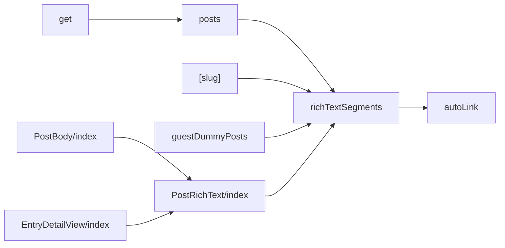
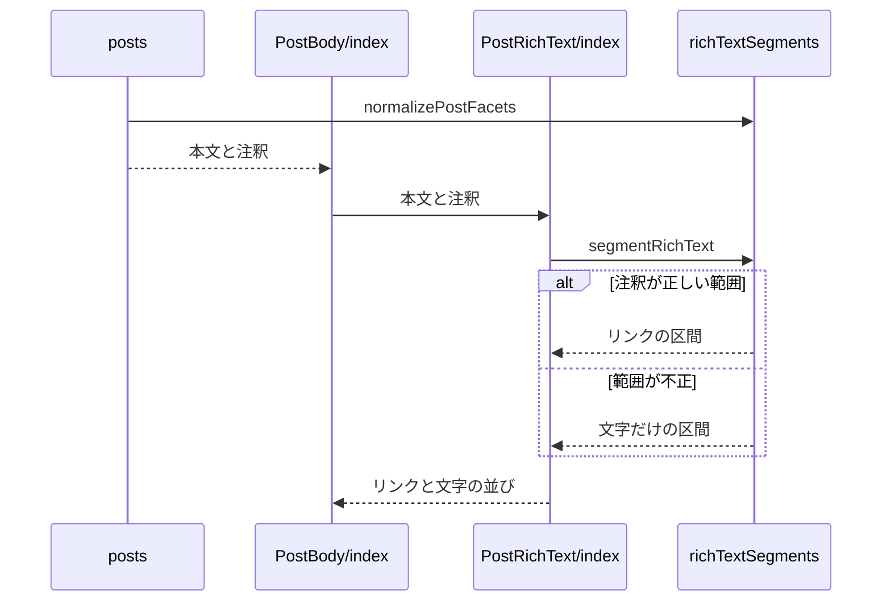

# 投稿本文のリンク表示 設計書

## 1. 構成

| パス                                               | 責務                          |
| -------------------------------------------------- | ----------------------------- |
| `src/lib/atproto/richTextSegments.ts`              | 注釈の正規化と区間の切り出し  |
| `src/util/autoLink.ts`                             | 平文の中のURLの検出           |
| `src/components/post/PostRichText/index.tsx`       | 区間のリンクの描画            |
| `src/components/post/PostBody/index.tsx`           | 本文へのリンク表示の組み込み  |
| `src/lib/entry/posts.ts`                           | 一覧の投稿への注釈の付与      |
| `src/lib/api/schema/v2/entries/get.ts`             | 一覧APIの応答の注釈の定義     |
| `src/pages/entries/[slug].astro`                   | entry詳細の投稿への注釈の付与 |
| `src/components/entry/EntryDetailView/index.astro` | entry詳細の説明文のリンク表示 |
| `src/lib/entry/guestDummyPosts.ts`                 | ゲスト表示の投稿の注釈        |

## 2. 関係図・ワークフロー

本文のリンク表示の依存方向を示す。



本文を区間に分けてリンクを描画する流れを示す。



## 3. 設計項目

### D-1: 注釈の正規化と区間の切り出し (FR-1, FR-3, FR-4, NFR-2)

```ts
export type PostFacetFeature =
  | { $type: "app.bsky.richtext.facet#mention"; did: string }
  | { $type: "app.bsky.richtext.facet#link"; uri: string }
  | { $type: "app.bsky.richtext.facet#tag"; tag: string }
export type PostFacet = {
  index: { byteStart: number; byteEnd: number }
  features: PostFacetFeature[]
}
export type RichTextSegment = { text: string; href?: string }

// 未知の feature を落とし、feature の無い facet を除く（外部入力の最小要件の検査）
export const normalizePostFacets = (input: unknown): PostFacet[]
// UTF-8 のバイト列で切り出す。範囲外・重なり・文字の途中で切れる facet は無視する
export const segmentRichText = (text: string, facets: PostFacet[]): RichTextSegment[]
```

| feature | `href`                                                                                                 |
| ------- | ------------------------------------------------------------------------------------------------------ |
| mention | `https://bsky.app/profile/<did>`                                                                       |
| tag     | `https://bsky.app/hashtag/<encodeURIComponent(tag)>`                                                   |
| link    | `uri`（`http:` と `https:` のときだけ。スキームを省略したドメインで始まる `uri` は `https://` を補う） |

文字の途中の判定は、境界のバイトが UTF-8 の継続バイト（`0b10xxxxxx`）かどうかで行う。

### D-2: リンクの描画 (FR-2, NFR-1)

```tsx
<PostRichText text={text} facets={facets} />
// segments.map((segment, index) => segment.href
//   ? <a key={index} href={segment.href} target="_blank" rel="noopener noreferrer">{segment.text}</a>
//   : <Fragment key={index}>{segment.text}</Fragment>)
```

`PostBody` は `facets` を受け取り、本文の `<p>` の中身を `PostRichText` にする。entry詳細ページの `PostBody` はサーバーで描画されるため、JavaScriptの実行なしでもリンクが表示される。リンクの色は `--color-link` とし、`card-muted` の中では文字と同じ色にする。

### D-3: 注釈の受け渡し (FR-5)

| 経路           | 処理                                                                    |
| -------------- | ----------------------------------------------------------------------- |
| 一覧API        | `normalizeTimelinePost` が `record.facets` を正規化して `facets` に置く |
| 応答のスキーマ | `TimelinePostSchema` に `facets: Common.CommonFacetsSchema.optional()`  |
| entry詳細      | `toEntryPostView` が `record.facets` を正規化して `facets` に置く       |
| ゲスト表示     | 翻訳後の本文の中の位置から、注釈のバイトの範囲を組み立てる              |

### D-4: 注釈の無いURLの検出 (FR-6, FR-7)

```ts
export type UrlRange = { start: number; end: number; href: string }
// 平文の中のURLの範囲（UTF-16の位置）とリンク先を出現順に返す
export const findUrlRanges = (text: string): UrlRange[]
```

`segmentRichText` は、注釈の範囲外の文字の区間を `findUrlRanges` で更に分け、URLの区間にリンク先を付ける。

| 対象           | 判定                                                                                   |
| -------------- | -------------------------------------------------------------------------------------- |
| URLの切れ目    | URLに使えるASCII文字（RFC 3986 の文字と `%`）が続く範囲。日本語・空白で終わる          |
| 始まり         | 直前が英数字・`.`・`-`・`@`・`/`・`_` でない位置（メールアドレス・メンションを除く）   |
| スキームの省略 | 最後のラベルが既知のトップレベルドメイン（`tlds`）のときだけURLとし、`https://` を補う |
| 末尾の記号     | `.,;:!?` と、対応する `(` の無い `)` を範囲から除く                                    |

entry詳細ページの説明文は注釈を持たないため、`PostRichText` に本文だけを渡して描画する。

## 4. エラー処理

| 事象                 | 処理                                     |
| -------------------- | ---------------------------------------- |
| 注釈の形式が不正     | その注釈を捨て、本文を文字のまま表示する |
| 注釈が無い・空の配列 | 本文全体を1つの文字の区間として表示する  |
