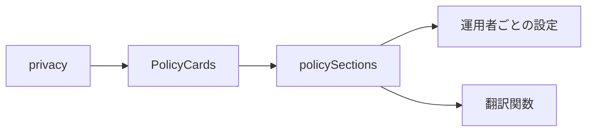
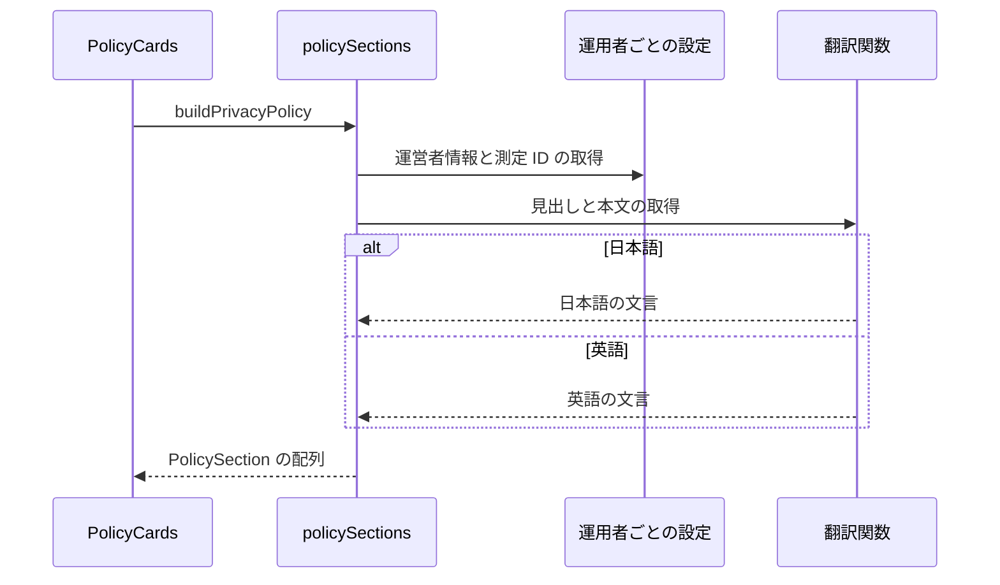

# プライバシーポリシー 設計書

## 1. 構成

| パス                                     | 責務                             |
| ---------------------------------------- | -------------------------------- |
| `src/lib/privacy/policySections.ts`      | 節の識別子と順序、本文の組み立て |
| `src/components/privacy/PolicyCards.tsx` | 節をカードとして並べて表示する   |
| `src/pages/privacy.astro`                | プライバシーポリシーのページ     |

## 2. 関係図・ワークフロー

ページの構成要素の依存方向を示す。



本文の組み立てと、表示言語による分岐を示す。



## 3. 設計項目

### D-1: 運営者情報の受け取り (FR-5, FR-10, FR-11)

```ts
import { siteConfig, type SiteConfig } from "@/lib/site/siteConfig"
```

- 運営者名・連絡先・日付と測定 ID は、運用者ごとの設定の `SiteConfig` で受け取る。
- 活動名・メールアドレス・ハンドルは連絡先の項目の値として、日付は辞書のプレースホルダ（`{enactedAt}`・`{revisedAt}`）として、`buildPrivacyPolicy` が設定の値を渡す。
- 測定 ID が null なら、収集する情報・情報の共有・保持期間・Cookie の節からアクセス解析の項目を除き、Cookie の節の見出しを「Cookie」だけにする。
- ハンドルが null なら、連絡先から Bluesky のアカウントの項目を除く。

### D-2: 節の組み立て (FR-1, FR-2, FR-3, FR-4, FR-6, FR-8, FR-9)

```ts
export type PolicyItem = string | { label: string; value: string; href?: string }
export type PolicyBlock =
  | { kind: "text"; text: string }
  | { kind: "list"; items: PolicyItem[] }
export type PolicySection = { id: string; title: string; blocks: PolicyBlock[] }
const SECTION_IDS = [
  "operator", "collected", "purpose", "external",
  "retention", "security", "cookies", "rights", "revision",
] as const
export const buildPrivacyPolicy = (
  t: Translator["t"],
  config: SiteConfig = siteConfig,
): PolicySection[]
```

| 節 (`id`)   | 内容                                                                             |
| ----------- | -------------------------------------------------------------------------------- |
| `operator`  | 本サービスの概要、活動名・メールアドレス・Bluesky のアカウント（項目名つき）     |
| `collected` | ログイン・予約投稿・配信の際の通信・アクセス解析・お問い合わせ・報告と提案の情報 |
| `purpose`   | 利用目的                                                                         |
| `external`  | 共有しないことと、利用者の操作・委託先・アクセス解析・GitHub・法令の例外         |
| `retention` | 区分ごとの保持期間（報告と提案は GitHub の Issue が削除されるまで）              |
| `security`  | 通信と予約用の認可の情報の暗号化、扱う者の限定、許可の範囲                       |
| `cookies`   | Cookie と端末内の保存の用途、Google アナリティクスの提供者・停止の方法           |
| `rights`    | 開示・訂正・削除を求められることと連絡先、画面から行える削除                     |
| `revision`  | 変更の方法と制定日・改定日                                                       |

- 一般的なプライバシーポリシーの構成に沿い、見出しに条番号を付けず、本サービスが扱う情報に絞って簡潔に書く。
- 配信の際の通信の情報は、本サービスを配信する Cloudflare が通信の処理のために扱うものとして書く。
- 連絡先は `{ label, value, href? }` の項目で返し、メールアドレスは `mailto:`、Bluesky のアカウントは `https://bsky.app/profile/{handle}` へのリンクにする。
- 本文は表を使わず、1文を短くし、暗号方式の名称のような技術の細部を書かない。
- 本文は辞書の `privacy.<節>.*` に置き、日本語を正本とする。英語は同じキー集合を型で強制される。
- 扱う情報の記載は実装に合わせる。保管場所の事実（ログインの情報・予約の保管期間）を変えたときは、同じ変更で本文を更新する。

### D-3: 表示とリンク (FR-7)

| 要素     | 内容                                                                                                                                                       |
| -------- | ---------------------------------------------------------------------------------------------------------------------------------------------------------- |
| 節       | 設定ページと同じカード（`base-card`・`base-padding`）に、見出し・段落・1階層の箇条書きを描画する                                                           |
| 連絡先   | 項目名つきの値を「項目名: 値」で描画し、`href` があれば値を新しいタブで開くリンクにする                                                                    |
| ページ   | 静的に生成し、ログインのページと同様にサイドバーとフッターナビを表示しない単独のページとする。ナビゲーションの項目には加えない。検索エンジンへの公開を許す |
| リンク元 | 設定のページ、ログインのページ、設定のダイアログ、予約の許可の案内。ダイアログからは新しいタブで開く                                                       |

## 4. エラー処理

- なし
