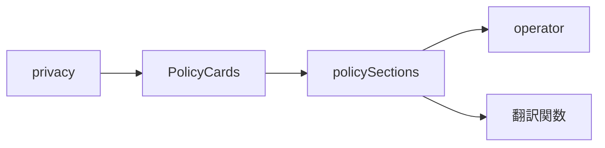
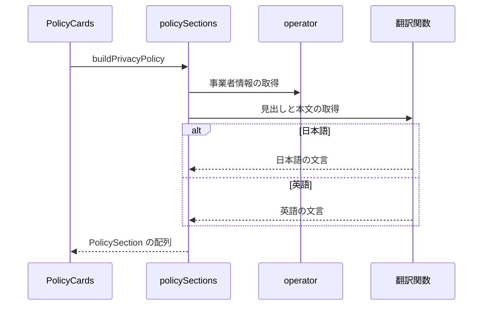

# プライバシーポリシー 設計書

## 1. 構成

| パス                                     | 責務                                       |
| ---------------------------------------- | ------------------------------------------ |
| `src/lib/privacy/operator.ts`            | 事業者の名称・連絡先・制定日・改定日の定数 |
| `src/lib/privacy/policySections.ts`      | 節の識別子と順序、本文の組み立て           |
| `src/components/privacy/PolicyCards.tsx` | 節をカードとして並べて表示する             |
| `src/pages/privacy.astro`                | プライバシーポリシーのページ               |

## 2. 関係図・ワークフロー

ページの構成要素の依存方向を示す。



本文の組み立てと、表示言語による分岐を示す。



## 3. 設計項目

### D-1: 事業者情報の定数 (FR-5)

```ts
export const operator = {
  name: "nekono",
  email: "skyshare@nekono.dev",
  blueskyHandle: "nekono.dev",
  enactedAt: "2026-10-20",
  revisedAt: "2026-10-20",
} as const
```

- 本文は、事業者名・連絡先・日付を辞書のプレースホルダ（`{operator}`・`{email}`・`{handle}`・`{enactedAt}`・`{revisedAt}`）で受け取り、`buildPrivacyPolicy` が `operator` の値を渡す。

### D-2: 節の組み立て (FR-1, FR-2, FR-3, FR-4, FR-6, FR-8)

```ts
export type PolicyBlock =
  | { kind: "text"; text: string }
  | { kind: "list"; items: string[] }
export type PolicySection = { id: string; title: string; blocks: PolicyBlock[] }
const SECTION_IDS = [
  "operator", "collected", "purpose", "external",
  "retention", "cookies", "rights", "revision",
] as const
export const buildPrivacyPolicy = (t: Translator["t"]): PolicySection[]
```

| 節 (`id`)   | 内容                                                                                                     |
| ----------- | -------------------------------------------------------------------------------------------------------- |
| `operator`  | 運営者の名称と連絡先、法令の遵守                                                                         |
| `collected` | ログイン・予約投稿・端末内の保存・アクセスログ・アクセス解析の区分ごとの情報の種類。預からない情報の注記 |
| `purpose`   | 利用目的。目的外に利用しないこと                                                                         |
| `external`  | 同意なく提供しないことと、例外（法令・Bluesky・Cloudflare・Google）。共有先 SNS・国外・外部送信の公表    |
| `retention` | 区分ごとの保存期間と、通信の保護・ログイン情報の保管の方法（技術の細部は書かない）                       |
| `cookies`   | Cookie と端末内の保存の用途、アクセス解析の停止方法、広告を行わないこと                                  |
| `rights`    | 開示・訂正・削除・利用停止の請求と窓口、画面から行える削除                                               |
| `revision`  | 改定の方法と制定日・改定日                                                                               |

- 参考にした同種のサービスのポリシーに合わせ、本サービスが利用者から預かる情報に絞って書く。PLC Directory・OGP 抽出・旧バックエンドのように、機能の都合で通信が起きるだけの相手は個別に列挙しない。
- 本文は表を使わず、1文を短くし、暗号方式の名称のような技術の細部を書かない。
- 本文は辞書の `privacy.<節>.*` に置き、日本語を正本とする。英語は同じキー集合を型で強制される。
- 取得する情報の記載は実装に合わせる。保管場所の事実（ログインの情報・端末内の保存項目・予約の保管期間）を変えたときは、同じ変更で本文を更新する。

### D-3: 表示とリンク (FR-7)

| 要素     | 内容                                                                                                       |
| -------- | ---------------------------------------------------------------------------------------------------------- |
| 節       | 設定ページと同じカード（`base-card`・`base-padding`）に、見出し・段落・1階層の箇条書きを描画する           |
| ページ   | 静的に生成し、サイドバーとフッターを表示する。ナビゲーションの項目には加えない。検索エンジンへの公開を許す |
| リンク元 | 設定のページ、ログインのページ、予約の認証情報の登録フォーム                                               |

## 4. エラー処理

- なし
