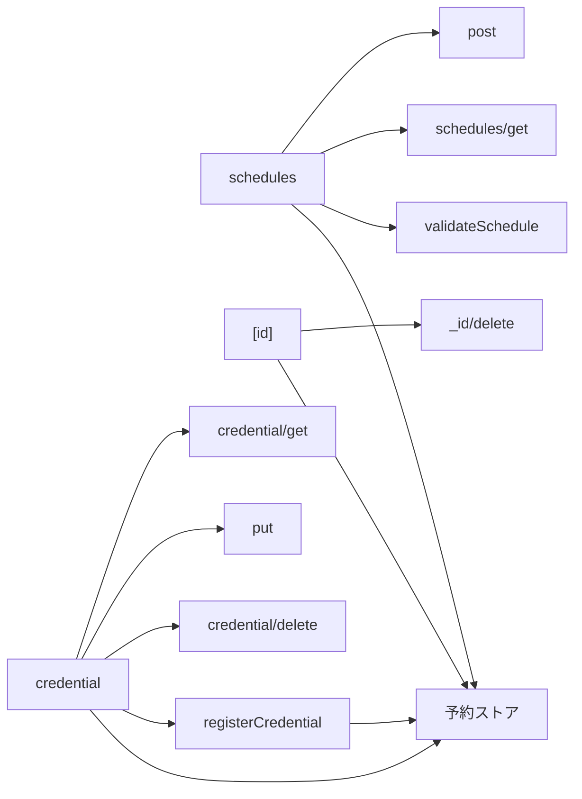
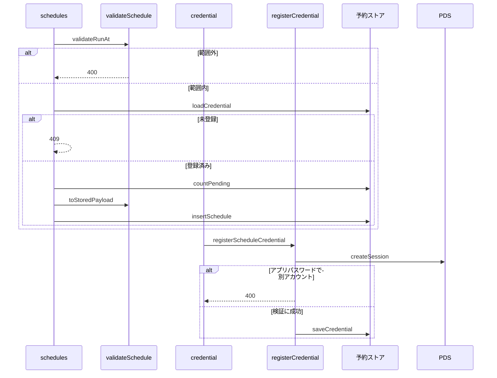

# 予約投稿API 設計書

## 1. 構成

| パス                                                   | 責務                                         |
| ------------------------------------------------------ | -------------------------------------------- |
| `src/pages/v2/schedules.ts`                            | 予約の作成と一覧のハンドラ                   |
| `src/pages/v2/schedules/[id].ts`                       | 予約の取消と削除のハンドラ                   |
| `src/pages/v2/schedules/credential.ts`                 | 予約用認証情報の取得・登録・削除のハンドラ   |
| `src/lib/api/schema/v2/schedules/post.ts`              | 予約の作成の入力スキーマ                     |
| `src/lib/api/schema/v2/schedules/get.ts`               | 予約の一覧のクエリと応答のスキーマ           |
| `src/lib/api/schema/v2/schedules/_id/delete.ts`        | 予約の取消のパスのスキーマ                   |
| `src/lib/api/schema/v2/schedules/credential/get.ts`    | 認証情報の登録状態のスキーマ                 |
| `src/lib/api/schema/v2/schedules/credential/put.ts`    | 認証情報の登録の入力スキーマ                 |
| `src/lib/api/schema/v2/schedules/credential/delete.ts` | 認証情報の削除の応答のスキーマ               |
| `src/lib/schedule/validateSchedule.ts`                 | 実行時刻の範囲と件数の検証、保管形式への変換 |
| `src/lib/schedule/registerCredential.ts`               | アプリパスワードでのログインと登録前の検証   |

## 2. 関係図・ワークフロー

ハンドラがスキーマと検証処理に依存する方向を示す。



作成の検証順序と、認証情報の登録の分岐を示す。



## 3. 設計項目

### D-1: 共通の検証とエラー (NFR-1, NFR-2, NFR-3, NFR-4)

| 段階                                         | 失敗時 |
| -------------------------------------------- | ------ |
| `Common.CommonCookieSchema` によるヘッダ検証 | 400    |
| `locals.session` の存在                      | 401    |
| 入力の解析と `safeParse()`                   | 400    |
| 予約の所有者の一致（取消・削除）             | 404    |
| 状態や件数の競合                             | 409    |
| 予約件数の上限                               | 429    |
| 想定外の例外                                 | 500    |

- すべての応答に `cache-control: no-store` を付け、本文は `{ error: string }` とする。
- `error` の値は機械可読の識別子とし、409 は `ScheduleCredentialRequired`・`ScheduleRunning`・`ScheduleCredentialInUse` の3種を返し分ける。
- 入力スキーマは `src/lib/api/schema/v2/schedules/` 配下に定義し、ハンドラはそのスキーマを `safeParse()` に直接渡す。OpenAPI 文書は同じスキーマから生成する。
- ハンドラが静的に読み込むのは Zod・予約ストア・`fetch` のみとし、`@atproto/*` は静的にも動的にも読み込まない。ログには予約の識別子と分類コードだけを出力し、パスワードとトークンを含む値を出力しない。

### D-2: 予約の作成 (FR-1, FR-11)

```ts
// POST /v2/schedules（multipart/form-data）
const RequestBodySchema = z
  .object({
    posts: z.array(SchedulePostItemSchema).min(1).max(MAX_THREAD_POST_COUNT),
    runAt: z.iso.datetime({ offset: true }),
    reply: Common.CommonReplyRefSchema.optional(),
    createEntry: z.boolean().optional(),
    visual: imageField.optional(),
    heading: headingField.optional(),
    caption: captionField.optional(),
  })
  .strict()

// 投稿の作成の入力から、動画の分岐を除いた3分岐
const SchedulePostItemSchema = z.union(EntryPostItemSchema.options.slice(0, 3))
```

- 画像・リンクカードの画像・代表画像の `Blob` は、`images` `ogImage` `visual` の順に番号を振って取り出す。
- 保管用の本文 `payload` は、`Blob` を `{ imageIndex: number }` に置き換えた JSON とする。
- 画像は `putImages` で保管し、返ったキーを `imageKeys` に保存する。

| 応答 | 本文                            |
| ---- | ------------------------------- |
| 200  | `{ id: string, runAt: string }` |

### D-3: 実行時刻と件数の検証 (FR-2, FR-3, FR-9)

```ts
const MIN_LEAD_SECONDS = 5 * 60
const MAX_LEAD_SECONDS = 30 * 24 * 60 * 60
const MAX_PENDING_PER_ACCOUNT = 20

export const validateRunAt = (runAt: string, nowSeconds: number): { ok: true; epoch: number } | { ok: false }
export const toStoredPayload = (
    body: ScheduleRequestBody,
): { payload: StoredPayload; images: { bytes: ArrayBuffer; mime: string }[] }
```

- `validateRunAt` は ISO 8601 の日時を UNIX 秒に変換し、`now + MIN_LEAD_SECONDS` 以上かつ `now + MAX_LEAD_SECONDS` 以下を許可する。
- 認証情報が未登録のアカウントは `loadCredential` が `null` を返すため、`ScheduleCredentialRequired` を返す。
- 検証の順序は、実行時刻 → 認証情報の登録 → 待機中の件数 → 画像の保管 → 予約の保存とする。画像を保管した後に保存が失敗したときは、保管した画像を削除する。

### D-4: 予約の一覧 (FR-7)

```ts
// GET /v2/schedules?status=pending&limit=20&cursor=...
const QuerySchema = z.object({
  status: z.enum(["pending", "running", "posted", "failed"]).optional(),
  limit: z.coerce.number().int().min(1).max(50).default(20),
  cursor: z.string().min(1).optional(),
})

type ScheduleListItem = {
  id: string
  runAt: string
  status: "pending" | "running" | "posted" | "failed"
  postCount: number
  preview: string // 先頭の投稿の本文の先頭100文字
  lastError: string | null
  resultUri: string | null
}
```

- 応答は `{ items: ScheduleListItem[], cursor?: string }` とし、`runAt` の昇順に並べる。
- 取得は `listSchedules` に常に認証済みアカウントの DID を渡して行う。

### D-5: 予約の取消と履歴の削除 (FR-8)

| 予約の状態       | 処理                                                                                                              | 応答 |
| ---------------- | ----------------------------------------------------------------------------------------------------------------- | ---- |
| 待機中           | `deleteSchedule` で行を削除し、`removeImages` で画像を削除し、認証情報が不要になれば `purgeIdleCredential` を呼ぶ | 200  |
| 投稿済み・失敗   | `deleteSchedule` で行を削除する                                                                                   | 200  |
| 実行中           | 何も変更せず `ScheduleRunning` を返す                                                                             | 409  |
| 存在しない・他人 | 何も変更しない                                                                                                    | 404  |

状態の確認と削除の間に実行が始まる競合を避けるため、削除は `status` が待機中・投稿済み・失敗の行に限定した条件つきの文で行う。

### D-6: 予約用認証情報の登録 (FR-4, FR-5, FR-6)

```ts
// PUT /v2/schedules/credential
const RequestBodySchema = z.object({ password: z.string().min(1) }).strict()

export const registerScheduleCredential = async (
    db: D1Database,
    secret: string,
    session: { did: string; service: string },
    password: string,
): Promise<{ ok: true } | { ok: false; status: 400 | 401 | 429 | 500 }>
```

| 手順 | 処理                                                                                                                                  | 失敗時                          |
| ---- | ------------------------------------------------------------------------------------------------------------------------------------- | ------------------------------- |
| 1    | `${service}/xrpc/com.atproto.server.createSession` へ `{ identifier: did, password }` を `fetch` で送る                               | 401・429 は同じ値、その他は 500 |
| 2    | 応答の `did` が `session.did` と一致することを確認する                                                                                | 400                             |
| 3    | `accessJwt` の本体を Base64URL で復号し、`scope` が `com.atproto.appPass` または `com.atproto.appPassPrivileged` であることを確認する | 400                             |
| 4    | `refreshJwt` を `saveCredential` で暗号化して保存する。`accessJwt` は保存せず破棄する                                                 | 500                             |

- パスワードはメモリ上でのみ扱い、保存・ログ出力・応答のいずれにも含めない。
- 登録で得たセッションは、利用者のブラウザのセッションとは独立した系統であり、ブラウザ側のトークンの更新と互いに無効化し合わない。

### D-7: 認証情報の状態確認と削除 (FR-10)

```ts
// GET /v2/schedules/credential -> { registered: boolean, updatedAt?: string }
// DELETE /v2/schedules/credential -> 200 | 409
const CredentialStatusSchema = z.object({
  registered: z.boolean(),
  updatedAt: z.iso.datetime().optional(),
})
```

- 削除は `countPending` が0件のときだけ認証情報の行を削除し、1件以上のときは `ScheduleCredentialInUse` を返す。
- 実行中の予約があるときも削除しない。

## 4. エラー処理

| 事象                                       | 処理                                                       |
| ------------------------------------------ | ---------------------------------------------------------- |
| 画像の保管に失敗                           | 保管済みの画像を削除して 500 を返す                        |
| 予約の保存に失敗                           | 保管した画像を削除して 500 を返す                          |
| 暗号鍵が未設定                             | 認証情報の登録と予約の作成を 500 で拒否する                |
| 登録時のログイン先が応答しない             | 500 を返し、何も保存しない                                 |
| 認証情報の行が予約の作成の直後に削除された | 実行側が失敗として記録し、一覧に失敗の分類コードを表示する |
