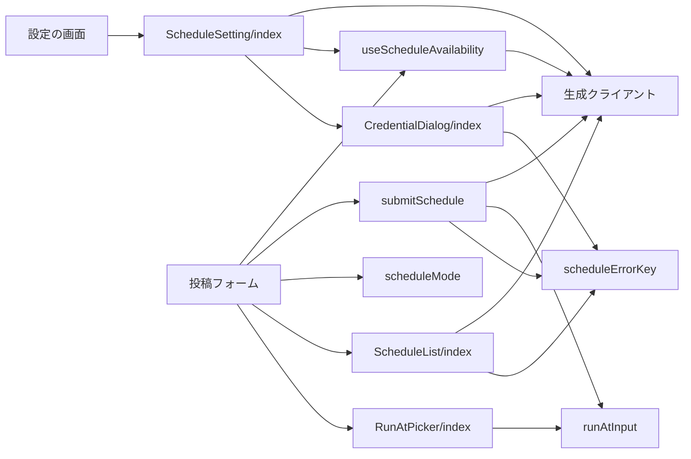
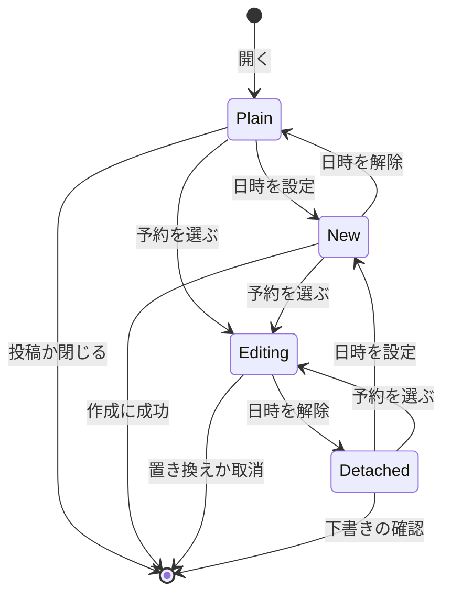
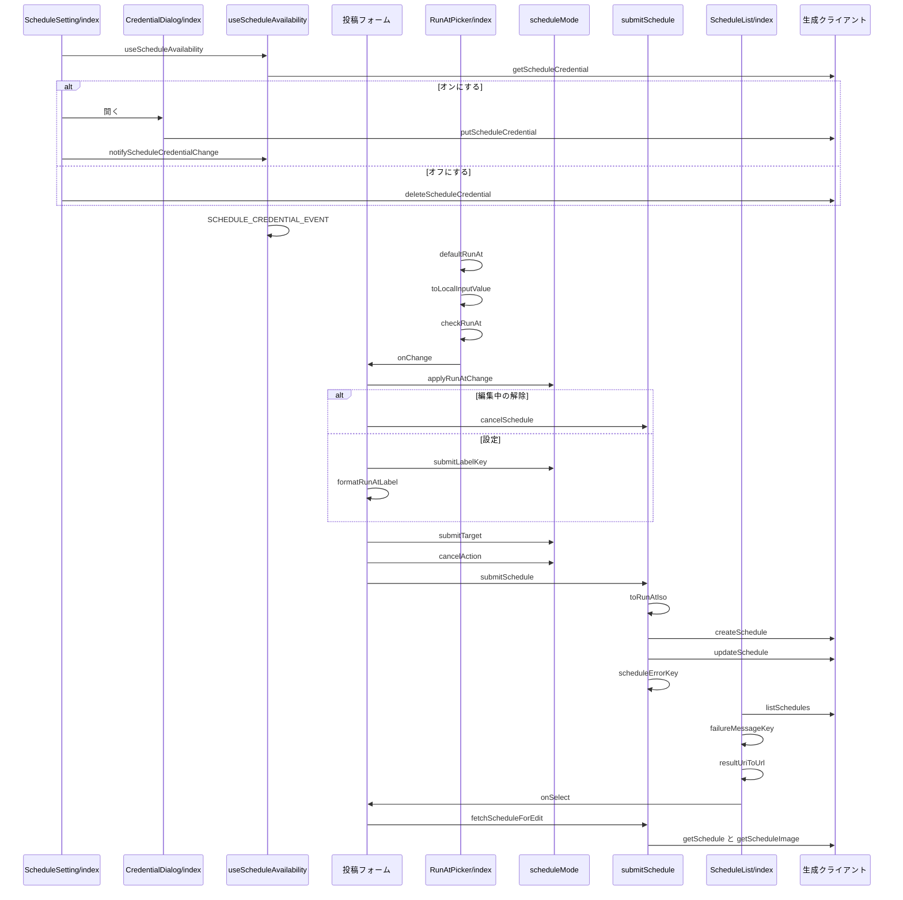

# 予約投稿の画面 設計書

## 1. 構成

| パス                                                 | 責務                                                       |
| ---------------------------------------------------- | ---------------------------------------------------------- |
| `src/lib/schedule/runAtInput.ts`                     | 日時の既定値・変換・範囲の判定・表示の文字列               |
| `src/lib/schedule/useScheduleAvailability.ts`        | 認証情報の登録状態と制限値の取得と、変更の通知の購読       |
| `src/lib/schedule/scheduleMode.ts`                   | 投稿フォームの予約の状態の遷移と、送信先とキャンセルの判定 |
| `src/lib/schedule/submitSchedule.ts`                 | 予約の作成と置き換えの呼び出しと、編集用の内容の取得       |
| `src/lib/schedule/scheduleErrorKey.ts`               | API のエラーと失敗の分類コードの文言キーの選択             |
| `src/components/schedule/ScheduleSetting/index.tsx`  | 設定の予約投稿のスイッチと、有効化と無効化の確認           |
| `src/components/schedule/CredentialDialog/index.tsx` | 予約用の認証情報（アプリパスワード）の入力のダイアログ     |
| `src/components/schedule/RunAtPicker/index.tsx`      | カレンダーのボタンと実行日時の指定のダイアログ             |
| `src/components/schedule/ScheduleList/index.tsx`     | 予約のタブの一覧と、選択・取消・履歴の削除                 |

## 2. 関係図・ワークフロー

画面の部品が判定処理と生成クライアントに依存する方向を示す。



投稿フォームの予約の状態の遷移を示す。



設定の切り替えと、日時の指定から送信までと、予約の書き戻しの分岐を示す。



## 3. 設計項目

### D-1: 日時の入力と変換 (FR-5)

```ts
export type RunAtLimits = { minLeadSeconds: number; maxLeadSeconds: number }
export const defaultRunAt = (now: Date): Date // 24時間後。秒とミリ秒を0にする
export const toLocalInputValue = (d: Date): string // "YYYY-MM-DDTHH:mm"（端末のタイムゾーン）
export const toRunAtIso = (d: Date): string // "+09:00" のような差を含む ISO 8601
export const checkRunAt = (d: Date, now: Date, limits: RunAtLimits): "ok" | "tooSoon" | "tooLate"
export const formatRunAtLabel = (d: Date, locale: string): string // Intl.DateTimeFormat の月・日・曜日・時・分
```

- `checkRunAt` は `d - now` が `minLeadSeconds` 未満なら `tooSoon`、`maxLeadSeconds` を超えるなら `tooLate` を返す。解釈できない日時も `tooSoon` とする。
- `toRunAtIso` は `Date` の `getTimezoneOffset` から `+09:00` 形式のオフセットを組み立てる。
- 範囲の数値は画面に持たず、`checkRunAt` に渡す制限値は API の応答から得る。

### D-2: 予約の可否の取得 (FR-1, FR-4)

```ts
export const SCHEDULE_CREDENTIAL_EVENT = "skyshare:schedule-credential-change"
export const notifyScheduleCredentialChange = (): void // window へ CustomEvent を送る
export const useScheduleAvailability = (enabled: boolean): {
  registered: boolean | null // 取得前と取得の失敗は null
  limits: ScheduleLimits | null
  reload: () => void
}
```

- `enabled` が偽（ゲストの表示）のときは通信せず `registered: null` を返す。
- マウント時と `astro:page-load` と `SCHEDULE_CREDENTIAL_EVENT` のたびに `getScheduleCredential` を呼ぶ。`getScheduleLimits` は最初に `registered` が真になったときに1回だけ呼ぶ。
- 投稿フォームは `registered === true && limits !== null` のときだけ予約投稿を有効とみなす。

### D-3: 設定の予約投稿のスイッチ (FR-1, FR-2)

| 操作             | 処理                                                                                                          |
| ---------------- | ------------------------------------------------------------------------------------------------------------- |
| 表示             | `useScheduleAvailability(!guestMode)` の `registered` をスイッチの状態にし、`null` の間は無効にする           |
| オンにする       | `CredentialDialog` を開く。登録に成功したら `notifyScheduleCredentialChange` を呼び、閉じたらオフのままにする |
| オフにする       | `listSchedules({ status: "pending", limit: 50 })` の件数を `ConfirmDialog` の文言に入れて確認する             |
| オフの確認を承諾 | `deleteScheduleCredential` を呼び、応答の `cancelled` を表示して `notifyScheduleCredentialChange` を呼ぶ      |
| オフの確認で409  | `schedule.error.running` を表示し、オンのままにする                                                           |

```tsx
// 設定の投稿フォームのグループの末尾に置く
<SettingList
  items={[
    {
      key: "scheduledPost",
      label: t("schedule.setting.label"),
      description: t("schedule.setting.description"),
      checked: registered === true,
      disabled: registered === null || guestMode,
      onCheckedChange: next =>
        next ? openCredentialDialog() : confirmDisable(),
    },
  ]}
/>
```

### D-4: 認証情報の入力のダイアログ (FR-3, NFR-3, NFR-5)

```tsx
type CredentialDialogProps = {
  open: boolean
  handle: string // ログイン中のアカウントのハンドル
  onRegistered: () => void
  onClose: () => void
}
```

| 項目   | 内容                                                                                                                               |
| ------ | ---------------------------------------------------------------------------------------------------------------------------------- |
| 種別   | 非モーダルの `<dialog>` を `show()` で開き、開いている間だけフォームを描画する                                                     |
| 欄     | 可視のユーザー名欄（`autocomplete="username"`、`defaultValue` にハンドル）とパスワード欄（`autocomplete="current-password"`）の2つ |
| 文言   | 注意の1文と作成場所の1文と、`/privacy/` へのリンクの3行だけを置く                                                                  |
| 大きさ | `max-height: calc(100dvh - 2rem)`・`max-width: calc(100vw - 2rem)`・`overflow-y: auto` とする                                      |
| 送信   | `PUT /v2/schedules/credential` を呼び、成功したら `onRegistered` を呼んで閉じる                                                    |

- パスワードは非制御入力で扱い、送信後に空に戻す。ログ・URL・ストレージには出力しない。ラベルには「確認」「再入力」を含めない。

### D-5: 実行日時の指定 (FR-4, FR-5, FR-6, NFR-1)

```tsx
type RunAtPickerProps = {
  value: Date | null
  limits: RunAtLimits | null // null のときはボタンを無効にする
  disabled: boolean
  disabledReason?: string // ボタンの title に出す
  onChange: (next: Date | null) => void
}
```

| 要素         | 内容                                                                                          |
| ------------ | --------------------------------------------------------------------------------------------- |
| ボタン       | カレンダーのアイコンの `nontext-button`。`value` があるとき `aria-pressed` と強調の配色にする |
| ダイアログ   | `Overlay` の中に `<input type="datetime-local">` と「設定」「解除」「閉じる」を置く           |
| 既定値       | `value ?? defaultRunAt(new Date())` を開くたびに入力欄へ入れる                                |
| 設定         | `checkRunAt` が `ok` のときだけ押せ、`onChange(日時)` を呼ぶ。範囲外は理由の文言を表示する    |
| 解除         | `value` があるときだけ表示し、`onChange(null)` を呼ぶ                                         |
| 実行日時の行 | 呼び出し側が `formatRunAtLabel` で「{日時}に予約」と表示し、行を押すとダイアログを開く        |

- 画面幅が640ピクセル未満のとき、共通 UI のクラスがボタンと入力欄の高さを44ピクセル以上にする。

### D-6: 投稿フォームの予約の状態 (FR-6, FR-7, FR-11, FR-12)

```ts
export type ScheduleMode =
  | { kind: "plain" }
  | { kind: "new"; runAt: Date }
  | { kind: "editing"; id: string; runAt: Date }
  | { kind: "detached" } // 編集中に日時を解除して予約を取り消した後
export const applyRunAtChange = (mode: ScheduleMode, next: Date | null): { mode: ScheduleMode; cancelScheduleId: string | null }
export const submitTarget = (mode: ScheduleMode):
  | { kind: "post" }
  | { kind: "create"; runAt: Date }
  | { kind: "update"; id: string; runAt: Date }
export const submitLabelKey = (mode: ScheduleMode, isThread: boolean): PlainMessageKey
export const cancelAction = (mode: ScheduleMode, hasUnsavedChanges: boolean): "close" | "draftConfirm" | "editChoice"
```

| 状態       | 投稿のボタン     | キャンセル                                    |
| ---------- | ---------------- | --------------------------------------------- |
| `plain`    | 投稿・すべて投稿 | 変更があれば `draftConfirm`、なければ `close` |
| `new`      | 予約・すべて予約 | 変更があれば `draftConfirm`、なければ `close` |
| `editing`  | 予約・すべて予約 | 常に `editChoice`                             |
| `detached` | 投稿・すべて投稿 | 本文があれば常に `draftConfirm`               |

- `applyRunAtChange` は、`editing` で `null` を受けたときだけ `cancelScheduleId` に識別子を入れて `detached` へ移る。`editing` で日時を受けたら識別子を保ったまま日時だけを変える。
- `editChoice` は `ChoiceDialog` で「予約を取り消す」（`deleteSchedule` の後に初期化）・「予約を残して閉じる」（初期化）・「編集を続ける」を出す。

### D-7: 予約の送信と編集用の内容の取得 (FR-7, FR-10, NFR-4)

```ts
export const submitSchedule = async (
  target: { kind: "create"; runAt: Date } | { kind: "update"; id: string; runAt: Date },
  body: Omit<CreateScheduleBody, "runAt">, // 投稿の作成と同じ組み立ての本文
): Promise<{ ok: true } | { ok: false; messageKey: PlainMessageKey }>
export const cancelSchedule = async (id: string): Promise<{ ok: true } | { ok: false; messageKey: PlainMessageKey }>
export const fetchScheduleForEdit = async (id: string): Promise<
  | { ok: true; runAt: Date; detail: ScheduleDetail; images: Blob[] } // images[n] は番号 n の画像
  | { ok: false; messageKey: PlainMessageKey }
>
```

- `submitSchedule` は `create` で `createSchedule`、`update` で `updateSchedule` を、`toRunAtIso(runAt)` を加えて1回だけ呼ぶ。送信中は呼び出し側が `useRef` の印で2回目を無視する。
- 成功したら呼び出し側が「予約しました」を表示し、ハッシュタグの履歴を記録して投稿フォームを初期化する。他の SNS への共有は行わない。
- `fetchScheduleForEdit` は `getSchedule` の後、`detail` の画像の番号の数だけ `getScheduleImage` を並行に呼ぶ。1つでも失敗したら全体を失敗にする。

### D-8: 予約のタブ (FR-8, FR-9, NFR-1)

```tsx
type ScheduleListProps = {
  active: boolean // タブが選ばれたときに取得する
  onSelect: (id: string) => void // 待機中の行を押したとき
}
export const resultUriToUrl = (uri: string): string | null // at://{did}/app.bsky.feed.post/{rkey} を bsky.app の URL に変換する
```

| 状態     | 表示                                   | 操作                   |
| -------- | -------------------------------------- | ---------------------- |
| 待機中   | 実行時刻、本文の冒頭、件数             | 行を押すと `onSelect`  |
| 実行中   | 実行時刻、進行中の表示                 | なし                   |
| 投稿済み | 先頭の投稿の Bluesky の URL へのリンク | 履歴の削除（確認つき） |
| 失敗     | 失敗の分類コードに対応する文言         | 履歴の削除（確認つき） |

- `listSchedules` を `cursor` で続けて取得し、続きがあるときだけ「さらに表示」ボタンを置く。削除は `DELETE /v2/schedules/{id}` を呼び、成功したら行を除く。

### D-9: エラー文言と言語 (FR-7, NFR-2)

```ts
export const scheduleErrorKey = (status: number, code?: string, context?: "credential"): PlainMessageKey
export const failureMessageKey = (code: string | null): PlainMessageKey // 未知のコードは schedule.failure.unknown
```

| API の応答                       | 辞書のキー                          |
| -------------------------------- | ----------------------------------- |
| 400                              | `schedule.error.invalid`            |
| 401（認証情報の登録時）          | `schedule.error.passwordRejected`   |
| 404                              | `schedule.error.notFound`           |
| 409 `ScheduleCredentialRequired` | `schedule.error.credentialRequired` |
| 409 `ScheduleRunning`            | `schedule.error.running`            |
| 429                              | `schedule.error.tooMany`            |
| 500                              | `schedule.error.server`             |

- 辞書は日本語と英語の両方に同じキー集合で `schedule` 名前空間として持つ。`schedule.error.credentialRequired` は設定で予約投稿を有効にする案内の文言とする。

## 4. エラー処理

| 事象                         | 処理                                                           |
| ---------------------------- | -------------------------------------------------------------- |
| 一覧の取得に失敗             | 再読み込みのボタンとエラーの文言を表示する                     |
| 作成・置き換えに失敗         | 状態と入力と日時を保ったまま、エラーの文言を表示する           |
| 登録に失敗                   | ダイアログを開いたまま、パスワード欄を空にしてエラーを表示する |
| 制限値の取得に失敗           | カレンダーのボタンを無効にし、title に取得の失敗の文言を出す   |
| 編集用の内容の取得に失敗     | 投稿フォームを変えず、エラーの文言を表示する                   |
| 日時の解除での取消に失敗     | 状態を `editing` に戻して日時を残し、エラーの文言を表示する    |
| 置き換えの時点で予約が実行中 | `schedule.error.running` を表示し、状態を `detached` にする    |
