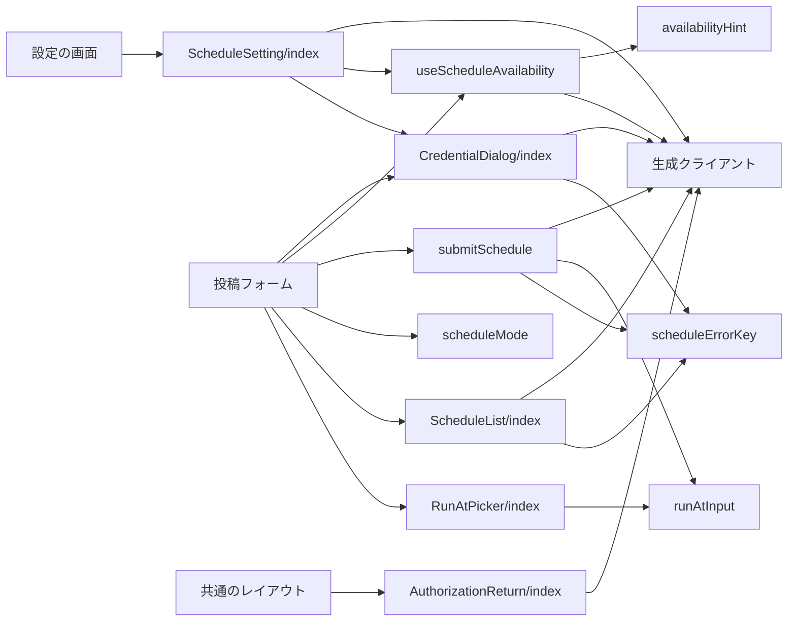
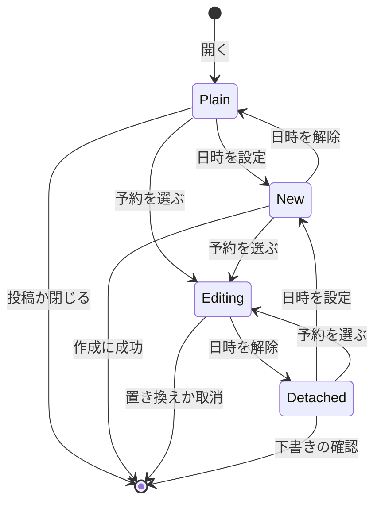
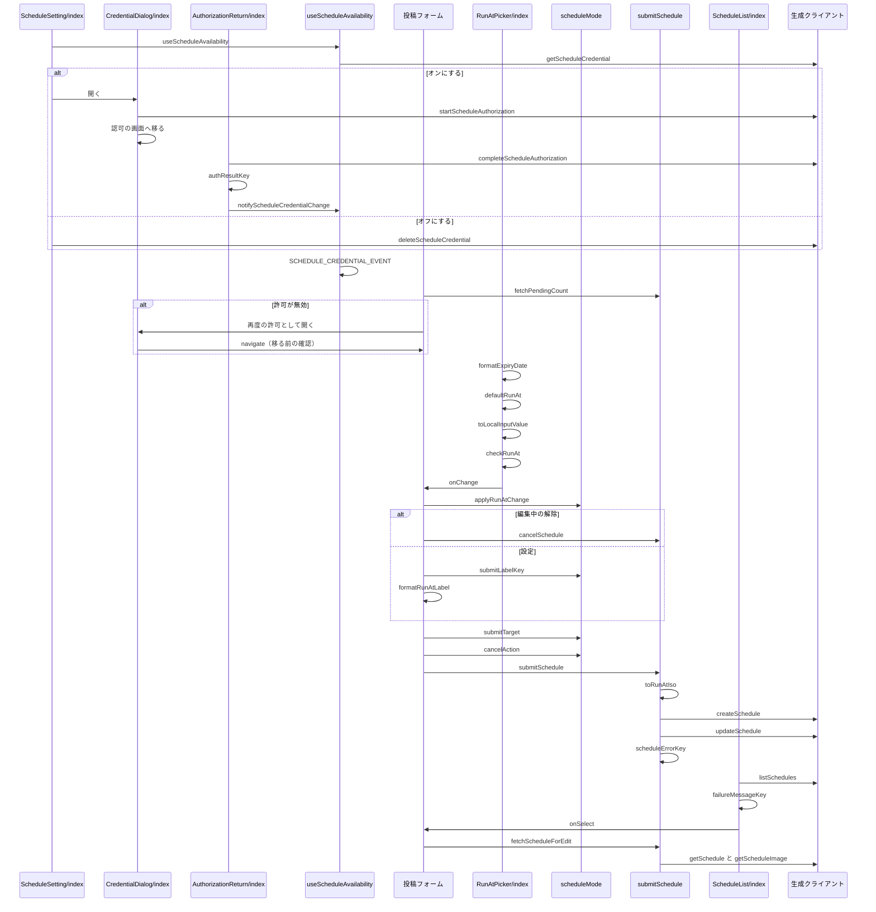

# 予約投稿の画面 設計書

## 1. 構成

| パス                                                    | 責務                                                       |
| ------------------------------------------------------- | ---------------------------------------------------------- |
| `src/lib/schedule/runAtInput.ts`                        | 日時の既定値・変換・範囲の判定・表示の文字列               |
| `src/lib/schedule/useScheduleAvailability.ts`           | 認証情報の登録状態と制限値の取得と、変更の通知の購読       |
| `src/lib/schedule/availabilityHint.ts`                  | 登録状態のヒント cookie の読み取り（schedule-api と共有）  |
| `src/lib/schedule/scheduleMode.ts`                      | 投稿フォームの予約の状態の遷移と、送信先とキャンセルの判定 |
| `src/lib/schedule/submitSchedule.ts`                    | 予約の作成と置き換えの呼び出しと、編集用の内容の取得       |
| `src/lib/schedule/scheduleErrorKey.ts`                  | API のエラーと失敗の分類コードの文言キーの選択             |
| `src/components/schedule/ScheduleSetting/index.tsx`     | 設定の予約投稿のスイッチと、有効化と無効化の確認           |
| `src/components/schedule/CredentialDialog/index.tsx`    | Bluesky での予約投稿の許可への案内のダイアログ             |
| `src/components/schedule/RunAtPicker/index.tsx`         | カレンダーのボタンと実行日時の指定のダイアログ             |
| `src/components/schedule/ScheduleList/index.tsx`        | 予約のタブの一覧と、選択・書き戻し・履歴の削除             |
| `src/components/schedule/AuthorizationReturn/index.tsx` | 許可の画面から戻ったときの完了と結果の表示（全ページ共通） |

## 2. 関係図・ワークフロー

画面の部品が判定処理と生成クライアントに依存する方向を示す。



投稿フォームの予約の状態の遷移を示す。



設定の切り替えと、日時の指定から送信までと、予約の書き戻しの分岐を示す。



## 3. 設計項目

### D-1: 日時の入力と変換 (FR-5)

```ts
export type RunAtLimits = { minLeadSeconds: number; maxLeadSeconds: number }
export const defaultRunAt = (now: Date): Date // 24時間後。秒とミリ秒を0にする
export const toLocalInputValue = (d: Date): string // "YYYY-MM-DDTHH:mm"（端末のタイムゾーン）
export const toRunAtIso = (d: Date): string // "+09:00" のような差を含む ISO 8601
export const checkRunAt = (d: Date, now: Date, limits: RunAtLimits): "ok" | "tooSoon" | "tooLate"
export const formatRunAtLabel = (d: Date, locale: string): string // Intl.DateTimeFormat の月・日・曜日・時・分
```

- `checkRunAt` は `d - now` が `minLeadSeconds` 未満なら `tooSoon`、`maxLeadSeconds` を超えるなら `tooLate` を返す。解釈できない日時も `tooSoon` とする。
- `toRunAtIso` は `Date` の `getTimezoneOffset` から `+09:00` 形式のオフセットを組み立てる。
- 範囲の数値は画面に持たず、`checkRunAt` に渡す制限値は API の応答から得る。

### D-2: 予約の可否の取得 (FR-1, FR-4)

```ts
export const SCHEDULE_CREDENTIAL_EVENT = "skyshare:schedule-credential-change"
export const notifyScheduleCredentialChange = (): void // window へ CustomEvent を送る
export const useScheduleAvailability = (enabled: boolean, revalidate?: boolean): {
  registered: boolean | null // 取得前と取得の失敗は null。再度の許可が必要なときも true
  reauthRequired: boolean
  expiresAt: Date | null // 許可の有効期限の目安
  limits: ScheduleLimits | null
  reload: () => void
}
```

- `enabled` が偽（ゲストの表示）のときは通信せず `registered: null` を返す。
- 登録状態は、`document.cookie` の登録状態のヒント cookie（`readScheduleHint`）があればそれを使い、`getScheduleCredential` を呼ばない。cookie が無いとき（初回・失効後・7日経過後）だけ呼び、その応答でサーバーが cookie を保存する。
- 次のときは cookie を使わずに必ず `getScheduleCredential` を呼ぶ: `reload` の呼び出し、`SCHEDULE_CREDENTIAL_EVENT`、`revalidate` が真（設定のスイッチ）のマウントと `astro:page-load`。投稿フォームは、日時の指定を開いたときと、下書き・予約の画面の予約のタブを開いたときに `reload` を呼ぶ。登録状態を変える設定の操作は `SCHEDULE_CREDENTIAL_EVENT` だけを送り、取得し直しは購読側に任せる。
- ページを開くたびに D1 を読むのをやめるための仕組みで、利用者が予約を使わないページ遷移では問い合わせない。ヒントは表示の仮の値であり、予約の作成はサーバーが再検証する。`getScheduleLimits` は最初に `registered` が真になったときに1回だけ呼ぶ。
- 投稿フォームは `registered === true && !reauthRequired && limits !== null` のときだけ予約投稿を有効とみなす。

### D-3: 設定の予約投稿のスイッチ (FR-1, FR-2)

| 操作             | 処理                                                                                                                               |
| ---------------- | ---------------------------------------------------------------------------------------------------------------------------------- |
| 表示             | `useScheduleAvailability(!guestMode)` の `registered` をスイッチの状態にし、`null` の間は無効にする                                |
| オンにする       | `CredentialDialog` を開く。閉じたらオフのままにする                                                                                |
| 再度の許可       | `reauthRequired` のときはオンのまま案内とボタンを出し、ボタンで `CredentialDialog` を開く（初回と同じ見出しと文）                  |
| オフにする       | `listSchedules({ status: "pending", limit: 50 })` の件数を `ConfirmDialog` の文言に入れて確認する                                  |
| オフの確認を承諾 | `deleteScheduleCredential` を呼び、応答の `cancelled` と `deletedHistory` の合計を表示して `notifyScheduleCredentialChange` を呼ぶ |
| オフの確認で409  | `schedule.error.running` を表示し、オンのままにする                                                                                |

```tsx
// 設定の投稿のグループの末尾に置く
<SettingList
  items={[
    {
      key: "scheduledPost",
      label: t("schedule.setting.label"),
      description: renderSlots(raw("schedule.setting.description"), { image }), // 末尾に画像のみ対応の注
      checked: registered === true,
      disabled: registered === null || guestMode,
      onCheckedChange: next =>
        next ? openCredentialDialog() : confirmDisable(),
    },
  ]}
/>
```

### D-4: 許可の案内のダイアログ (FR-3, NFR-3, NFR-5)

```tsx
type CredentialDialogProps = {
  open: boolean
  onClose: () => void
  navigate?: (url: string) => void // 認可の画面へ移る。既定は location.assign。投稿フォームは移る前の確認を挟む
}
```

| 項目   | 内容                                                                                                                                                                          |
| ------ | ----------------------------------------------------------------------------------------------------------------------------------------------------------------------------- |
| 種別   | `Overlay` の中の `role="dialog"`。入力欄は置かない                                                                                                                            |
| 文言   | 何を許可するか・`@ハンドル` のアカウントで有効にすること（`getActiveAccountHandle`）・認証情報を Skyshare に保存することと `/privacy/` へのリンク。許可のボタンは「認証する」 |
| 許可   | `startScheduleAuthorization({ returnTo })` に今のページのパスを渡し、返った URL へ移る。失敗は文言を表示して再び押せる                                                        |
| 大きさ | `Overlay` の内容の最大の高さに従い、収まらない分は縦に流す                                                                                                                    |

- `@media (max-width: 639px)` では `Overlay` の背景に `align-items: flex-start` を指定し、画面の上部に固定する（投稿フォームと同じ）。

### D-5: 実行日時の指定 (FR-4, FR-5, FR-6, NFR-1)

```tsx
type RunAtPickerProps = {
  value: Date | null
  limits: RunAtLimits | null // null のときはボタンを無効にする
  disabled: boolean
  disabledReason?: string // ボタンの title に出す
  onChange: (next: Date | null) => void
  open?: boolean // 実行日時の行からも開けるよう、開閉を呼び出し側が持てる
  onOpenChange?: (open: boolean) => void
  slots?: ScheduleSlots | null // 待機中の予約の枠。取得前と取得の失敗は null で、表示しない
}
export type ScheduleSlots = { used: number; max: number; consumes: boolean } // consumes はこの予約が新たに枠を使うか
export const fetchPendingCount = async (): Promise<number | null> // 待機中の予約の件数（submitSchedule に置く）
```

| 要素         | 内容                                                                                               |
| ------------ | -------------------------------------------------------------------------------------------------- |
| ボタン       | カレンダーのアイコンの `nontext-button`。`value` があるとき `aria-pressed` と強調の配色にする      |
| ダイアログ   | `Overlay` の中に `<input type="datetime-local">` と「設定」「解除」「閉じる」を置く                |
| 既定値       | `value ?? defaultRunAt(new Date())` を開くたびに入力欄へ入れる                                     |
| 設定         | `checkRunAt` が `ok` のときだけ押せ、`onChange(日時)` を呼ぶ。範囲外は理由の文言を表示する         |
| 解除         | `value` があるときだけ表示し、`onChange(null)` を呼ぶ                                              |
| 実行日時の行 | 呼び出し側が `formatRunAtLabel` で「{日時}に予約」と表示し、行を押すとダイアログを開く             |
| 枠の棒       | `slots.max` 個のマスを並べ、使用済みを塗り、`consumes` のとき次の1マスを淡く塗る（`role="meter"`） |
| 枠の空き     | `consumes` で空きが無ければ、理由の文言を表示して「設定」を押せない                                |

- 画面幅が640ピクセル未満のとき、共通 UI のクラスがボタンと入力欄の高さを44ピクセル以上にする。
- 動画を含むときはボタンを無効にし、title に理由を出す（確認のダイアログは出さない）。動画を予約できないことは、設定の予約投稿の注で案内する。
- 投稿フォームは日時の指定を開くたびに `fetchPendingCount` を呼び、編集中の予約では `consumes` を偽にして渡す（すでに枠を使っているため）。
- 実行日時の設定中（`scheduledRunAt !== null`）は、各セグメントの `VideoPicker` を無効にし、理由を title に出す。動画の取り外しの操作は、この状態では動画が無いため不要である。

### D-6: 投稿フォームの予約の状態 (FR-6, FR-7, FR-11, FR-12)

```ts
export type ScheduleMode =
  | { kind: "plain" }
  | { kind: "new"; runAt: Date }
  | { kind: "editing"; id: string; runAt: Date }
  | { kind: "detached" } // 編集中に日時を解除して予約を取り消した後
export const applyRunAtChange = (mode: ScheduleMode, next: Date | null): { mode: ScheduleMode; cancelScheduleId: string | null }
export const submitTarget = (mode: ScheduleMode):
  | { kind: "post" }
  | { kind: "create"; runAt: Date }
  | { kind: "update"; id: string; runAt: Date }
export const submitLabelKey = (mode: ScheduleMode, isThread: boolean): PlainMessageKey
export const cancelAction = (mode: ScheduleMode, hasUnsavedChanges: boolean, hasText: boolean): "close" | "draftConfirm" | "editChoice"
```

| 状態       | 投稿のボタン     | キャンセル                                    |
| ---------- | ---------------- | --------------------------------------------- |
| `plain`    | 投稿・すべて投稿 | 変更があれば `draftConfirm`、なければ `close` |
| `new`      | 予約・すべて予約 | 変更があれば `draftConfirm`、なければ `close` |
| `editing`  | 予約・すべて予約 | 常に `editChoice`                             |
| `detached` | 投稿・すべて投稿 | 本文があれば常に `draftConfirm`               |

- `applyRunAtChange` は、`editing` で `null` を受けたときだけ `cancelScheduleId` に識別子を入れて `detached` へ移る。`editing` で日時を受けたら識別子を保ったまま日時だけを変える。
- `restoredFailedId`（失敗の予約から書き戻した入力のときの履歴の識別子）は `ScheduleMode` と別に持つ。書き戻しは `plain` の状態で入力を戻し、投稿または予約に成功したときに `cancelSchedule(restoredFailedId)` を呼んで履歴を削除する（失敗しても操作は妨げない）。フォームの初期化・下書きの適用・待機中の予約の書き戻しで `null` に戻す。
- `editChoice` は `ChoiceDialog` で「予約を取り消す」（`deleteSchedule` の後に初期化）・「予約を残して閉じる」（初期化）・「編集を続ける」を出す。

### D-7: 予約の送信と編集用の内容の取得 (FR-7, FR-10, NFR-4)

```ts
export const submitSchedule = async (
  target: { kind: "create"; runAt: Date } | { kind: "update"; id: string; runAt: Date },
  body: Omit<CreateScheduleBody, "runAt">, // 投稿の作成と同じ組み立ての本文
): Promise<{ ok: true } | { ok: false; messageKey: PlainMessageKey }>
export const cancelSchedule = async (id: string): Promise<{ ok: true } | { ok: false; messageKey: PlainMessageKey }>
export const fetchScheduleForEdit = async (id: string): Promise<
  | { ok: true; runAt: Date; detail: ScheduleDetail; images: Blob[] } // images[n] は番号 n の画像
  | { ok: false; messageKey: PlainMessageKey }
>
```

- `submitSchedule` は `create` で `createSchedule`、`update` で `updateSchedule` を、`toRunAtIso(runAt)` を加えて1回だけ呼ぶ。送信中は呼び出し側が `useRef` の印で2回目を無視する。
- 成功したら呼び出し側が「予約しました」を表示し、ハッシュタグの履歴を記録して投稿フォームを初期化する。他の SNS への共有は行わない。
- `fetchScheduleForEdit` は待機中と失敗の予約を取得でき、`detail.status` で区別する。`getSchedule` の後、`detail` の画像の番号の数だけ `getScheduleImage` を並行に呼ぶ。1つでも失敗したら全体を失敗にする。

### D-8: 予約のタブ (FR-8, FR-9, NFR-1)

```tsx
type ScheduleListProps = {
  active: boolean // タブが選ばれたときに取得する
  onSelect: (id: string) => void // 待機中の行を押したとき、または失敗の行の「フォームに書き戻す」を押したとき
  onOpenSettings?: () => void // 予約投稿が無効のときだけ渡す。一覧の上に案内と「設定を開く」を置く
}
```

| 状態   | 表示                           | 操作                                                        |
| ------ | ------------------------------ | ----------------------------------------------------------- |
| 待機中 | 実行時刻、本文の冒頭、件数     | 行を押すと `onSelect`                                       |
| 実行中 | 実行時刻、進行中の表示         | なし                                                        |
| 失敗   | 失敗の分類コードに対応する文言 | 「フォームに書き戻す」で `onSelect`、履歴の削除（確認つき） |

- `listSchedules` を `cursor` で続けて取得し、続きがあるときだけ「さらに表示」ボタンを置く。削除は `DELETE /v2/schedules/{id}` を呼び、成功したら行を除く。
- 「設定を開く」は、投稿フォームが下書き・予約の画面を閉じてから `requestNavigation("/settings/")` で移る。作成中の内容は、再度の許可へ進むときと同じ確認で守る。

### D-9: エラー文言と言語 (FR-7, NFR-2)

```ts
export const scheduleErrorKey = (status: number, code?: string, context?: "credential"): PlainMessageKey
export const failureMessageKey = (code: string | null): PlainMessageKey // 未知のコードは schedule.failure.unknown
```

| API の応答                       | 辞書のキー                          |
| -------------------------------- | ----------------------------------- |
| 400                              | `schedule.error.invalid`            |
| 401（認証情報の登録時）          | `schedule.error.passwordRejected`   |
| 404                              | `schedule.error.notFound`           |
| 409 `ScheduleCredentialRequired` | `schedule.error.credentialRequired` |
| 409 `ScheduleRunning`            | `schedule.error.running`            |
| 429                              | `schedule.error.tooMany`            |
| 500                              | `schedule.error.server`             |

- 辞書は日本語と英語の両方に同じキー集合で `schedule` 名前空間として持つ。`schedule.error.credentialRequired` は設定で予約投稿を有効にする案内の文言とする。

### D-10: 再度の許可と許可の画面からの戻り (FR-1, FR-3, FR-4, FR-11)

```ts
export const authResultKey = (result: string): PlainMessageKey // AuthorizationReturn に置く。ok・Denied・AccountMismatch・SessionRequired と、その他の失敗
export const formatExpiryDate = (d: Date, locale: string): string // 有効期限の目安の年月日
```

| 場面               | 処理                                                                                                                      |
| ------------------ | ------------------------------------------------------------------------------------------------------------------------- |
| 許可が無効         | カレンダーのボタンと実行日時の行は、日時の指定の代わりに `CredentialDialog` を開く                                        |
| 認可の画面へ移る前 | `navigate` を投稿フォームの `requestNavigation` にし、`cancelAction` に従い3択か下書きの保存の確認を挟んでから移る        |
| 戻り               | 共通のレイアウトの `AuthorizationReturn` が `#scheduleAuthorization=1&…` を読んで住所から消し、完了を呼んで結果を表示する |
| 有効期限の目安     | `RunAtPicker` の `expiresAt` に渡し、予約するたびに延びる旨とともに `formatExpiryDate` の日付を示す                       |

- 戻りは別のサイトからの遷移で、`SameSite=Strict` のセッションの cookie が届かない。完了は戻ったページから呼び、cookie を届ける。
- `AuthorizationReturn` は全ページに置くため、生成クライアントは戻りの項目があるときだけ動的に読み込む。完了が401なら `SessionRequired`、通信の失敗は汎用の失敗として表示する。
- 他のページへのリンクでの移動も、同じ `cancelAction` の確認に従う（予約の編集中は3択）。

## 4. エラー処理

| 事象                         | 処理                                                         |
| ---------------------------- | ------------------------------------------------------------ |
| 一覧の取得に失敗             | 再読み込みのボタンとエラーの文言を表示する                   |
| 作成・置き換えに失敗         | 状態と入力と日時を保ったまま、エラーの文言を表示する         |
| 認可の開始に失敗             | ダイアログを開いたまま、エラーの文言を表示する               |
| 制限値の取得に失敗           | カレンダーのボタンを無効にし、title に取得の失敗の文言を出す |
| 編集用の内容の取得に失敗     | 投稿フォームを変えず、エラーの文言を表示する                 |
| 日時の解除での取消に失敗     | 状態を `editing` に戻して日時を残し、エラーの文言を表示する  |
| 置き換えの時点で予約が実行中 | `schedule.error.running` を表示し、状態を `detached` にする  |
