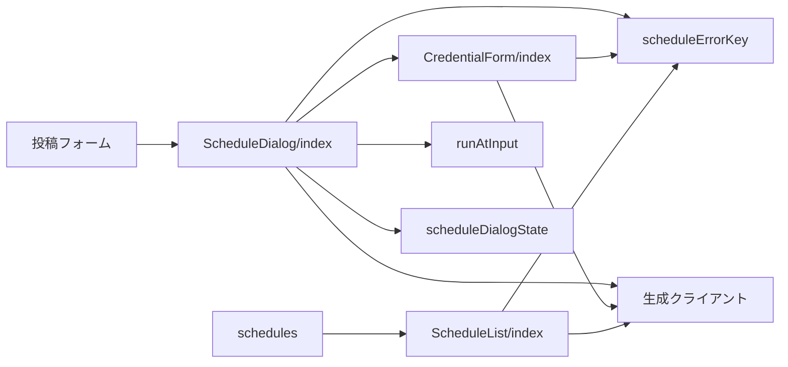
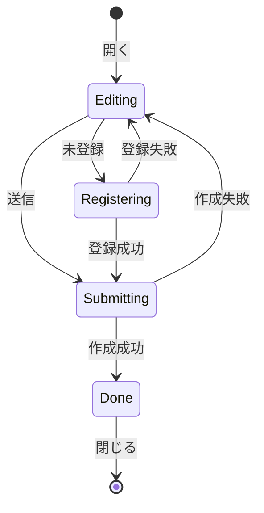
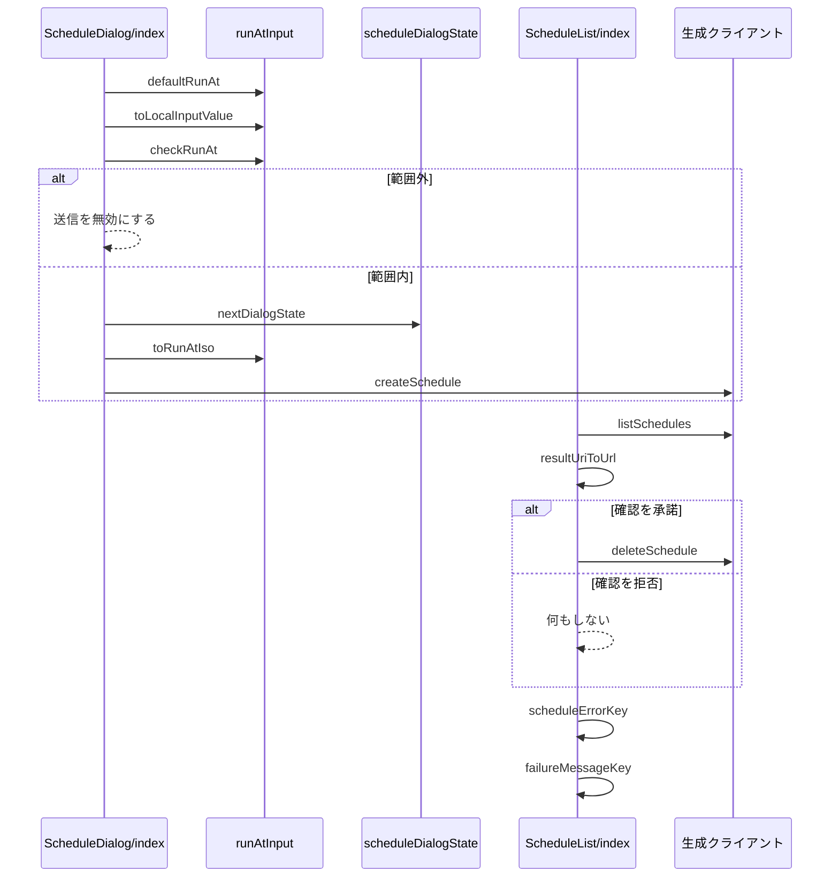

# 予約投稿の画面 設計書

## 1. 構成

| パス                                               | 責務                                           |
| -------------------------------------------------- | ---------------------------------------------- |
| `src/lib/schedule/runAtInput.ts`                   | 日時の既定値・変換・範囲の判定                 |
| `src/lib/schedule/scheduleDialogState.ts`          | 予約ダイアログの状態の遷移                     |
| `src/lib/schedule/scheduleErrorKey.ts`             | API のエラーと失敗の分類コードの文言キーの選択 |
| `src/components/schedule/ScheduleDialog/index.tsx` | 予約日時の入力と送信のダイアログ               |
| `src/components/schedule/CredentialForm/index.tsx` | 予約用の認証情報（アプリパスワード）の登録     |
| `src/components/schedule/ScheduleList/index.tsx`   | 予約の一覧の表示と、取消・削除・認証情報の操作 |
| `src/pages/schedules.astro`                        | 予約の一覧のページ                             |

## 2. 関係図・ワークフロー

画面の部品が判定処理と生成クライアントに依存する方向を示す。



ダイアログの状態の遷移を示す。



日時の判定から予約の送信までと、一覧での取消の確認の分岐を示す。



## 3. 設計項目

### D-1: 日時の入力と変換 (FR-1, FR-2, FR-3)

```ts
export const defaultRunAt = (now: Date): Date
export const toLocalInputValue = (d: Date): string // "YYYY-MM-DDTHH:mm"（端末のタイムゾーン）
export const toRunAtIso = (localValue: string): string // "+09:00" のような差を含む ISO 8601
export const checkRunAt = (
    d: Date,
    now: Date,
    limits: { minLeadSeconds: number; maxLeadSeconds: number },
): "ok" | "tooSoon" | "tooLate"
```

- `defaultRunAt` は `now` の1時間後を、分を切り上げずに返す。
- `checkRunAt` は `d - now` が `minLeadSeconds` 未満なら `tooSoon`、`maxLeadSeconds` を超えるなら `tooLate` を返す。解釈できない日時も `tooSoon` とする。
- `toRunAtIso` は `Date` の `getTimezoneOffset` から `+09:00` 形式のオフセットを組み立てる。
- 範囲の数値は画面に持たず、`checkRunAt` に渡す制限値は API の応答から得る。

### D-2: 予約ダイアログ (FR-1, FR-6, NFR-1, NFR-4)

```tsx
type ScheduleDialogProps = {
  open: boolean
  buildRequest: () => Promise<Omit<CreateScheduleBody, "runAt"> | null> // 投稿フォームの内容を予約の作成の入力に変換する
  onScheduled: (id: string) => void
  onClose: () => void
}

export const nextDialogState = (state: DialogState, event: DialogEvent): DialogState
```

| 状態        | 表示                                   | 次の状態                                                  |
| ----------- | -------------------------------------- | --------------------------------------------------------- |
| Editing     | 日時の入力欄、範囲外の理由、送信ボタン | 認証情報が未登録なら Registering、登録済みなら Submitting |
| Registering | アプリパスワードの入力フォーム         | 成功で Submitting、失敗で Editing                         |
| Submitting  | 送信ボタンを無効にし、進行中の表示     | 成功で Done、失敗で Editing                               |
| Done        | 一覧への案内のリンクと閉じるボタン     | 閉じる                                                    |

- 開くたびに、制限値（`GET /v2/schedules/limits`）と認証情報の登録状態とアカウントのハンドルを取得する。制限値の取得に失敗したら、送信を無効にして再取得のボタンを出す。
- 送信中の確定操作は `nextDialogState` が無視する。状態の更新を待たずに重複を防ぐため、送信中を示す値を `useRef` でも持つ。
- 成功したら `onScheduled` を呼び、呼び出し側が投稿フォームの入力を初期化する。
- 非モーダルの `<dialog>` を `show()` で開き、開いている間だけ内容を描画する。
- 画面幅が640ピクセル未満のとき、共通 UI のクラスがボタンと入力欄の高さを44ピクセル以上にする。

### D-3: 認証情報の登録フォーム (FR-4, FR-5, NFR-3)

```tsx
type CredentialFormProps = {
  handle: string // ログイン中のアカウントのハンドル
  onRegistered: () => void
  onCancel: () => void
}
```

| 項目             | 内容                                                                                                                               |
| ---------------- | ---------------------------------------------------------------------------------------------------------------------------------- |
| ダイアログの種別 | 非モーダルとし、予約ダイアログが開いたときにだけフォームを描画する                                                                 |
| 欄               | 可視のユーザー名欄（`autocomplete="username"`、`defaultValue` にハンドル）とパスワード欄（`autocomplete="current-password"`）の2つ |
| 構成             | 同じフォームにほかのテキスト入力を置かない                                                                                         |
| 文言             | メインパスワードを入力しない注意と、Bluesky の設定画面でアプリパスワードを作る手順を表示する                                       |
| 送信             | `PUT /v2/schedules/credential` を呼び、成功したら `onRegistered` を呼ぶ                                                            |

- パスワードは非制御入力で扱い、送信後に空に戻す。ログ・URL・ストレージには出力しない。
- パスワード欄のラベルには「確認」「再入力」を含めない。

### D-4: 予約の一覧 (FR-7, FR-8, FR-9, NFR-1)

```ts
type ScheduleListItem = {
    id: string
    runAt: string
    status: "pending" | "running" | "posted" | "failed"
    postCount: number
    preview: string
    lastError: string | null
    resultUri: string | null
}
export const resultUriToUrl = (uri: string): string | null // at://{did}/app.bsky.feed.post/{rkey} を bsky.app の URL に変換する
```

| 状態     | 表示                                   | 操作             |
| -------- | -------------------------------------- | ---------------- |
| 待機中   | 実行時刻、本文の冒頭、件数             | 取消（確認つき） |
| 実行中   | 実行時刻、進行中の表示                 | なし             |
| 投稿済み | 先頭の投稿の Bluesky の URL へのリンク | 履歴の削除       |
| 失敗     | 失敗の分類コードに対応する文言         | 履歴の削除       |

- 取消と削除は `DELETE /v2/schedules/{id}` を呼び、成功したら行を一覧から除く。取消の確認には共通の確認ダイアログを使う。
- 一覧は `listSchedules` の `cursor` を使い、続きがあるときだけ「さらに表示」ボタンを置く。
- 失敗の分類コードごとの文言は、辞書のキー `schedule.failure.<コード>` で引く。未知のコードは汎用の文言にする。

### D-5: 認証情報の状態と削除 (FR-10)

```ts
type CredentialStatus = { registered: boolean; updatedAt?: string }
```

- 一覧のページの上部に、`GET /v2/schedules/credential` の結果として登録状態を表示する。
- 登録済みで待機中と実行中の予約が0件のときだけ、削除ボタンを有効にして `DELETE /v2/schedules/credential` を呼ぶ。
- 待機中の予約があるときは、削除ボタンを無効にして理由を表示する。

### D-6: エラー文言と言語 (FR-11, NFR-2)

```ts
export const scheduleErrorKey = (status: number, code?: string, context?: "credential"): PlainMessageKey
export const failureMessageKey = (code: string | null): PlainMessageKey
```

| API の応答                       | 辞書のキー                          |
| -------------------------------- | ----------------------------------- |
| 400                              | `schedule.error.invalid`            |
| 401（認証情報の登録時）          | `schedule.error.passwordRejected`   |
| 409 `ScheduleCredentialRequired` | `schedule.error.credentialRequired` |
| 409 `ScheduleRunning`            | `schedule.error.running`            |
| 409 `ScheduleCredentialInUse`    | `schedule.error.credentialInUse`    |
| 429                              | `schedule.error.tooMany`            |
| 500                              | `schedule.error.server`             |

- 辞書は日本語と英語の両方に同じキー集合で `schedule` 名前空間として追加する。
- 日時の表示は、表示言語の書式で端末のタイムゾーンに変換する。

## 4. エラー処理

| 事象                     | 処理                                                         |
| ------------------------ | ------------------------------------------------------------ |
| 一覧の取得に失敗         | 再読み込みのボタンとエラーの文言を表示する                   |
| 作成に失敗               | Editing に戻し、入力した日時を保ったままエラーを表示する     |
| 登録に失敗               | Registering のまま、パスワード欄を空にしてエラーを表示する   |
| 制限値の取得に失敗       | 送信ボタンを無効にし、再取得のボタンとエラーの文言を表示する |
| 取消の時点で予約が実行中 | `schedule.error.running` を表示し、一覧を再取得する          |
