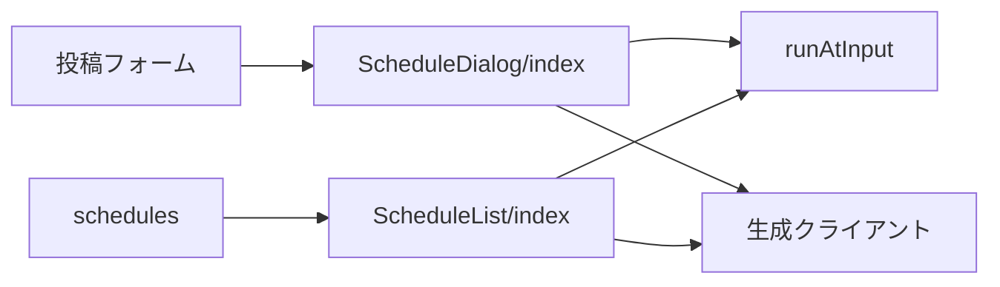
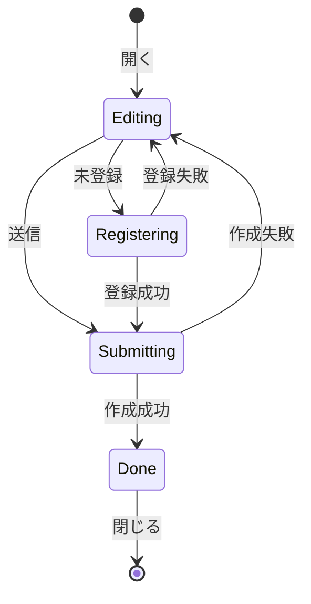
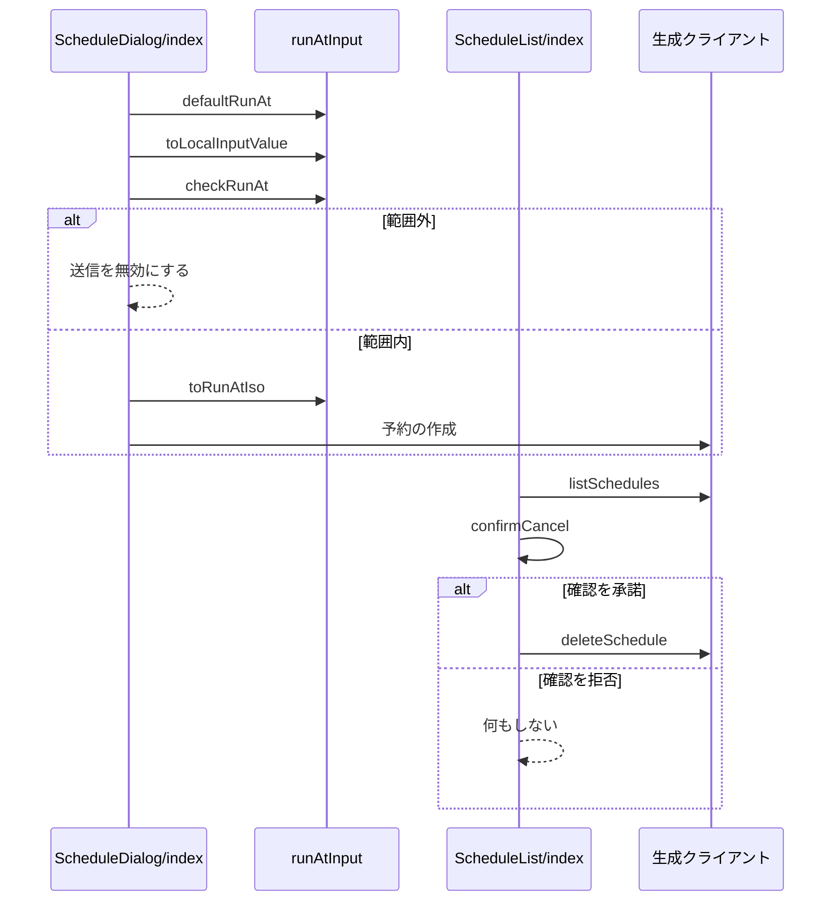

# 予約投稿の画面 設計書

## 1. 構成

| パス                                      | 責務                                           |
| ----------------------------------------- | ---------------------------------------------- |
| `src/lib/schedule/runAtInput.ts`          | 日時の既定値・変換・範囲の判定                 |
| `src/components/ScheduleDialog/index.tsx` | 予約日時の入力と認証情報の登録のダイアログ     |
| `src/components/ScheduleList/index.tsx`   | 予約の一覧の表示と、取消・削除・認証情報の操作 |
| `src/pages/schedules.astro`               | 予約の一覧のページ                             |

## 2. 関係図・ワークフロー

画面の部品が日時の判定と生成クライアントに依存する方向を示す。



ダイアログの状態の遷移を示す。



日時の判定から予約の送信までと、一覧での取消の確認の分岐を示す。



## 3. 設計項目

### D-1: 日時の入力と変換 (FR-1, FR-2, FR-3)

```ts
export const defaultRunAt = (now: Date): Date
export const toLocalInputValue = (d: Date): string // "YYYY-MM-DDTHH:mm"（端末のタイムゾーン）
export const toRunAtIso = (localValue: string): string // "+09:00" のような差を含む ISO 8601
export const checkRunAt = (d: Date, now: Date): "ok" | "tooSoon" | "tooLate"

const MIN_LEAD_MS = 5 * 60 * 1000
const MAX_LEAD_MS = 30 * 24 * 60 * 60 * 1000
```

- `defaultRunAt` は `now` の1時間後を、分を切り上げずに返す。
- `checkRunAt` は `d - now` が `MIN_LEAD_MS` 未満なら `tooSoon`、`MAX_LEAD_MS` を超えるなら `tooLate` を返す。
- `toRunAtIso` は `Date` の `getTimezoneOffset` から `+09:00` 形式のオフセットを組み立てる。

### D-2: 予約ダイアログ (FR-1, FR-6, NFR-1, NFR-4)

```tsx
type ScheduleDialogProps = {
  open: boolean
  buildRequest: () => FormData // 投稿フォームの内容を予約の作成の入力に変換する
  onScheduled: (id: string) => void
  onClose: () => void
}
export const ScheduleDialog: (props: ScheduleDialogProps) => JSX.Element
```

| 状態        | 表示                                   | 次の状態                                                  |
| ----------- | -------------------------------------- | --------------------------------------------------------- |
| Editing     | 日時の入力欄、範囲外の理由、送信ボタン | 認証情報が未登録なら Registering、登録済みなら Submitting |
| Registering | アプリパスワードの入力フォーム         | 成功で Submitting、失敗で Editing                         |
| Submitting  | 送信ボタンを無効にし、進行中の表示     | 成功で Done、失敗で Editing                               |
| Done        | 一覧への案内のリンクと閉じるボタン     | 閉じる                                                    |

- 認証情報の登録状態は、ダイアログを開くたびに取得する。
- Submitting の間は送信の関数を呼ばない。状態の更新を待たずに重複を防ぐため、送信中を示す値を `useRef` でも持つ。
- 成功したら `onScheduled` を呼び、呼び出し側が投稿フォームの入力を初期化する。
- ボタンと入力欄は、共通 UI のクラスで高さと幅を44ピクセル以上にする。

### D-3: 認証情報の登録フォーム (FR-4, FR-5, NFR-3)

```tsx
type CredentialFormProps = {
  handle: string // ログイン中のアカウントのハンドル
  onRegistered: () => void
  onCancel: () => void
}
```

| 項目             | 内容                                                                                                                               |
| ---------------- | ---------------------------------------------------------------------------------------------------------------------------------- |
| ダイアログの種別 | 非モーダル（`dialog.show()`）とし、開いたときにだけフォームを描画する                                                              |
| 欄               | 可視のユーザー名欄（`autocomplete="username"`、`defaultValue` にハンドル）とパスワード欄（`autocomplete="current-password"`）の2つ |
| 構成             | 同じフォームにほかのテキスト入力を置かない                                                                                         |
| 文言             | メインパスワードを入力しない注意と、Bluesky の設定画面でアプリパスワードを作る手順を表示する                                       |
| 送信             | `PUT /v2/schedules/credential` を呼び、成功したら `onRegistered` を呼ぶ                                                            |

- パスワードの値は、送信後に状態から消す。ログ・URL・ストレージには出力しない。
- パスワード欄のラベルには「確認」「再入力」を含めない。

### D-4: 予約の一覧 (FR-7, FR-8, FR-9, NFR-1)

```ts
type ScheduleListItem = {
    id: string
    runAt: string
    status: "pending" | "running" | "posted" | "failed"
    postCount: number
    preview: string
    lastError: string | null
    resultUri: string | null
}
export const confirmCancel = (item: ScheduleListItem): boolean
```

| 状態     | 表示                                   | 操作             |
| -------- | -------------------------------------- | ---------------- |
| 待機中   | 実行時刻、本文の冒頭、件数             | 取消（確認つき） |
| 実行中   | 実行時刻、進行中の表示                 | なし             |
| 投稿済み | 先頭の投稿の Bluesky の URL へのリンク | 履歴の削除       |
| 失敗     | 失敗の分類コードに対応する文言         | 履歴の削除       |

- 取消と削除は `DELETE /v2/schedules/{id}` を呼び、成功したら行を一覧から除く。
- 一覧は `listSchedules` の `cursor` を使い、続きがあるときだけ「さらに表示」ボタンを置く。
- 失敗の分類コードごとの文言は、辞書のキー `schedule.error.<コード>` で引く。

### D-5: 認証情報の状態と削除 (FR-10)

```ts
type CredentialStatus = { registered: boolean; updatedAt?: string }
```

- 一覧のページの上部に、`GET /v2/schedules/credential` の結果として登録状態を表示する。
- 登録済みで待機中の予約が0件のときだけ、削除ボタンを有効にして `DELETE /v2/schedules/credential` を呼ぶ。
- 待機中の予約があるときは、削除ボタンを無効にして理由を表示する。

### D-6: エラー文言と言語 (FR-11, NFR-2)

| API の応答                       | 辞書のキー                          |
| -------------------------------- | ----------------------------------- |
| 400                              | `schedule.error.invalid`            |
| 401（認証情報の登録時）          | `schedule.error.passwordRejected`   |
| 409 `ScheduleCredentialRequired` | `schedule.error.credentialRequired` |
| 409 `ScheduleRunning`            | `schedule.error.running`            |
| 409 `ScheduleCredentialInUse`    | `schedule.error.credentialInUse`    |
| 429                              | `schedule.error.tooMany`            |
| 500                              | `schedule.error.server`             |

- 辞書は日本語と英語の両方に同じキー集合で `schedule` 名前空間として追加する。
- 日時の表示は、表示言語の書式で端末のタイムゾーンに変換する。

## 4. エラー処理

| 事象                     | 処理                                                       |
| ------------------------ | ---------------------------------------------------------- |
| 一覧の取得に失敗         | 再読み込みのボタンとエラーの文言を表示する                 |
| 作成に失敗               | Editing に戻し、入力した日時を保ったままエラーを表示する   |
| 登録に失敗               | Registering のまま、パスワード欄を空にしてエラーを表示する |
| 取消の時点で予約が実行中 | `schedule.error.running` を表示し、一覧を再取得する        |
