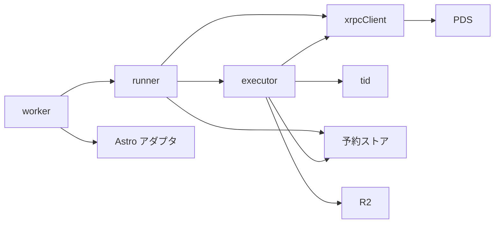
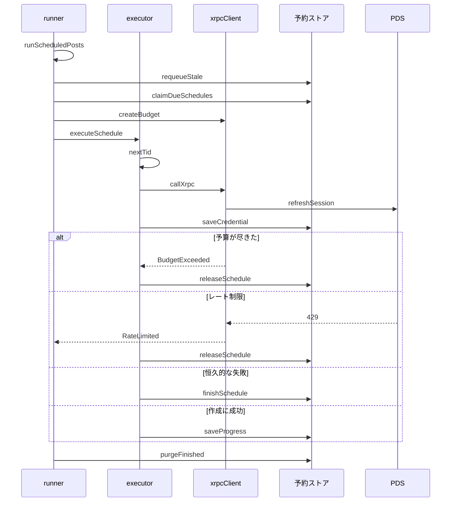
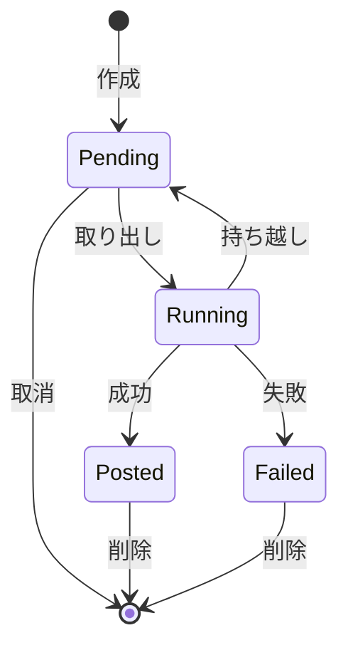

# 予約投稿の実行 設計書

## 1. 構成

| パス                             | 責務                                                            |
| -------------------------------- | --------------------------------------------------------------- |
| `src/worker.ts`                  | Worker のエントリ。画面と API は Astro に任せ、定期実行を受ける |
| `src/lib/schedule/runner.ts`     | 1回の定期実行の流れ。復帰・取り出し・実行・後片付けを行う       |
| `src/lib/schedule/executor.ts`   | 1件の予約を進捗に従って段階的に実行する                         |
| `src/lib/schedule/xrpcClient.ts` | 通信回数の予算つきの XRPC クライアント                          |
| `src/lib/schedule/tid.ts`        | レコードキーに使う TID の採番                                   |

## 2. 関係図・ワークフロー

エントリから実行処理と通信クライアントへの依存方向を示す。



1件の予約の実行における、通信の予算と失敗の分岐を示す。



予約の状態の遷移を示す。



## 3. 設計項目

### D-1: エントリと起動設定 (FR-1, NFR-1)

```ts
// src/worker.ts
import { handle } from "@astrojs/cloudflare/handler"

export default {
  fetch: handle,
  async scheduled(
    _event: unknown,
    env: ScheduleEnv,
    ctx: { waitUntil: (promise: Promise<unknown>) => void },
  ) {
    ctx.waitUntil(runScheduledPosts(env, Math.floor(Date.now() / 1000)))
  },
}
```

| 設定             | 値                                                                    |
| ---------------- | --------------------------------------------------------------------- |
| `main`           | `src/worker.ts`（アダプタの既定のエントリの代わりに指定する）         |
| `triggers.crons` | `["* * * * *"]`（無料枠で使える最短の1分間隔。トリガーは1つだけ使う） |
| `d1_databases`   | バインディング名 `DB`                                                 |
| `r2_buckets`     | バインディング名 `SCHEDULE_IMAGES`                                    |
| シークレット     | `SCHEDULE_ENC_KEY`                                                    |

### D-2: 1回の定期実行の流れ (FR-1, FR-10, FR-11, NFR-1)

```ts
export const runScheduledPosts = async (
    env: ScheduleEnv,
    now: number,
    fetchImpl?: typeof fetch,
): Promise<void>

const MAX_EXTERNAL_CALLS = 40
```

| 順序 | 処理                                                                                                                                     |
| ---- | ---------------------------------------------------------------------------------------------------------------------------------------- |
| 1    | `requeueStale` で停止した予約を待機中へ戻す                                                                                              |
| 2    | `claimDueSchedules` で到来した予約を最大5件取り出す                                                                                      |
| 3    | 取り出した順に `executeSchedule` を呼ぶ。通信の予算が尽きるかレート制限を受けたら、以降の予約は実行せず `releaseSchedule` で待機中へ戻す |
| 4    | `purgeFinished` で終了から7日を過ぎた予約を削除する                                                                                      |

- 1回の実行で使う予算は、取り出した予約の全体で共有する。
- 例外が実行全体を中断させないよう、予約ごとに `try` で囲み、分類できない例外は一時的な失敗として扱う。

### D-3: 予算つきの通信クライアント (FR-5, FR-12, NFR-2, NFR-4, NFR-5)

```ts
type Budget = { remaining: number; rateLimited: boolean }

export const createBudget = (limit: number): Budget
export const callXrpc = async (
    budget: Budget,
    req: {
        service: string
        nsid: string
        method: "GET" | "POST"
        params?: Record<string, string>
        token?: string
        body?: unknown | Uint8Array
        contentType?: string
    },
): Promise<{ ok: true; json: any } | { ok: false; kind: "BudgetExceeded" | "RateLimited" | "Auth" | "Invalid" | "Transient" }>
```

| PDS の応答                          | `kind`           |
| ----------------------------------- | ---------------- |
| 予算が 0 のとき（通信しない）       | `BudgetExceeded` |
| 429                                 | `RateLimited`    |
| 401、`ExpiredToken`、`InvalidToken` | `Auth`           |
| 400（`InvalidRequest`）             | `Invalid`        |
| 5xx、ネットワークエラー             | `Transient`      |

- 通信のたびに `budget.remaining` を1減らし、`fetch` の URL は `${service}/xrpc/${nsid}` とする。
- ライブラリは使わず、標準の `fetch` だけで通信する。ログには `nsid` と `kind` だけを出力する。

### D-4: 1件の予約の段階実行 (FR-2, FR-3, FR-4, FR-6, NFR-3)

```ts
export const executeSchedule = async (
    env: ScheduleEnv,
    budget: Budget,
    row: ScheduleRow,
    now: number,
    fetchImpl?: typeof fetch,
): Promise<"posted" | "released" | "failed">

export const nextTid = (prev?: string): string
```

| 段階 | 処理                                                                                                                                      | 進捗への反映 |
| ---- | ----------------------------------------------------------------------------------------------------------------------------------------- | ------------ |
| 1    | `loadCredential` で復号し、`refreshSession` で更新する。得た `refreshJwt` を `saveCredential` で保管してから先へ進む                      | なし         |
| 2    | `rkeys` が空なら、投稿数と entry の1件分だけ `nextTid` で採番して保存する                                                                 | `rkeys`      |
| 3    | `blobs` に無い画像を、R2 から読み `com.atproto.repo.uploadBlob` で送る                                                                    | `blobs`      |
| 4    | `created` の次の投稿から、`buildBskyPostRecord` で組み立て `com.atproto.repo.putRecord` を `rkey` 指定で呼ぶ。`createdAt` は `now` とする | `created`    |
| 5    | `gates` の次の投稿から、`buildThreadgateRecord` と `buildPostgateRecord` で組み立てた記録を、投稿と同じ `rkey` で作成する                 | `gates`      |
| 6    | 作成指定があり `entryDone` が偽なら、`buildSkyshareEntryRecord` で先頭の投稿を派生元にした記録を作成する                                  | `entryDone`  |
| 7    | `finishSchedule` で投稿済みにし、`removeImages` と `purgeIdleCredential` を呼ぶ                                                           | -            |

- 投稿の返信先は、先頭は指定された既存の投稿、2件目以降は先頭の投稿を `root`、直前の投稿を `parent` とする。
- すべてのレコードは `putRecord` で書き込む。進捗の保存前に中断して同じキーへ再び書き込んでも、レコードは上書きされるだけで1件のままである。
- 各段階の進捗は、通信が1回成功するたびに `saveProgress` で保存する。
- 投稿は 1 件ずつ `putRecord` で作成し、投稿全体の原子性は持たない。途中で失敗した予約は、進捗に従って再開する。
- `tid.ts` の `nextTid` は、マイクロ秒の時刻と固定のクロック識別子から 13 文字の Base32 ソート可能な文字列を作り、`prev` 以下の値を返さない。

### D-5: 失敗の分類と再試行 (FR-7, FR-8, FR-9, FR-12)

```ts
type FailureCode =
  | "CredentialMissing"
  | "CredentialInvalid"
  | "CredentialExpired"
  | "InvalidRecord"
  | "ImageMissing"
  | "RetryExceeded"

const MAX_ATTEMPTS = 5
```

| 事象                            | 処理                                                                                               |
| ------------------------------- | -------------------------------------------------------------------------------------------------- |
| 認証情報の行が無い              | `CredentialMissing` で失敗                                                                         |
| 復号に失敗                      | `CredentialInvalid` で失敗                                                                         |
| 更新時に `Auth`                 | `CredentialExpired` で失敗                                                                         |
| 更新以外の通信で `Auth`         | `attempts` に1を加えて待機中へ戻す（`Transient` と同じ扱い）                                       |
| 作成時に `Invalid`              | `InvalidRecord` で失敗                                                                             |
| 画像が R2 に無い                | `ImageMissing` で失敗                                                                              |
| `Transient`                     | `attempts` に1を加えて待機中へ戻す。`attempts` が `MAX_ATTEMPTS` に達したら `RetryExceeded` で失敗 |
| `BudgetExceeded`、`RateLimited` | `attempts` を変えずに待機中へ戻す                                                                  |
| すべての段階が成功              | 投稿済みにし、先頭の投稿の URI を記録する                                                          |

- 失敗の記録には分類コードだけを保存し、応答の本文を保存しない。

## 4. エラー処理

| 事象                         | 処理                                                                    |
| ---------------------------- | ----------------------------------------------------------------------- |
| 暗号鍵が未設定               | 全予約を `CredentialInvalid` で失敗にせず、実行を中止してログに記録する |
| D1 の取り出しに失敗          | 実行を中止し、次の定期実行で再試行する                                  |
| 進捗の保存で更新0件          | 別の実行が回収した予約として扱い、その予約の実行を中止する              |
| 定期実行が実行制限で強制終了 | 実行中のまま残った予約を、次の定期実行の `requeueStale` が回収する      |
