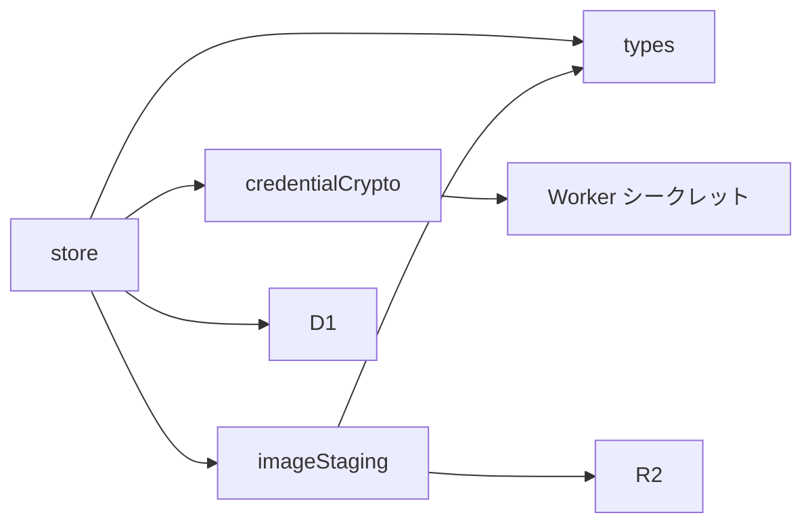
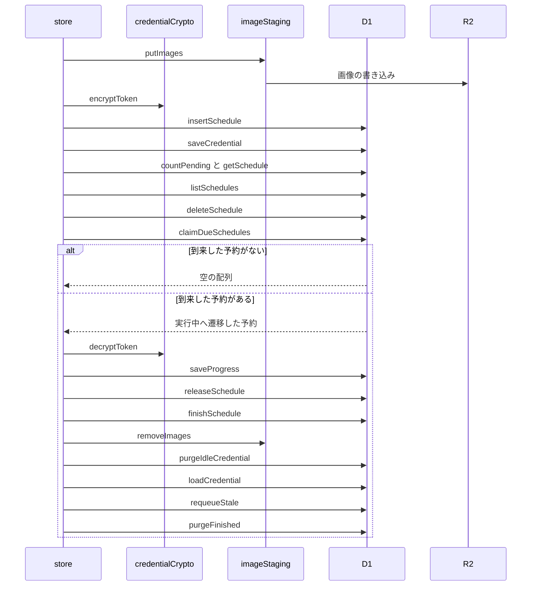

# 予約ストア 設計書

## 1. 構成

| パス                                   | 責務                                       |
| -------------------------------------- | ------------------------------------------ |
| `src/lib/schedule/types.ts`            | 予約の型・状態・上限値の定義               |
| `src/lib/schedule/store.ts`            | 予約と認証情報の保管、取り出し、状態の遷移 |
| `src/lib/schedule/credentialCrypto.ts` | 認証情報の暗号化と復号                     |
| `src/lib/schedule/imageStaging.ts`     | 添付画像の一時保管と削除                   |

## 2. 関係図・ワークフロー

保管処理が型の定義と暗号化と画像の保管へ依存する方向を示す。



予約の登録と、取り出しから終了までの流れを示す。



## 3. 設計項目

### D-1: 予約の型と状態 (FR-1, NFR-1)

```ts
type ScheduleStatus = "pending" | "running" | "posted" | "failed"

type ScheduleRow = {
  id: string // TID
  did: string
  runAt: number // UNIX 秒
  status: ScheduleStatus
  payload: string // 投稿・entry・gate の JSON
  imageKeys: string // R2 キーの JSON 配列
  progress: string // 実行の進捗の JSON
  attempts: number
  lastError: string | null // 失敗の分類コード
  resultUri: string | null // 先頭の投稿の at:// URI
  updatedAt: number
  finishedAt: number | null
}

const CLAIM_LIMIT = 5
const MAX_IMAGE_BYTES_PER_SCHEDULE = 10 * 1000 * 1000
```

データベースのスキーマは次のとおりとする。

```sql
CREATE TABLE scheduled_posts (
  id TEXT PRIMARY KEY, did TEXT NOT NULL, run_at INTEGER NOT NULL,
  status TEXT NOT NULL CHECK (status IN ('pending','running','posted','failed')),
  payload TEXT NOT NULL, image_keys TEXT NOT NULL DEFAULT '[]',
  progress TEXT NOT NULL DEFAULT '{}', attempts INTEGER NOT NULL DEFAULT 0,
  last_error TEXT, result_uri TEXT, updated_at INTEGER NOT NULL, finished_at INTEGER
);
CREATE INDEX scheduled_posts_due ON scheduled_posts (status, run_at);
CREATE INDEX scheduled_posts_owner ON scheduled_posts (did, status);
CREATE TABLE schedule_credentials (
  did TEXT PRIMARY KEY, service TEXT NOT NULL, token_enc TEXT NOT NULL, updated_at INTEGER NOT NULL
);
```

### D-2: 予約の保存・取得・削除 (FR-2, NFR-3)

```ts
export const insertSchedule = (db: D1Database, row: NewSchedule): Promise<void>
export const getSchedule = (db: D1Database, did: string, id: string): Promise<ScheduleRow | null>
export const listSchedules = (
    db: D1Database,
    did: string,
    opts: { status?: ScheduleStatus; limit: number; cursor?: string },
): Promise<{ items: ScheduleRow[]; cursor?: string }>
export const deleteSchedule = (db: D1Database, did: string, id: string): Promise<ScheduleRow | null>
export const countPending = (db: D1Database, did: string): Promise<number>
```

- すべての問い合わせは `WHERE did = ?` を含める。
- `deleteSchedule` は `running` 以外の行だけを削除してその行を返し、呼び出し側が画像のキーを使って削除する。実行中の行は削除せず `null` を返す。
- 一覧のカーソルは最後の行の `(run_at, id)` を base64 にした値とする。

### D-3: 取り出しと進捗 (FR-3, FR-7, FR-10, NFR-1)

```ts
export const claimDueSchedules = (db: D1Database, now: number, limit: number): Promise<ScheduleRow[]>
export const saveProgress = (db: D1Database, id: string, progress: Progress, attempts?: number): Promise<void>
export const releaseSchedule = (db: D1Database, id: string, countAttempt: boolean, now: number): Promise<void>
export const finishSchedule = (
    db: D1Database,
    id: string,
    result: { status: "posted" | "failed"; resultUri?: string; lastError?: string },
    now: number,
): Promise<void>

type Progress = {
    rkeys: string[] // 投稿ごとに事前採番した TID
    blobs: Record<number, unknown> // 画像の番号 -> アップロード済みの blob
    created: { uri: string; cid: string }[] // 作成済みの投稿
    gates: number // 作成済みの gate の件数
    entryDone: boolean
}
```

| 段階 | SQL の方針                                                                                                                                                                       |
| ---- | -------------------------------------------------------------------------------------------------------------------------------------------------------------------------------- |
| 取得 | `UPDATE ... SET status='running', updated_at=? WHERE id IN (SELECT id ... WHERE status='pending' AND run_at<=? ORDER BY run_at LIMIT ?) RETURNING *` の1文で取り出しと遷移を行う |
| 進捗 | `status='running'` の行だけを更新し、`updated_at` を更新する                                                                                                                     |
| 戻し | `status='running'` の行だけを `pending` に戻し、`countAttempt` が真のときだけ `attempts` に1を加える。`progress` は変えない                                                      |
| 終了 | `status` と `finished_at` を設定し、`running` の行だけを更新する                                                                                                                 |

`limit` は `CLAIM_LIMIT` を超えた値を渡されても `CLAIM_LIMIT` に丸める。

### D-4: 停止した予約の復帰と履歴の削除 (FR-8, FR-9)

```ts
export const requeueStale = (db: D1Database, now: number, staleSeconds: number): Promise<number>
export const purgeFinished = (db: D1Database, now: number, retentionSeconds: number): Promise<number>

const STALE_SECONDS = 600
const FINISHED_RETENTION_SECONDS = 7 * 24 * 60 * 60
```

- `requeueStale` は `running` で `updated_at` が `now - staleSeconds` より古い行を `pending` に戻し、`attempts` に1を加える。
- `purgeFinished` は `posted` と `failed` で `finished_at` が保持期間より古い行を削除し、その行の画像のキーが残っていれば画像も削除する。

### D-5: 認証情報の暗号化と保管 (FR-4, FR-5, NFR-2)

```ts
export const encryptToken = (secret: string, did: string, token: string): Promise<string>
export const decryptToken = (secret: string, did: string, encrypted: string): Promise<string>

export const saveCredential = (db: D1Database, secret: string, c: { did: string; service: string; token: string }): Promise<void>
export const loadCredential = (db: D1Database, secret: string, did: string): Promise<{ service: string; token: string } | null>
export const purgeIdleCredential = (db: D1Database, did: string): Promise<boolean>
```

| 項目     | 値                                                                        |
| -------- | ------------------------------------------------------------------------- |
| 方式     | AES-GCM 256 ビット、`crypto.subtle` を使う                                |
| 鍵       | Worker のシークレット `SCHEDULE_ENC_KEY`（Base64 の 32 バイト）を取り込む |
| IV       | 暗号化のたびに 12 バイトの乱数を生成する                                  |
| AAD      | アカウントの DID（別アカウントの行への差し替えで復号に失敗させる）        |
| 保管形式 | `Base64(IV ‖ 暗号文)`                                                     |

`purgeIdleCredential` は、`pending` と `running` の予約が0件のときだけ行を削除して `true` を返す。

### D-6: 添付画像の一時保管 (FR-6, NFR-1)

```ts
export const putImages = (
    bucket: R2Bucket,
    did: string,
    id: string,
    images: { bytes: ArrayBuffer; mime: string }[],
): Promise<string[]>
export const removeImages = (bucket: R2Bucket, keys: string[]): Promise<void>
```

- キーは `schedules/{did}/{id}/{番号}` とする。
- 画像の合計バイト数が `MAX_IMAGE_BYTES_PER_SCHEDULE` を超えるときは、書き込まずに例外を投げる。
- 途中で書き込みに失敗したときは、書き込み済みのキーを削除してから例外を投げる。
- バケットには、保管から45日を過ぎたオブジェクトを削除するライフサイクルルールを設定し、削除漏れの保管を残さない。

## 4. エラー処理

| 事象                           | 処理                                                           |
| ------------------------------ | -------------------------------------------------------------- |
| 暗号鍵が未設定または不正な長さ | 例外を投げ、認証情報を保管も復号もしない                       |
| 復号に失敗                     | 例外を投げる。呼び出し側は予約を失敗として扱う                 |
| 画像の合計が上限を超過         | 何も書き込まず例外を投げる                                     |
| 画像の削除に失敗               | 例外を握りつぶさずに記録し、ライフサイクルルールの削除に任せる |
| 進捗の保存で行が実行中でない   | 更新0件として扱い、呼び出し側へ実行の中止を知らせる            |
