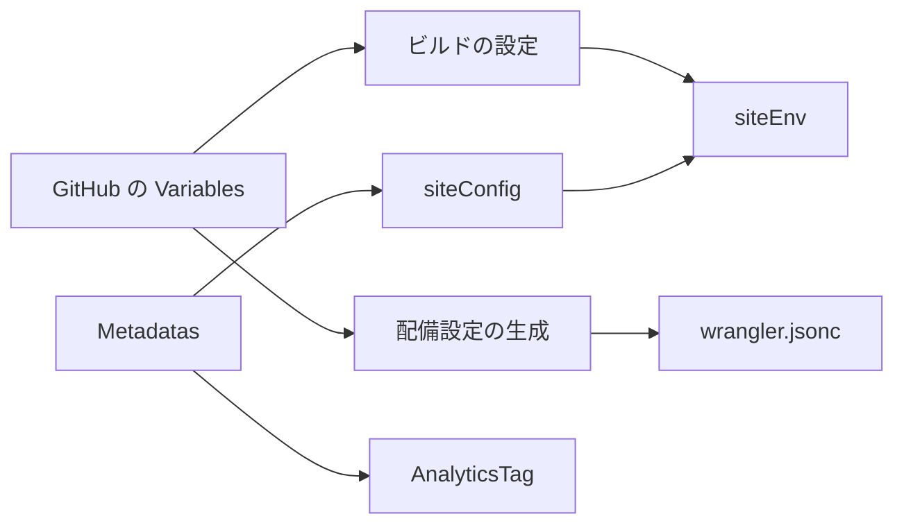
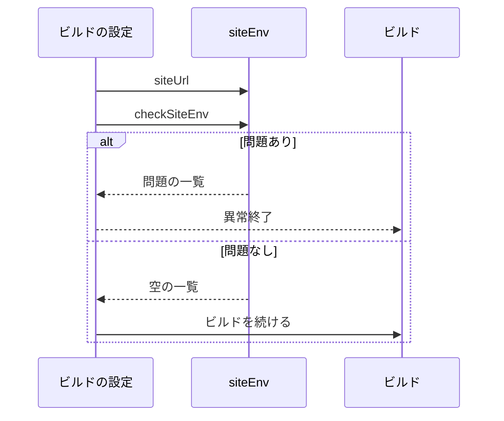
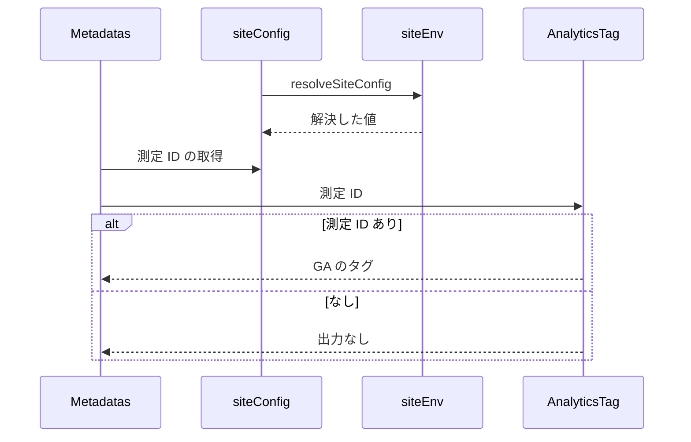

# 運用者ごとの設定 設計書

## 1. 構成

| パス                                       | 責務                                                       |
| ------------------------------------------ | ---------------------------------------------------------- |
| `src/lib/site/siteEnv.ts`                  | 環境変数の検査と、サイトの URL・運営者情報・測定 ID の解決 |
| `src/lib/site/siteConfig.ts`               | ビルドに埋め込まれた値を解決した、アプリ全体が参照する設定 |
| `src/components/layout/AnalyticsTag.astro` | 測定 ID があるときだけ GA のタグを出す                     |
| `src/components/layout/Metadatas.astro`    | ページ共通のメタタグに GA のタグを加える                   |

## 2. 関係図・ワークフロー

値の流れを示す。



本番ビルドの前の検査と、サイトの URL の決定を示す。



ページの描画での測定 ID の受け渡しを示す。



## 3. 設計項目

### D-1: 運営者情報と測定 ID (FR-1, FR-2, FR-3, FR-4, NFR-1)

```ts
export type SiteConfig = {
  operator: { name: string; email: string; blueskyHandle: string | null }
  privacy: { enactedAt: string; revisedAt: string }
  analyticsId: string | null
}
export const checkSiteEnv = (env: Env): string[]
export const resolveSiteConfig = (env: Env, dev: boolean): SiteConfig
export const siteUrl = (env: Env): string
export const siteConfig: SiteConfig
```

| 変数                             | 必須 | 形式           |
| -------------------------------- | ---- | -------------- |
| `SITE_HOST`                      | 必須 | ドメイン名     |
| `PUBLIC_OPERATOR_NAME`           | 必須 | 任意の文字列   |
| `PUBLIC_OPERATOR_EMAIL`          | 必須 | メールアドレス |
| `PUBLIC_OPERATOR_BLUESKY_HANDLE` | 任意 | ドメイン形式   |
| `PUBLIC_PRIVACY_ENACTED_AT`      | 必須 | `YYYY-MM-DD`   |
| `PUBLIC_PRIVACY_REVISED_AT`      | 必須 | `YYYY-MM-DD`   |
| `PUBLIC_GA_MEASUREMENT_ID`       | 任意 | `G-` と英数字  |

- `siteEnv.ts` は `import.meta.env` に依存せず、`astro.config.mjs` から読み込める。
- 測定 ID は形式を検査した値だけを使うため、`AnalyticsTag` は GA の初期化スクリプトにそのまま埋め込める。
- コード・テンプレート・ワークフローに運用者固有の値を書かない。直書きの検出をテストで行う（lexicon の NSID は対象外）。

### D-2: サイトの URL と配備設定 (FR-5, FR-6, FR-7, FR-8)

- `astro.config.mjs` の検査は `astro build` のときだけ行い、開発サーバーでは行わない。
- `hack/render-deploy-config.mjs` は、テンプレートの routes の `"pattern": "SITE_HOST"` を次の値で置き換える。

| 変数           | 必須 | 用途                                         |
| -------------- | ---- | -------------------------------------------- |
| `SITE_HOST`    | 必須 | 本番のドメイン                               |
| `STAGING_HOST` | 任意 | ステージングのドメイン（未設定なら行わない） |

| 資源       | 名前                       | 共用                           |
| ---------- | -------------------------- | ------------------------------ |
| Worker     | `skyshare`                 | ステージングは `-staging`      |
| D1（`DB`） | `skyshare-schedule`        | 本番・プレビュー・ステージング |
| R2         | `skyshare-schedule-images` | 本番・プレビュー・ステージング |

- D1 は `database_id` を書かない。`wrangler deploy` が同じ名前の D1 を探してつなぎ、マイグレーションも名前で解決する。
- 独自ドメインの routes に `zone_name` を書かない（ドメインからゾーンが決まる）。
- プレビューは設定ファイルの `database_id` のない D1 を使えないため、プレビューのバインディングはダッシュボードの Preview base config に置き、テンプレートの `previews` には D1・R2 を書かない。
- ステージングでは、Worker 名に `-staging` を付け、ドメインを `STAGING_HOST` にし、ブランチ別のプレビューを無効にする。
- 本番の D1 を共用するため、プレビューとステージングのワークフローはマイグレーションを適用しない。暗号鍵は本番・プレビュー・ステージングで同じ値にする。

## 4. エラー処理

| 事象                               | 処理                                           |
| ---------------------------------- | ---------------------------------------------- |
| 本番ビルドで必須の値が欠ける       | 欠けた変数名と形式の違いを挙げてビルドを止める |
| 配備設定の必須の値が欠ける         | 変数名を示して異常終了する                     |
| ドメインにスキームやパスが含まれる | 異常終了する                                   |
