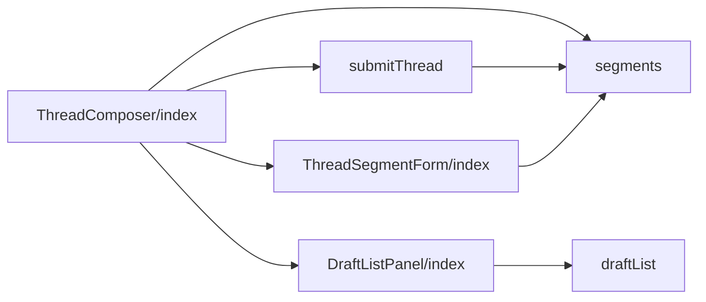
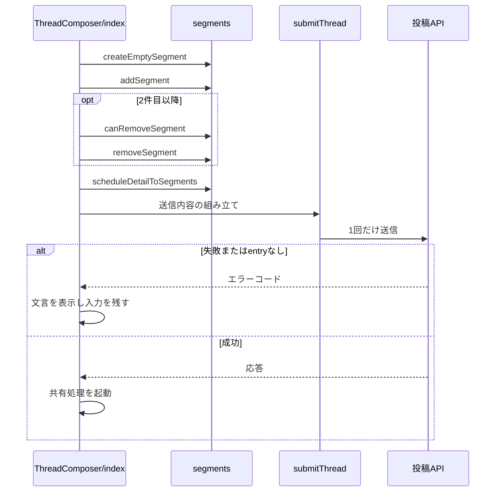

# 投稿フォーム 設計書

## 1. 構成

| パス                                                             | 責務                                               |
| ---------------------------------------------------------------- | -------------------------------------------------- |
| `src/components/post/ThreadComposer/index.tsx`                   | セグメント配列・編集中の位置・送信・共有設定の配置 |
| `src/components/post/ThreadComposer/ThreadSegmentForm/index.tsx` | 1セグメントの編集表示と簡略表示                    |
| `src/components/post/ThreadComposer/segments.ts`                 | セグメントの状態と追加・削除・下書き変換           |
| `src/components/post/ThreadComposer/submitThread.ts`             | 送信内容の組み立てと送信                           |
| `src/lib/entry/draftList.ts`                                     | 下書き一覧の応答の整形                             |
| `src/components/entry/DraftListPanel/index.tsx`                  | 下書きの一覧と復元                                 |

## 2. 関係図・ワークフロー

投稿フォームの構成要素の依存方向を示す。



セグメント操作から送信までの流れと、失敗時の分岐を示す。



## 3. 設計項目

### D-1: セグメントの状態 (FR-1, FR-2, FR-5)

```ts
export type SegmentState = {
  id: string
  text: string
  languageCode: string
  selfLabel: CreateEntryBodySelfLabels | undefined
  postGate: PostGateValue
  imageEntry: ImageEntry | null
  ogpResult: OgpResult | null
  videoEntry: VideoEntry | null
}
export const createEmptySegment = (languageCode: string): SegmentState // id は crypto.randomUUID()
export const addSegment = (segments: SegmentState[], languageCode: string): SegmentState[] // MAX_THREAD_POST_COUNT で止める
export const canRemoveSegment = (index: number): boolean => index > 0
export const removeSegment = (segments: SegmentState[], index: number): SegmentState[]
```

`ThreadComposer` は `segments` と `activeIndex` を保持する。単発投稿はセグメントが1件の場合として同じコンポーネントで扱う。各セグメントは入力部品（`PostBodyEditor` `ImagePicker` `VideoPicker` `OgpFetchButton` `PostGateDialog` `SelfLabelsSelect` `LanguageSelect`）を個別にインスタンス化し、`id` はセグメントの位置から一意に決める。

### D-2: セグメントの表示 (FR-3, FR-4, FR-6, NFR-1)

```tsx
<div data-testid={`thread-segment-${index}`}>
  <Avatar size="md" />
  {hasNext && <div className={styles["connector-line"]} aria-hidden="true" />}
  {/* 編集表示と簡略表示を常にマウントし、hidden で切り替える */}
  <div hidden={!isActive} data-testid="segment-editor">
    本文・入力部品・ツールボックス
  </div>
  <div hidden={isActive} className={styles.row}>
    本文の要約・画像のサムネイル・削除ボタン
  </div>
</div>
```

- 条件付きの描画で入力部品をアンマウントすると、`ImagePicker` の内部stateが消えて添付済みの画像のプレビューが失われるため、`hidden` で切り替える。
- 簡略表示は `imageEntry.thumbnailPreview` を読み取り専用で表示し、`canRemoveSegment(index)` のときだけ削除ボタンを出す。
- ツールボックス（返信・引用の設定、言語、画像添付、自己ラベル）は、アバターの列の下まで含めた全幅に置く。アバターの縦線は先頭行の範囲に限る。

### D-3: 送信 (FR-7, FR-8, FR-10)

```ts
const entryCandidateIndex = segments.findIndex(
  s => (!!s.imageEntry || !!s.videoEntry) && !manualImageAttach,
)
const posts = await Promise.all(segments.map(buildPostItem)) // 動画 > 画像 > リンクカードの順で1つを載せる
const body = {
  posts,
  ...(entryCandidateIndex !== -1
    ? {
        createEntry: true,
        ...buildEntryText({
          userName,
          postText: segments[0].text,
          videoDurationSec,
        }),
        visual: (
          segments[entryCandidateIndex].imageEntry ??
          segments[entryCandidateIndex].videoEntry!
        ).thumbnailBlob,
      }
    : {}),
}
const res = await createEntry(body) // 1回だけ送信する
```

- 本文のリンク・メンション・ハッシュタグは `detectFacetsForSubmission` で送信直前に検出する。
- entryを要求したのに応答に `skyshareEntry` が無い場合は失敗として扱う。
- 状態は送信中・成功・失敗の3つとし、セグメントごとの進捗は表示しない。
- 送信内容の組み立ては `buildThreadRequestBody` に切り出し、予約の作成と置き換えも同じ本文を使う。
- 予約の状態 `scheduleMode` を保持し、`submitTarget(scheduleMode)` が `post` なら `createEntry`、それ以外は `submitSchedule` に本文を渡す。投稿のボタンの文言は `submitLabelKey` で決める。
- 動画のセグメントがあるときは `hasVideoSegment` が真になり、カレンダーのボタンを無効にする。カレンダーのボタンは編集中のセグメントのツールボックスの、スレッドに追加のボタンの左に `runAtPicker` として渡す。
- キャンセルは `cancelAction(scheduleMode, hasUnsavedDraftChanges())` で、閉じる・下書きの保存の確認・予約の編集の3択に分ける。
- 成功後の共有処理には、先頭のセグメントの本文・応答のentryのURL・先頭のセグメントのリンクカードのURLを渡す。

### D-4: 下書きと予約の書き戻し (FR-9, FR-12, NFR-2)

| 方向 | 変換                                                                                              |
| ---- | ------------------------------------------------------------------------------------------------- |
| 保存 | `segmentsToDraftPosts(segments)` → `{ text, labels? }[]` を下書きAPIの `posts` に送る             |
| 復元 | `draftPostsToSegments(posts, languageCode)` → 画像・動画・リンクカードが空のセグメント配列        |
| 一覧 | `draftList.ts` が `{ id, posts, updatedAt }` に整形する                                           |
| 予約 | `scheduleDetailToSegments(detail, images, languageCode)` → 画像とリンクカードを含むセグメント配列 |

```ts
export const scheduleDetailToSegments = (
  detail: ScheduleDetail,
  images: Blob[], // images[n] は番号 n の画像
  languageCode: string, // langs が無い投稿に使う
): SegmentState[]
```

- 画像は `originalBlobs` に保管された画像を、`meta` に `imagesMeta` を入れ、`thumbnailBlob` は `detail.visual` の画像があればそれ、無ければ先頭の画像とする。プレビューは `URL.createObjectURL` で作る。
- リンクカードは `ogMeta` と `ogImage` の画像から `OgpResult` を作り、`gate` は `postGate` に、`selfLabels` は `selfLabel` に戻す。
- 下書き・予約の画面は `Overlay` の中に `TabButtons`（下書き・予約）を置き、下書きのタブに `DraftListPanel`、予約のタブに `ScheduleList` を描画する。開くたびに下書きのタブを選ぶ。
- 画面幅が640ピクセル未満のとき、この `Overlay` の背景に `align-items: flex-start` を指定して上端を固定する（投稿フォームの `postform-backdrop` と同じ理由で、一覧の高さが変わっても上端を動かさない）。投稿フォーム上部のキャンセル・下書き・予約・投稿のボタンには `header-button` を付け、この幅で文字を `--font-size-sm`、左右の余白を `--space-2` にし、常に `white-space: nowrap` とする。
- `DraftListPanel` は `loading` が真の間、`Loading` のスピナーを表示する（取得中に全面を覆うスピナーは出さない）。

### D-5: 設定の配置 (FR-11)

| 領域           | 並び順                                                                                                                                                                                           |
| -------------- | ------------------------------------------------------------------------------------------------------------------------------------------------------------------------------------------------ |
| 主トグル       | ポップアップを開く設定 → 画像を自分で添付                                                                                                                                                        |
| 詳細オプション | 自動ポップアップするSNS（ポップアップを開く設定がONのときだけ） → 長文を省略して共有（`disabled={isSubmitting \|\| manualImageAttach}`） → 返信・引用の設定を保存 → 投稿フォームを固定表示しない |

```ts
const resolveShareOptionsDefaultOpen = ({
  optionsList,
}: {
  optionsList: boolean[]
}) => optionsList.some(Boolean)
// optionsList: [pinnedFormDisabled, shareToggles.truncateIntentText]
```

共有設定はマウント後に読み込まれるため、`Collapsible` の `key` を読み込み完了で切り替えて再マウントし、`defaultOpen` を実際の値で評価し直す。

## 4. エラー処理

| 事象               | 処理                                               |
| ------------------ | -------------------------------------------------- |
| 投稿APIの失敗      | エラーコードから文言キーを決めて表示し、入力を残す |
| 投稿者名の取得失敗 | entryの作成失敗として扱い、送信しない              |
| 応答にentryが無い  | entryの作成失敗として扱う                          |
