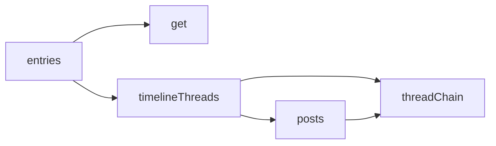
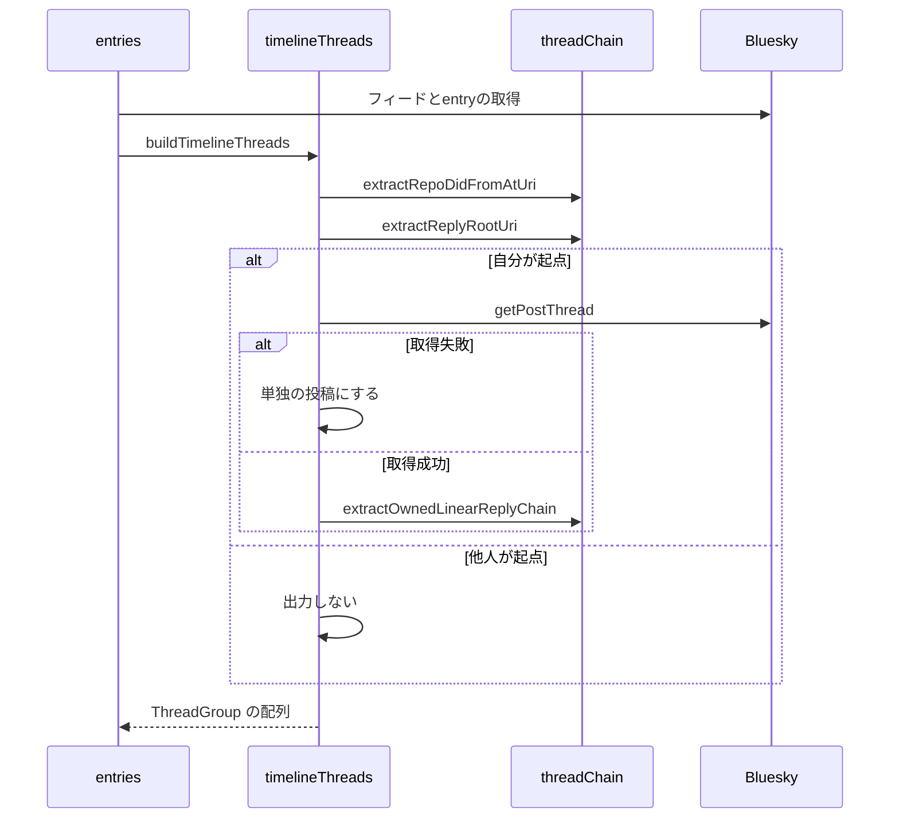

# タイムラインAPI 設計書

## 1. 構成

| パス                                   | 責務                                 |
| -------------------------------------- | ------------------------------------ |
| `src/pages/v2/entries.ts`              | 一覧の取得のハンドラ                 |
| `src/lib/api/schema/v2/entries/get.ts` | クエリと応答のスキーマ               |
| `src/lib/entry/timelineThreads.ts`     | スレッドグループの構築               |
| `src/lib/entry/posts.ts`               | 投稿の型と変換、entryの突き合わせ    |
| `src/lib/atproto/repo.ts`              | 新しい日時の範囲のレコードの取得     |
| `src/lib/atproto/threadChain.ts`       | 返信の連鎖の抽出と起点・所有者の判定 |

## 2. 関係図・ワークフロー

一覧取得の呼び出しの依存方向を示す。



スレッドグループの構築と取得失敗時の分岐を示す。



## 3. 設計項目

### D-1: 応答の形式 (FR-9, NFR-1, NFR-2)

```ts
export type TimelinePost = {
  uri: string
  cid: string
  url: string
  indexedAt: string
  author: TimelinePostAuthor
  text: string
  images: SourceImage[]
  skyshareEntry?: TimelineSkyshareEntry // 派生元のURIで突き合わせる
}
export type ThreadGroup = { rootPost: TimelinePost; replies: TimelinePost[] } // replies は古い順。0件は単独の投稿
// 200: { cursor?: string, threads: ThreadGroup[] }
const feedRes = await fetchOwnAuthorFeed(agent, did, limit, cursor) // 件数が足りなければカーソルをたどる
const threads = await buildTimelineThreads(agent, did, feedRes.feed) // entryは付与しない
const sinceMs = resolveEntryRangeStartMs(threads) // D-4
const rawEntries =
  sinceMs === undefined
    ? []
    : await listRecordsSince(
        agent,
        { repo: did, collection: ENTRY_COLLECTION },
        sinceMs,
      )
const result = attachSkyshareEntries(
  threads,
  groupTimelineEntriesBySourceUri(rawEntries),
)
```

投稿の型は返信の参照を持たず、スレッドの構造は `ThreadGroup` だけで表す。

### D-2: スレッドグループの構築 (FR-1, FR-2, FR-5, FR-6, FR-7, FR-8)

```
1. feed を順に正規化し、protocolRootUri = record.reply.root.uri ?? 自身 を併記する
   extractRepoDidFromAtUri(protocolRootUri) !== did の投稿は解決対象にしない
   replyCount > 0 または返信である投稿の protocolRootUri を解決対象に加える
2. 起点が feed にあり、D-5 でスレッドの構成を確定できる起点は、その結果を使う
   確定できない起点ごとに並行して
   getPostThread({ uri: rootUri, depth: MAX_THREAD_POST_COUNT })
   → extractOwnedLinearReplyChain(thread, did, MAX_THREAD_POST_COUNT)
   → normalizePostViewToTimelinePost で起点と後続を変換する（起点ごとに try/catch）
3. 解決した起点が feed に無ければ、起点の indexedAt より古い最初の位置に挿入する
4. 順に走査して ThreadGroup を組み立てる
   他人が起点 → 出力しない
   解決済みのスレッドに含まれる → 起点ごとに1回だけ { rootPost, replies（古い順） } を出力する
   自身が起点で未解決 → { rootPost: 自身, replies: [] }
   それ以外（採用されなかった系統） → 出力しない
```

状態を保存せず、取得のたびに `getPostThread` と抽出をやり直すため、系統の構成が変われば次の取得で選出し直される。

### D-3: 系統の選出 (FR-3, FR-4)

```ts
export const extractOwnedLinearReplyChain = (
  thread: AppBskyFeedDefs.ThreadViewPost, ownerDid: string, maxCount: number,
): AppBskyFeedDefs.PostView[]
export const extractReplyRootUri = (post: AppBskyFeedDefs.PostView): string | undefined
export const extractRepoDidFromAtUri = (uri: string): string | undefined // at://<did>/... の did
```

| 条件                           | 採用                                                                                                         |
| ------------------------------ | ------------------------------------------------------------------------------------------------------------ |
| 起点が `ownerDid` の投稿でない | 空配列                                                                                                       |
| 自分の返信の候補が0件          | 打ち切る                                                                                                     |
| 候補が1件                      | 投稿日時によらず採用する                                                                                     |
| 候補が2件以上                  | 親の `createdAt` との差の絶対値が最小の候補。同値は `replies` の順で先勝ち。`createdAt` の欠けた候補は後回し |
| `maxCount` に到達              | 打ち切る                                                                                                     |

採用しなかった候補の先は列挙しない。

### D-4: entryの取得範囲 (FR-9, NFR-3)

```ts
export const ENTRY_RANGE_MARGIN_MS = 24 * 60 * 60 * 1000
export const resolveEntryRangeStartMs = (threads: ThreadGroup[]): number | undefined
export const listRecordsSince = async (
  agent, params: { repo: string; collection: string }, sinceMs: number,
): Promise<any[]> // reverse: true・100件ずつ
export const attachSkyshareEntries = (
  threads: ThreadGroup[], entriesBySourceUri: Map<string, TimelineSkyshareEntry>,
): ThreadGroup[]
```

entryは派生元の投稿が存在してから作られるため、`createdAt` が表示する投稿のいちばん古い日時より前のentryは、表示する投稿のどれにも紐づかない。

| 項目       | 内容                                                                                                                                     |
| ---------- | ---------------------------------------------------------------------------------------------------------------------------------------- |
| 範囲の始点 | 確定したスレッドグループの全投稿の `indexedAt` の最小値から `ENTRY_RANGE_MARGIN_MS` を引いた日時。投稿が0件なら `undefined` で取得しない |
| 取得       | `reverse: true` で新しい順に100件ずつ取得し、ページ内の全レコードの `createdAt` が始点より古くなった時点で、次のページを取得しない       |
| 判定不能   | `createdAt` が文字列でないレコードは古いとみなさず、取得を続ける                                                                         |
| 付与       | `source.uri` が一致する投稿へ、起点と後続の区別なく `skyshareEntry` を付ける                                                             |

### D-5: 一覧だけでの構成の確定 (FR-5, NFR-4)

```ts
export const buildThreadViewFromPosts = (
  rootUri: string, posts: Map<string, AppBskyFeedDefs.PostView>,
): AppBskyFeedDefs.ThreadViewPost | undefined
```

`posts` は feed の投稿を `uri` で引く表で、起点から親子の関係（`record.reply.parent.uri`）で木を組む。

| 条件                                                               | 結果                               |
| ------------------------------------------------------------------ | ---------------------------------- |
| 起点が `posts` に無い                                              | `undefined`（個別取得する）        |
| 木のどれかの投稿の `replyCount` が、`posts` にある子の件数と不一致 | `undefined`（個別取得する）        |
| `replyCount` が数値でない投稿がある                                | `undefined`（個別取得する）        |
| すべての投稿で一致                                                 | 木を返し、系統の選出にそのまま渡す |

返信数は他人の返信も数えるため、他人の返信が付いたスレッドは一致せず、個別取得に回る。

## 4. エラー処理

| 事象                 | 処理                                                     |
| -------------------- | -------------------------------------------------------- |
| `limit` が範囲外     | 400                                                      |
| 未認証               | 401                                                      |
| 一覧の取得の失敗     | `resolveXrpcStatus` で変換したステータス                 |
| スレッドの取得の失敗 | その起点だけ単独の投稿として扱い、他の起点に影響させない |
