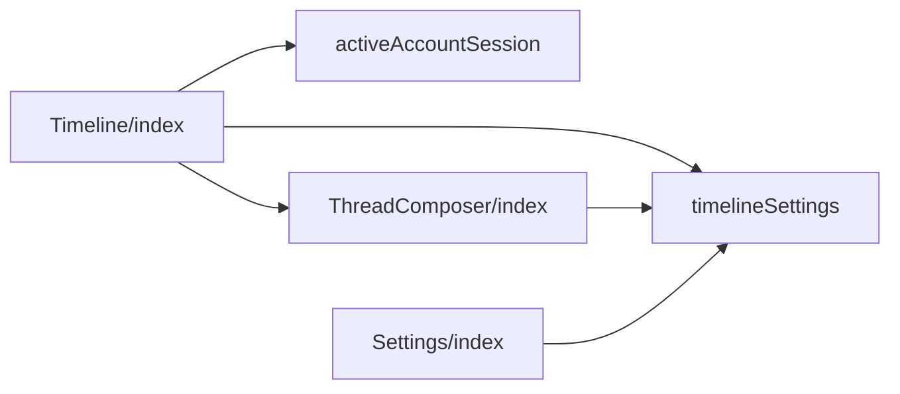
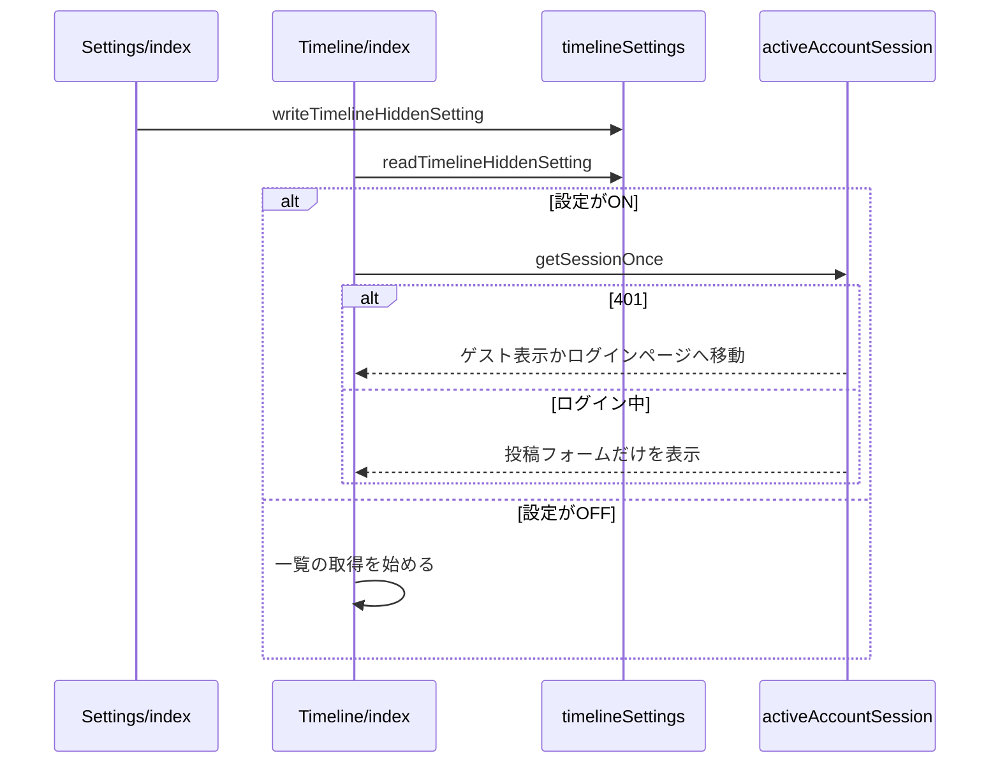

# タイムラインを表示しない設定 設計書

## 1. 構成

| パス                                           | 責務                                         |
| ---------------------------------------------- | -------------------------------------------- |
| `src/lib/settings/timelineSettings.ts`         | 設定の読み書き                               |
| `src/components/post/Timeline/index.tsx`       | 一覧・投稿フォーム・新規投稿ボタンの出し分け |
| `src/components/post/ThreadComposer/index.tsx` | 固定表示しないのスイッチの無効化             |
| `src/components/settings/Settings/index.tsx`   | 設定ページの行と固定表示しないの行の無効化   |
| `src/lib/account/activeAccountSession.ts`      | 未ログインの判定に使うセッションの取得       |

## 2. 関係図・ワークフロー

設定を参照する構成要素の依存方向を示す。



トップページで設定を読み込んでから一覧を取得するか決める流れを示す。



## 3. 設計項目

### D-1: 設定の読み書き (FR-1)

```ts
// 保存キーは timelineHidden。"true" と "false" 以外・window が無い・例外のときは defaultValue
export const readTimelineHiddenSetting = (defaultValue: boolean): boolean
export const writeTimelineHiddenSetting = (value: boolean): void // 例外は握りつぶす
```

### D-2: トップページの出し分け (FR-3, FR-4, FR-7, NFR-1)

```tsx
// マウント前（サーバー描画と初回描画）は null とし、マウント後に保存値を読む
const [timelineHidden, setTimelineHidden] = useState<boolean | null>(null)
const showPinnedForm = !pinnedFormDisabled || timelineHidden === true
// 無限スクロールの enabled: paginationMode === "infinite" && timelineHidden === false
```

| 要素                        | `timelineHidden` が true のとき                                                           |
| --------------------------- | ----------------------------------------------------------------------------------------- |
| 一覧と末尾の表示            | 描画しない。`enabled` が false のため取得も始めない                                       |
| 固定表示の `ThreadComposer` | `pinnedFormDisabled` によらず描画する                                                     |
| `PostLauncher`              | 描画しない（フローティングとサイドバーの両方のボタンが消える）                            |
| 未ログインの判定            | `getSessionOnce` が401なら、ゲスト表示の要求があればゲスト表示、無ければ `/login/` へ移る |

設定の読み込み前（`null`）は一覧の取得を始めないため、ONのときに一覧を1回も取得しない。

### D-3: 固定表示しないの無効化 (FR-2, FR-5, FR-6)

| 箇所                              | 表示                                                                                  |
| --------------------------------- | ------------------------------------------------------------------------------------- |
| 設定ページの表示のグループ        | 表示言語の次にタイムラインを表示しない、その次に固定表示しないのスイッチを置く        |
| 設定ページの固定表示しないの行    | `checked: pinnedFormDisabled && !timelineHidden`、`disabled: timelineHidden`          |
| `ThreadComposer` の詳細オプション | 同じ `checked` と `disabled` にし、詳細オプションを初期状態で開く条件にも同じ値を使う |

固定表示しないの保存値は書き換えない。設定をOFFに戻すと、保存値どおりの表示に戻る。

## 4. エラー処理

| 事象                     | 処理                                   |
| ------------------------ | -------------------------------------- |
| 保存領域の読み取りの例外 | OFFとして扱う                          |
| 保存領域の書き込みの例外 | 書き込みを諦め、表示は維持する         |
| セッションの取得の失敗   | 記録だけして投稿フォームの表示を続ける |
