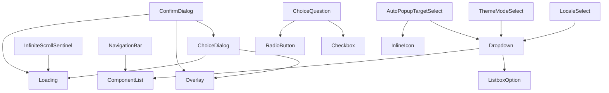

# common

特定の機能ドメインに依存しない汎用UI部品。根には `Loading`（回転するスピナーを自身の CSS で描く）と `InlineIcon` だけを置き、ほかは役割の分類フォルダに分ける。分類フォルダは部品フォルダを持たず、直下に部品を置かない。

## 分類

役割で分ける。部品を探すときは、役割の名前のフォルダを開く。分類フォルダは部品フォルダを持たず、直下に部品を置かない。

- `dialog/`: 重ねて表示する部品。`Overlay`（全画面の土台）、`FloatingBox`（アンカー追従）、`ChoiceDialog`、`ConfirmDialog`。
- `select/`: 選択肢から選ぶ部品。`Dropdown`（プルダウン）が土台で、`LocaleSelect`・`ThemeModeSelect`・`AutoPopupTargetSelect` がそれを使う。選択肢行は `ListboxOption`。`ChoiceQuestion` は単一・複数の選択肢を並べる。
- `input/`: 値を入力・切り替える部品。`CountedTextInput`・`ToggleSwitch`・`Checkbox`・`RadioButton`。
- `list/`: 一覧を並べる部品。`ComponentList`（反復描画）、`NavigationBar`（前後の移動）、`InfiniteScrollSentinel`。
- `media/`: 画像や人の表示。`Avatar`・`MediaThumb`。
- `section/`: 開閉・切り替えるまとまり。`Collapsible`・`TabButtons`。

上記の図は、分類をまたぐ依存も含む（例: `select/` の `ChoiceQuestion` は `input/` の部品を使う）。`media/` と `section/` の部品は、common の中の他の部品に依存しない。

## 部品の補足

- `ChoiceQuestion` は質問文を `legend` にした `fieldset` で選択肢を縦に並べ、単一選択は`RadioButton`、複数選択は`Checkbox`(`variant="card"`)で描画する。選択状態は持たず、`selectedIds`から表示を決め、操作は`onChange`に識別子の配列で通知する(無効の間は通知しない)。表示文は呼び出し側が渡した文言をそのまま使い、i18n 辞書は持たない。
- `ConfirmDialog`は`ChoiceDialog`が定義する`DialogButtonVariant`型・`variantClassName`（ボタン配色）をimportして再利用するが、UI構造・責務は独立している（`ChoiceDialog`はボタン列挙（任意で`description`の説明文を1つ表示可）のみ、`ConfirmDialog`はタイトル・本文メッセージ・確定/キャンセルボタンを持つ）。
- `FloatingBox` は`Overlay`と同じ`createPortal`技法で`document.body`直下へ描画するが、中身（`children`）を一切関知しない薄いプリミティブであり、`Overlay`への依存は持たない(z-indexの整合のみ`Overlay`が定義する`--overlay-z`変数をCSS上で参照する)。
- `Dropdown` はアプリ共通のプルダウン（`<select>`の代替）。パネルはトリガーと同じ外枠の中の`position:absolute`（ポータル・`FloatingBox`は使わず、スクロール・キーボードへの追従はブラウザ任せ。親の`overflow`は`ui.module.css`が`data-dropdown`を目印に解除する）、選択肢行は`ListboxOption`（`composer/ThreadComposer/ThreadSegmentForm/SuggestPopover`と共用）、反復描画は`ComponentList`に委譲する。パネル幅は全選択肢のうち最も広いものに合わせる。`searchable` ではトリガー自身が入力欄になり、1回目の操作で一覧モード、開いたまま再操作で検索モード（トリガーへ入力して絞り込む）。詳細は[specs/dropdown](../../../specs/dropdown)。
- `Overlay`・`Loading`・`ComponentList`・`ChoiceDialog`・`InlineIcon` は、複数の領域から使われる基盤部品。
