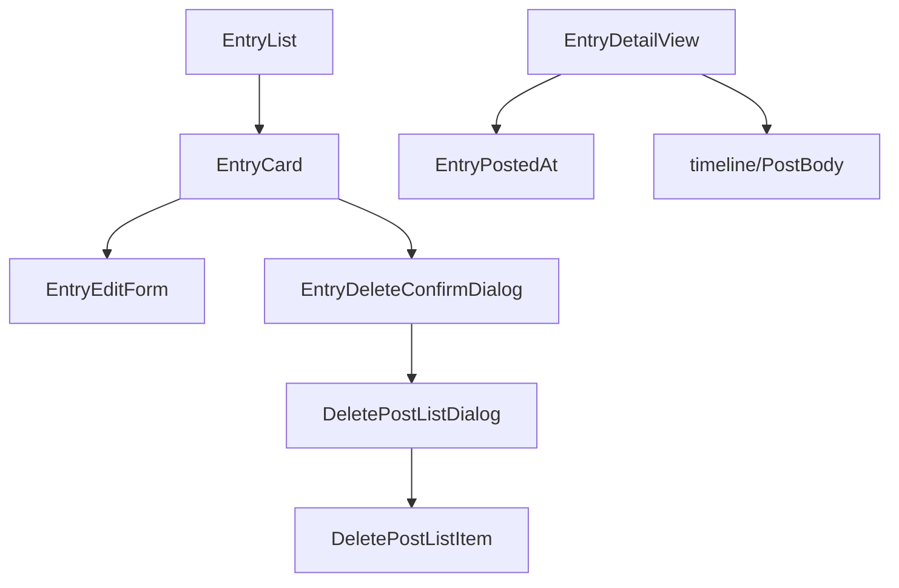

# entry

skyshare entry（下書き・保存済みページ）の一覧表示・編集・削除まわりの部品。

- `EntryList` の子が `EntryCard`、`EntryCard` の子が `EntryEditForm`。`EntryCard` の表示は `ImageGallery`（`image/`）と `PostRichText`（`timeline/`）を使う。
- `EntryDeleteConfirmDialog` は `EntryCard`（この領域）と `PostCard`（`timeline/`）の両方から使われるため、子にせず領域の直下に置く。
- `DraftListPanel` と `DraftSaveConfirmDialog` は下書きの一覧と保存の確認で、投稿フォームの部品なので `composer/ThreadComposer/` の子に置いた。
- `EntryDetailView` は Entry 詳細ページ全体を描く Astro コンポーネント。
