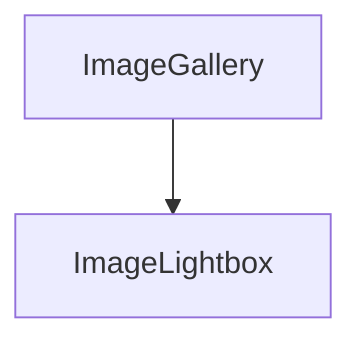

# image

画像の拡大表示（`ImageGallery`・`ImageLightbox`）の部品。画像の選択・クロップ・代替テキスト・リンクカードのプレビューは、投稿フォームの部品なので `composer/ThreadComposer/` の子に置いた（`ImagePicker`・`ImageCropDialog`・`ImageAltDialog`・`OgpFetchButton`・`ThumbnailAdjustButton` など）。

- `ImageGallery` は Entry の一覧・投稿の表示から使われ、`ImageLightbox` は `ImageGallery` の子。
