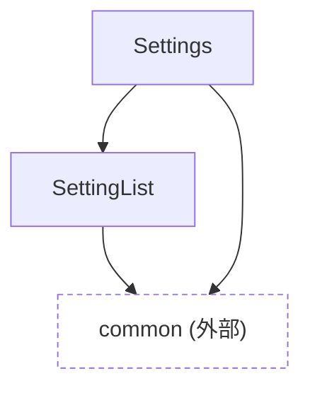

# settings

設定項目一覧の部品。`src/pages/settings.astro` から `Settings` が使われる。

- `Settings` は設定の 3 グループを組み立てる。投稿のグループの中の予約投稿のスイッチは `schedule/ScheduleSetting` を使う。
- `SettingList` は設定の一覧を描く。`common` の `ComponentList`・`CountedTextInput`・`ToggleSwitch` を使う。
